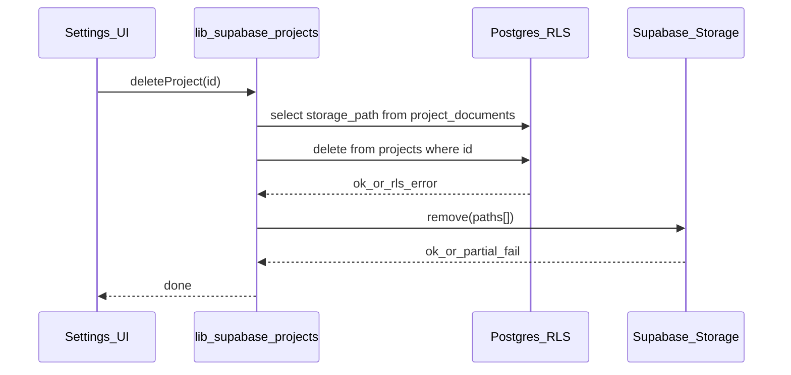

# Admin project deletion (Settings + storage + credit guard)

## Context (current codebase)

- `[public.projects](supabase/migrations/202603241800_projects_project_users.sql)` has `used_credits` (non-negative). This is the source of truth for "credits spent on this project."
- `[public.project_documents](supabase/migrations/202603261200_project_documents_storage.sql)` references `projects(id)` **on delete cascade**; files live in bucket `project-documents` under `{project_id}/{document_id}/{filename}`. **Postgres does not delete storage objects** when a row or project disappears.
- `[project_users](supabase/migrations/202603241800_projects_project_users.sql)` also **cascade**s on project delete. No other migrations reference `public.projects` by FK.
- RLS today: `[projects_delete_admin](supabase/migrations/202603241900_projects_project_users_rls.sql)` allows any dashboard admin to delete any project, with **no** credit check.
- Dashboard project detail Settings UI lives in `[app/(dashboard)/projects/[id]/page.tsx](<app/(dashboard)`/projects/[id]/page.tsx>) (lines ~496–556): form + "Save Changes"; header already shows `project.usedCredits` from Supabase.
- Document helpers: `[lib/supabase/documents.ts](lib/supabase/documents.ts)` defines `PROJECT_DOCUMENTS_BUCKET`, `listProjectDocuments`, and `deleteProjectDocument` (DB row then storage `remove`).

## Security and ordering (important)

1. **RLS**: Tighten `projects_delete_admin` so deletion requires `public.is_dashboard_admin()` **and** `used_credits = 0`. That blocks direct API abuse even if the UI is wrong.
2. **Storage cleanup order** (avoids deleting blobs if the DB delete fails):

- `SELECT storage_path FROM project_documents WHERE project_id = :id`
- `DELETE FROM projects WHERE id = :id` (cascade removes `project_documents` and `project_users`)
- `storage.from(bucket).remove(paths)` in chunks if needed (Supabase limits batch size; chunk e.g. 50–100 paths per call)
- If storage removal fails after a successful project delete, log / toast a warning (orphan objects); optional follow-up: `list` with prefix `{projectId}/` and remove any stragglers for resilience.

## Implementation steps

### 1. Migration: RLS policy

Add a new migration (after your latest, e.g. alongside `[supabase/migrations/202603291200_delete_organization_if_empty.sql](supabase/migrations/202603291200_delete_organization_if_empty.sql)`) that **drops and recreates** `projects_delete_admin` with:

`using (public.is_dashboard_admin() and used_credits = 0)`

### 2. `deleteProject` in `[lib/supabase/projects.ts](lib/supabase/projects.ts)`

- Guard: `getSupabaseBrowserClient()`, valid UUID (reuse pattern from `[lib/supabase/documents.ts](lib/supabase/documents.ts)` `isUuidString` — import from documents or share a tiny `lib/supabase/uuid.ts` only if you want zero duplication; importing from `documents` is fine).
- Steps as above; map RLS / zero-credits failures to a clear `Error` message (e.g. "Cannot delete project while credits have been used" when delete returns no row / policy violation).
- Export `deleteProject` for the page.

### 3. Settings UI in `[app/(dashboard)/projects/[id]/page.tsx](<app/(dashboard)`/projects/[id]/page.tsx>)

- Show a **danger zone** block only when `user?.role === "admin"` **and** `useRemoteDetail` (Supabase-backed UUID project), mirroring other admin-only tabs.
- **Disabled** when `project.usedCredits > 0`, with short copy explaining deletion is only allowed when **0 credits used** (matches header badge).
- Confirm before delete: `window.confirm` (consistent with `[app/(dashboard)/organizations/page.tsx](<app/(dashboard)`/organizations/page.tsx>)) or `[components/ui/alert-dialog.tsx](components/ui/alert-dialog.tsx)` for a more polished modal—either is acceptable; pick one style for consistency.
- On success: `toast.success`, `router.push("/projects")`.
- On error: `toast.error` with message from thrown `Error`.

### 4. Out of scope / non-goals

- **Users and organizations** are untouched (project delete does not cascade to them).
- **Mock-only** dashboard (no Supabase client): hide delete or show no remote action—no need to mutate `[lib/mock-data.ts](lib/mock-data.ts)` unless you explicitly want demo parity.
- **Client-area** `[app/client/projects/[id]/page.tsx](app/client/projects/[id]/page.tsx)`: not required for "dashboard admins"; RLS already prevents non-admins from deleting.

## Testing checklist

- Admin, `used_credits = 0`, with documents: project row and `project_documents` gone; storage objects for those paths removed.
- Admin, `used_credits > 0`: button disabled; if forced via API/another client, delete rejected by RLS.
- Non-admin: no delete UI; direct delete would fail RLS anyway.
