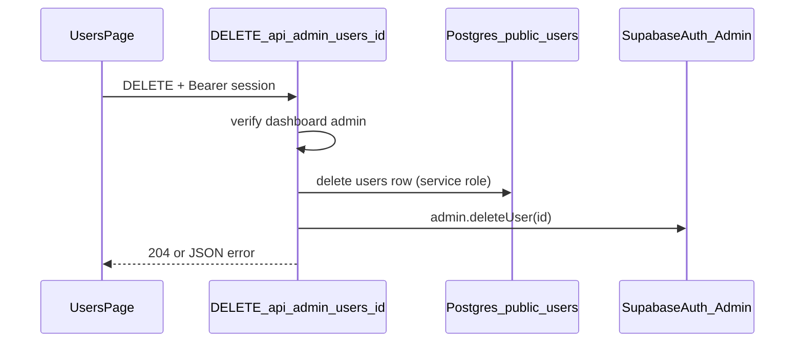

# Admin delete users (Supabase Auth + `public.users`)

## Why not copy the organization RPC pattern?

- [delete_organization_if_empty](supabase/migrations/202603291200_delete_organization_if_empty.sql) only touches Postgres (`public.organizations`).
- Removing a person fully requires **Supabase Auth Admin** (`auth.admin.deleteUser`), which needs the **service role** and already matches how users are created in `[app/api/admin/users/route.ts](app/api/admin/users/route.ts)` (`getSupabaseAdminClient()` + `auth.admin.createUser` + `public.users` upsert).

There is **no `DELETE` policy** on `[public.users](supabase/migrations/202603232355_admin_rls_users_organizations.sql)` (only select/update/insert for admins). Rather than widening RLS for deletes, keep deletes on the server with the admin client—same security boundary as `POST`.

## Server: `DELETE /api/admin/users/[id]`

- Add `[app/api/admin/users/[id]/route.ts](app/api/admin/users/[id]/route.ts)` exporting `DELETE`.
- **Reuse the same auth pattern as `POST`** in `[app/api/admin/users/route.ts](app/api/admin/users/route.ts)`: `getSupabaseServerClient()`, resolve `actingUser` (session + optional `Authorization: Bearer` fallback), user-scoped `.from("users").select("id,role").eq("id", actingUser.id).maybeSingle()`, require `role === "admin"`, then `getSupabaseAdminClient()`.
- **Validation / guards**
  - Validate `id` as UUID (same style as existing `z` usage); return `400` if invalid.
  - **Block self-delete**: if `actingUser.id === id`, return `400` with a clear message (avoids locking the admin out accidentally).
  - **Block deleting the last admin** (recommended): before deleting, if the target row has `role === "admin"`, count other admins (`neq("id", id)` or equivalent); if none remain, return `400`.
- **Data removal order (safe without relying on undocumented FKs)**
  1. `adminClient.from("users").delete().eq("id", id)` — service role bypasses RLS; `[project_users](supabase/migrations/202603241800_projects_project_users.sql)` rows cascade; `[project_documents.uploaded_by](supabase/migrations/202603261200_project_documents_storage.sql)` sets null.
  2. `adminClient.auth.admin.deleteUser(id)` — removes login / `auth.users`.
  - If step 1 returns “no row” but the user still exists in Auth (edge case), still run step 2 so the account cannot sign in.
  - Map Supabase errors to `4xx`/`5xx` JSON `{ error: string }` like `POST`.

**Optional refactor (small):** extract a shared `requireDashboardAdmin(request)` (or similar) used by both `POST` and `DELETE` to avoid duplicating the ~70 lines of session/bearer/admin lookup—only if you want one maintenance point; otherwise duplicate minimally in the new file.

## UI: mirror Organizations row menu

- `[components/users/user-table.tsx](components/users/user-table.tsx)`: add optional `onDelete?: (user: User) => void` and optional `currentUserId?: string` (or derive “deletable” via a predicate prop—either is fine).
  - Add a **Delete** `DropdownMenuItem` with `Trash2` and `text-red-600 focus:text-red-600` like `[components/organizations/organization-table.tsx](components/organizations/organization-table.tsx)`.
  - **Do not show Delete** for the signed-in admin’s own row (`user.id === currentUserId`).
  - Optionally hide Delete for the last admin row only if the server enforces it anyway—UI can stay simple and rely on toast error.
- `[app/(dashboard)/users/page.tsx](<app/(dashboard)`/users/page.tsx>): `handleDelete` with `window.confirm` (wording similar to org delete: permanent, cannot be undone), `fetch(\`/api/admin/users/${encodeURIComponent(id)}, { method: "DELETE", headers: { Authorization: Bearer ${session.access_token} } })`(same session pattern as`handleCreateUser`), then` refreshData()`+`toast.success`/`toast.error`.
  - Pass `currentUser?.id` and `onDelete` into `UserTable`.

## Testing / verification

- Manual: as admin, delete a non-admin test user; confirm they disappear from the table and cannot log in.
- Try deleting self → expect API/UI to prevent or show error.
- Try deleting last admin → expect `400` with clear message.

## Diagram (high level)

