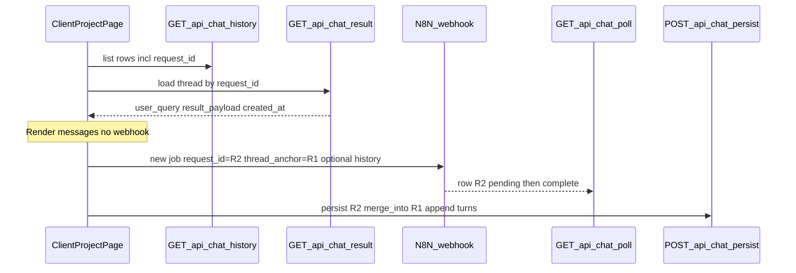

# Chat history: load thread and continue without a new row

## Problem (current behavior)

- `[components/client/project-detail/chat-history-card.tsx](components/client/project-detail/chat-history-card.tsx)` calls `onQuestionSelect?.(item.user_query)` on click.
- `[app/client/projects/[id]/page.tsx](app/client/projects/[id]/page.tsx)` `handleHistoryQuestionSelect` appends a **user** message and calls `submitQuestion(question)` when `useRealChat` is true — which runs a **new** n8n job with a **new** `request_id` and `[useChatQuestion](hooks/useChatQuestion.ts)` always `postPersist`s a **new** `[chat_results](supabase/migrations/202603311200_chat_results.sql)` row.
- The history API strips identity: `[buildHistoryResponse](lib/api/chat-history-server.ts)` maps rows to a **numeric** `id` via `stableIdFromRequestId` and does **not** return `request_id`, so the client cannot fetch “this exact row” (and dedupes by **trimmed `user_query`**, which collapses distinct threads with the same text).

## Target behavior

1. **Click history item** → fetch that stored result, replace (or hydrate) the center timeline with the **saved** user + assistant turn(s) for that item — **no** webhook call, **no** new DB row.
2. **Send a follow-up** while a thread is active → still use a **fresh** `request_id` for polling/async (unchanged contract with `[/api/chat/poll](app/api/chat/poll/route.ts)`), but **persist** merges the new assistant outcome into the **anchor** `chat_results` row so the sidebar does not gain a new line for that continuation.
3. **Product/data note:** Today each row is effectively **one** Q/A pair (`[summary_chat_result_rows.md](agent-os/product/data-examples/summary_chat_result_rows.md)`). “Full conversation” for **legacy rows** = that pair until multi-turn data exists.

## n8n: two paths (you selected “unsure”)

| Path                        | What we ship                                                                                                                                                                   | AI context quality          |
| --------------------------- | ------------------------------------------------------------------------------------------------------------------------------------------------------------------------------ | --------------------------- |
| **A (recommended default)** | App sends a **thread anchor** (`request_id` of first row) and a **structured prior messages** array (or minimal transcript) in the webhook body; n8n updated to feed the model | Best                        |
| **B (interim)**             | App merges DB/history only; n8n still gets isolated `chatInput` per message until the workflow changes                                                                         | Weaker until n8n catches up |

The plan should implement **server + client persistence and hydration** so Path B works structurally; add a **documented webhook payload extension** for Path A in the spec and `[agent-os/specs/2026-03-26-1400-project-chat-n8n-integration/](agent-os/specs/2026-03-26-1400-project-chat-n8n-integration/)` handoff style notes.

## Architecture (high level)

**Merge rule (conceptual):** Upsert the **job** row by `R2` for polling if the pipeline still writes per-job rows, **or** (cleaner long-term) only update **R1** after completion and avoid a durable second row — exact choice depends on whether `[/api/chat/n8n-complete](app/api/chat/n8n-complete/route.ts)` always inserts by `request_id`. The implementation task must **reconcile client `persist` with n8n callback** so you do not end up with duplicate or orphan rows (inspect current write paths and pick one idempotent strategy).

## Task 1: Save spec documentation (shape-spec)

Create `[agent-os/specs/2026-04-01-1600-chat-history-thread-load-continue/](agent-os/specs/2026-04-01-1600-chat-history-thread-load-continue/)` with:

- **plan.md** — this plan (refined after implementation kickoff if needed).
- **shape.md** — scope, decisions (Path A vs B), screenshot reference, contradiction with legacy “click re-runs webhook” in `[agent-os/product/dev-notes/chat-history-spec.md](agent-os/product/dev-notes/chat-history-spec.md)`.
- **standards.md** — embed `[agent-os/standards/global/domain-data-layer.md](agent-os/standards/global/domain-data-layer.md)` (types + migration discipline for new fields).
- **references.md** — links to files above + `[lib/api/chat-payload.ts](lib/api/chat-payload.ts)` for normalizing `result_payload` to UI text.
- **visuals/** — copy `[assets/image-6ac77106-8c4a-4ba9-a006-b6c65eefaff3.png](file:///Users/royalnashef/.cursor/projects/Users-royalnashef-Desktop-smart-arse/assets/image-6ac77106-8c4a-4ba9-a006-b6c65eefaff3.png)` (or workspace path you prefer under the spec folder).

## Task 2: History API and types

- Extend `[HistoryItem](lib/chat-history-types.ts)` with `**request_id: string`** (keep numeric `id` only if you still need React keys; prefer `**request_id` as key to avoid hash collisions).
- Update `[buildHistoryResponse](lib/api/chat-history-server.ts)`: **stop deduping by `user_query`** for the client project chat (each `chat_results` row is one thread head). Keep caps (20 / pagination) but order by `created_at` desc.
- Ensure `[GET /api/chat/history](app/api/chat/history/route.ts)` selects `request_id` (already selected; currently dropped when mapping).

## Task 3: Thread hydration endpoint

- Add a authenticated route, e.g. `**GET /api/chat/result?request_id=&project_id=**`, using `[requireChatSession](lib/api/require-chat-session.ts)`: load `chat_results` for `user_id`, optional `project_id` match, return `user_query`, `created_at`, `status`, `result_payload` (and later `message_thread` if added).
- Add `lib/chat-result.ts` (or similar) fetch helper mirroring `[lib/chat-history.ts](lib/chat-history.ts)`.

## Task 4: Persist merge for continuations

- Extend `[persistBodySchema](app/api/chat/persist/route.ts)` with optional `**thread_anchor_request_id**` (uuid): when present, after validating org/project ownership, **merge** the new turn into the anchor row’s stored transcript (see Task 5) and **do not** create a new sidebar-visible row (either skip inserting a second row or delete/ignore the ephemeral job row — finalize after auditing n8n-complete vs client persist).
- Align `[useChatQuestion](hooks/useChatQuestion.ts)` to accept optional anchor + pass merged history for Path A when n8n is ready.

## Task 5: Transcript model

- Prefer storing an ordered `**messages[]`** (user/assistant, content, timestamps) inside `**result_payload\*\`first to avoid an immediate DB migration; if you need querying/indexing later, add a dedicated`jsonb` column via migration per domain-data-layer standard.
- Add small pure helpers: **serialize** from UI `ChatMessage[]`, **deserialize** to UI, **append** after each completed turn.

## Task 6: Client UI wiring

- `[ChatHistoryCard](components/client/project-detail/chat-history-card.tsx)`: change callback to pass `**HistoryItem` (or `request_id`)**, not only `user_query`; remove the “rerun” semantics (`isRerunning` / `submitQuestion` coupling) — replace with **loading thread state (spinner on row while fetch runs).
- `[app/client/projects/[id]/page.tsx](app/client/projects/[id]/page.tsx)`:
  - Track `**activeThreadRequestId: string | null` (null = brand-new chat; new sends create a new anchor as today).
  - On history select: `setMessages` from hydrated transcript; set `activeThreadRequestId`; **do not** call `submitQuestion`.
  - On send with active anchor: call `submitQuestion` with anchor + transcript for n8n (Path A) and persist merge (Task 4).
  - Optionally add **“New chat”** control to clear anchor and reset messages (product polish).

## Task 7: Verification

- Update `[smoke-test-checklist.md](agent-os/specs/2026-03-26-1400-project-chat-n8n-integration/smoke-test-checklist.md)` or project QA notes: click history → no duplicate row; send follow-up → single history line updates or stays single-row per design.

## Product alignment

- Matches mission: **auditable, project-scoped** chat (`[mission.md](agent-os/product/mission.md)`).
- Supersedes the “click re-runs webhook” behavior documented in `[chat-history-spec.md](agent-os/product/dev-notes/chat-history-spec.md)` for the **client** project page (keep or adapt any admin/dashboard rerun behavior separately if it still exists).
