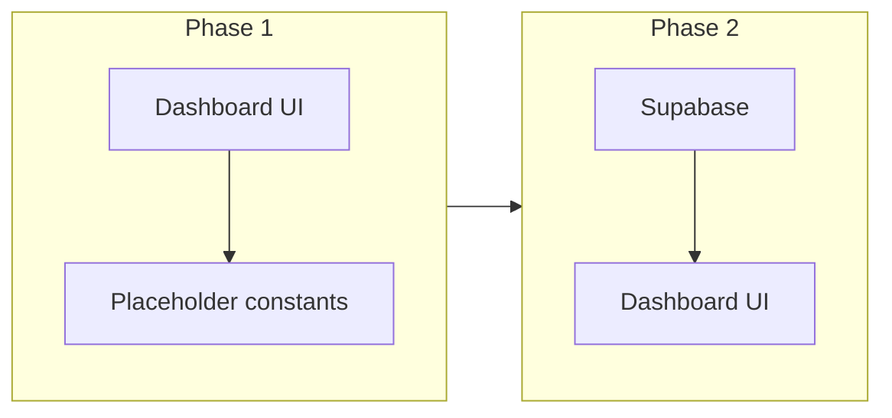

# Dashboard layout (placeholders) + stat bar redesign

## Context

- Current implementation: `[app/(dashboard)/dashboard/page.tsx](<app/(dashboard)`/dashboard/page.tsx>) renders `[components/dashboard/stats-bar.tsx](components/dashboard/stats-bar.tsx)`, which computes **Total Projects**, **Active Projects**, **Credits Remaining**, and **Active Users** from `[lib/mock-data](lib/mock-data.ts)` and `getVisibleProjects()`.
- Product direction: org-scoped projects, usage/credits, and future `**QueryLog`-style** analytics (`[agent-os/standards/global/domain-data-layer.md](agent-os/standards/global/domain-data-layer.md)` mentions `QueryLog` for audit/analytics). There is **no confirmed Supabase table for “queries” in migrations yet—phase 2 will define the source (e.g. new table, view, or aggregate from messages/logs).
- **Out of scope for this spec:** client-facing dashboard behavior and per-org stat scoping for non-admin roles (per your note). Phase 1 targets the **admin dashboard** visual structure; keep existing auth gates as today.

## Visual reference

- Baseline screenshot (current four stats): workspace asset `[assets/image-d702519f-cdd1-414c-9c82-b8e8c654b56b.png](file:///Users/royalnashef/.cursor/projects/Users-royalnashef-Desktop-smart-arse/assets/image-d702519f-cdd1-414c-9c82-b8e8c654b56b.png)` — copy into the new spec’s `visuals/` during **Task 1**.

## Layout ideas (phase 1)

| Zone              | Purpose                | Placeholder treatment                                                                                                                                                                                                                                                     |
| ----------------- | ---------------------- | ------------------------------------------------------------------------------------------------------------------------------------------------------------------------------------------------------------------------------------------------------------------------- |
| **Stat bar**      | At-a-glance counts     | Four tiles, same card pattern as today (`grid-cols-2` / `lg:grid-cols-4`), new labels/icons. Use **fixed placeholder integers** (e.g. one small `const` object in `stats-bar.tsx`) so the UI is purely design-first; add `// TODO: wire Supabase counts` for each metric. |
| **Primary row**   | “What needs attention” | Two columns on large screens: e.g. **Recent activity** (list skeleton) + **Usage / queries trend** (chart placeholder using muted box + `Skeleton` from shadcn if already in project).                                                                                    |
| **Secondary row** | Navigation / depth     | **Quick links** or **Top projects** — card with 3–4 skeleton rows linking to `/projects`, `/users`, `/organizations`, `/analytics` (buttons or `Link` styling consistent with header CTA).                                                                                |

This matches your choice of **structured placeholders** rather than an empty main area.

## Implementation notes (phase 1 code)

- **Icons:** `lucide-react` only — e.g. `FolderOpen` (Projects), `MessageSquare` or `Search` (Queries), `Users`, `Building2` (Organizations). Reuse existing token pattern (`text-`_, `bg-`_) from current stat cards for visual continuity.
- **Subtitle copy:** Update admin line under the title in `[dashboard/page.tsx](<app/(dashboard)`/dashboard/page.tsx>) so it no longer promises “credits” as the hero metric (e.g. overview of projects, usage, and team — align with new stats).
- **New component:** Add something like `[components/dashboard/dashboard-overview-placeholder.tsx](components/dashboard/dashboard-overview-placeholder.tsx)` (name flexible) that owns the skeleton zones; keep `[page.tsx](<app/(dashboard)`/dashboard/page.tsx>) thin (header + `StatsBar` + placeholder layout).
- **Client role:** No dedicated client work; optionally leave non-admin users seeing the same placeholder dashboard or a single muted message — **minimal change** unless the existing page already branches; prefer not to expand scope.

## Phase 2 (follow-up, not in initial implementation pass)

- Replace placeholders with Supabase queries: `count(*)` on `projects`, `users` (or `auth` exposure per existing patterns), `organizations`, and a **defined** queries metric (migration + RLS + admin-only policy if needed).
- Optional: loading/error states and stale-while-revalidate if you introduce server data fetching.

## Standards to snapshot in spec `standards.md`

From `[agent-os/standards/index.yml](agent-os/standards/index.yml)`, include full text of:

- `[css/ui-styling.md](agent-os/standards/css/ui-styling.md)` — feature folder placement, tokens, `cn`, Lucide.
- `[global/project-conventions.md](agent-os/standards/global/project-conventions.md)` — `@/` imports, client boundaries, naming.

Optionally add a short excerpt from `[global/app-routing-protected-shell.md](agent-os/standards/global/app-routing-protected-shell.md)` if dashboard auth/loading patterns are touched.

## Reference code to cite in `references.md`

- `[components/dashboard/stats-bar.tsx](components/dashboard/stats-bar.tsx)` — current stat card markup.
- `[app/(dashboard)/dashboard/page.tsx](<app/(dashboard)`/dashboard/page.tsx>) — page shell and CTA.
- `[app/(dashboard)/analytics/page.tsx](<app/(dashboard)`/analytics/page.tsx>) — optional pattern reference for chart/card density (if useful for skeleton styling).
