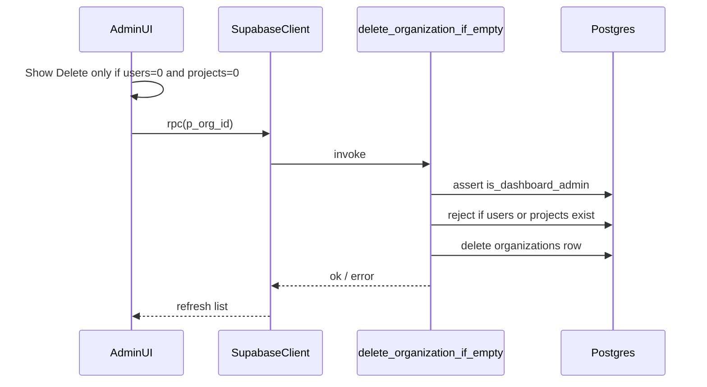

# Delete empty organizations from dashboard

## Current behavior

- UI: `[components/organizations/organization-table.tsx](components/organizations/organization-table.tsx)` exposes **Edit** / **Activate** and **Deactivate** via a dropdown; `[app/(dashboard)/organizations/page.tsx](<app/(dashboard)`/organizations/page.tsx>) wires **deactivate** to `[setOrganizationStatus](lib/supabase/organizations.ts)` (soft delete).
- Data: `[listOrganizationsForDashboard](lib/supabase/organizations.ts)` already derives `**org.userIds.length`** (from `users.organization_id` counts) and `**org.projectIds.length\*\`(from`projects.organization_id`). Those are the right signals for the UI gate.
- Database: `[202603232355_admin_rls_users_organizations.sql](supabase/migrations/202603232355_admin_rls_users_organizations.sql)` enables RLS on `organizations` with **no DELETE policy**, so a client `.delete()` would be denied. `[projects.organization_id](supabase/migrations/202603241800_projects_project_users.sql)` uses `**on delete cascade` (deleting an org would remove its projects if the delete were allowed).

## Recommended approach: RPC + UI (no blanket RLS delete)

Use a `**SECURITY DEFINER` Postgres function (new migration) that:

1. Verifies the caller is an admin via existing `[public.is_dashboard_admin()](supabase/migrations/202603232355_admin_rls_users_organizations.sql)`.
2. `**IF EXISTS` any `public.users` row with `organization_id = p_org_id` → raise a clear exception (e.g. “organization has users”).
3. `**IF EXISTS` any `public.projects` row with `organization_id = p_org_id` → raise (e.g. “organization has projects”).
4. `**DELETE FROM public.organizations WHERE id = p_org_id` (single transaction; avoids TOCTOU between UI check and delete).

- `GRANT EXECUTE ON FUNCTION ... TO authenticated` (same pattern as `is_dashboard_admin`).
- **Do not** add a broad `organizations_delete_admin` RLS policy unless you explicitly want admins to delete any org and rely entirely on FKs; the RPC keeps the “empty only” rule in one place.

**Production note:** If your live DB has other tables referencing `organizations` beyond `projects` / `users.organization_id`, extend the function with the same existence checks or matching `ON DELETE` behavior before shipping.

## App changes

1. `**[lib/supabase/organizations.ts](lib/supabase/organizations.ts)`

- Add `deleteOrganization(id: string): Promise<void>` that calls `supabase.rpc('delete_organization_if_empty', { p_org_id: id })` (exact param name to match migration).
- Map PostgREST/RPC errors to user-facing `Error` messages like the rest of the file.

1. `**[components/organizations/organization-table.tsx](components/organizations/organization-table.tsx)`

- Add optional `onDelete?: (org: Organization) => void`.
- Render a **Delete** item (e.g. `Trash2` icon, destructive styling consistent with your UI—similar to amber styling used for Deactivate) **only when** `onDelete` is provided **and** `org.projectIds.length === 0 && org.userIds.length === 0`.
- Show this for **both** active and inactive rows when empty (inactive rows currently only show **Activate**; Delete should still appear when eligible).

1. `**[app/(dashboard)/organizations/page.tsx](<app/(dashboard)`/organizations/page.tsx>)

- Implement `handleDelete`: `window.confirm` with explicit “permanently delete” wording, call `deleteOrganization`, `refreshOrganizations()`, `toast.success` / `toast.error` mirroring `[handleDeactivate](<app/(dashboard)`/organizations/page.tsx>).

## Flow (mermaid)

## Testing (manual)

- Org with 0 users, 0 projects: Delete succeeds; row disappears; list refreshes.
- Org with ≥1 user or ≥1 project: Delete menu hidden; if RPC called anyway, error message is clear.
- Non-admin: RPC should fail (admin check).
