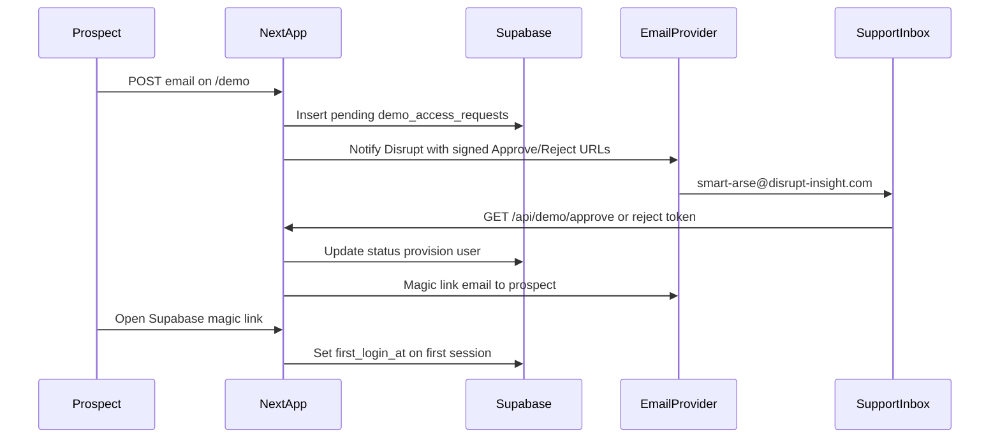

# Demo Access Flow — Magic-Link Approval

## Shaping summary

**In scope (confirmed):** Full estimate from [`agent-os/product/notes-archive/demo-access-flow-spec.md`](agent-os/product/notes-archive/demo-access-flow-spec.md) — public request page, Disrupt notification + email approve/reject, Supabase magic link to shared demo org, admin dashboard, `first_login_at` tracking, stale-request cleanup.

**Visuals:** Match [`components/login-page.tsx`](components/login-page.tsx) + [`components/login-flow-background.tsx`](components/login-flow-background.tsx) (email-only form, neutral success copy).

**Notification recipient (v1):** [`lib/support-contact.ts`](lib/support-contact.ts) → `smart-arse@disrupt-insight.com`. No env recipient list yet; future company settings page will own configurable support email.

**Supersedes:** Prior shaping at [`agent-os/specs/2026-04-02-1200-demo-magic-link-approval/`](agent-os/specs/2026-04-02-1200-demo-magic-link-approval/) — this spec is the execution source of truth.

### Default decisions (open questions from estimate doc)

| Question                | Decision                                                                           |
| ----------------------- | ---------------------------------------------------------------------------------- |
| Re-submit after reject? | Yes — new submission creates a new row if no active `pending` row for that email   |
| Magic link expiry       | Supabase default (~1 hour)                                                         |
| Admin nav placement     | New admin-only sidebar item **Demo requests** → `/demo-requests` (alongside Users) |
| Expired requests        | Mark `status = expired`, retain rows for reporting                                 |

### End-to-end flow

### Key codebase patterns to reuse

- **User provisioning:** [`app/api/admin/users/route.ts`](app/api/admin/users/route.ts) — `auth.admin.createUser` with `admin_provisioned: true`, then `public.users` upsert with fixed `organization_id` (demo org from env `DEMO_ORGANIZATION_ID`).
- **Auth trigger skip:** [`supabase/migrations/202603281000_auth_users_drop_all_custom_triggers_and_harden_skip.sql`](supabase/migrations/202603281000_auth_users_drop_all_custom_triggers_and_harden_skip.sql) — prevents auto org creation for provisioned users.
- **Admin APIs:** [`lib/api/require-dashboard-admin.ts`](lib/api/require-dashboard-admin.ts).
- **Cron:** Mirror [`app/api/cron/pause-expired-projects/route.ts`](app/api/cron/pause-expired-projects/route.ts) + entry in [`vercel.json`](vercel.json).
- **No transactional email in repo today** — new Resend (or SendGrid) integration required for Disrupt notification, branded magic-link wrapper, and plain-text rejection.

### Standards (included in spec folder)

- [`agent-os/standards/javascript/auth-rbac.md`](agent-os/standards/javascript/auth-rbac.md)
- [`agent-os/standards/global/developer-guide.md`](agent-os/standards/global/developer-guide.md)
- [`agent-os/standards/global/app-routing-protected-shell.md`](agent-os/standards/global/app-routing-protected-shell.md)
- [`agent-os/standards/css/ui-styling.md`](agent-os/standards/css/ui-styling.md)
- [`agent-os/standards/global/project-conventions.md`](agent-os/standards/global/project-conventions.md)

---

## Task 1: Save spec documentation

Create [`agent-os/specs/2026-05-19-1200-demo-access-flow/`](agent-os/specs/2026-05-19-1200-demo-access-flow/) with:

- **plan.md** — This plan
- **shape.md** — Scope, decisions above, product alignment, notification note
- **standards.md** — Full text of the five standards listed above
- **references.md** — Login page, admin users route, requireDashboardAdmin, cron route, April spec (historical)
- **visuals/README.md** — “Reuse login page; no separate mockups”

---

## Task 2: Database — `demo_access_requests` + demo org

Migration (new file under `supabase/migrations/`):

- Table `demo_access_requests` per estimate columns: `id`, `email`, `status` (`pending` | `approved` | `rejected` | `magic_link_sent` | `expired`), timestamps (`requested_at`, `approved_at`, `rejected_at`, `magic_link_sent_at`, `first_login_at`), `user_id` FK, `metadata` jsonb.
- Indexes on `email`, `status`, `requested_at`.
- **RLS:** No anon/client direct access; service role + admin policies only.
- Seed or document shared **demo organization**; wire `DEMO_ORGANIZATION_ID` in env example.

Idempotency: unique partial index or app logic — one `pending` row per normalized email within TTL.

---

## Task 3: Shared server modules

Under `lib/demo-access/` (or similar):

- **Token service** — HMAC sign/verify (`DEMO_APPROVAL_SECRET`): payload `{ requestId, action, expiresAt }`; default TTL 72h; single-use via status checks (friendly HTML result pages for expired/used).
- **Provisioning service** — Approve path: `createUser` / link existing user with `admin_provisioned`, upsert `public.users` with `role: "user"` (or `client` per product choice) + `DEMO_ORGANIZATION_ID`, `generateLink({ type: 'magiclink' })`, send email, transition `approved` → `magic_link_sent`.
- **Email service** — Resend client + three templates: (1) Disrupt notification with Approve/Reject buttons, (2) branded magic-link to prospect, (3) plain-text rejection.
- **Request service** — Create pending request, rate limit (e.g. 3/hour/email), anti-enumeration responses.

Env vars (document in README): `DEMO_ORGANIZATION_ID`, `DEMO_APPROVAL_SECRET`, `DEMO_REQUEST_TTL_DAYS` (default 7), `EMAIL_PROVIDER_API_KEY`, `EMAIL_FROM_ADDRESS`, `NEXT_PUBLIC_APP_URL`, existing `CRON_SECRET`.

---

## Task 4: Public demo signup

- **Page:** [`app/demo/page.tsx`](app/demo/page.tsx) — public route outside dashboard shell; extract or compose shared layout from login (logo, background, single email field, loading/submit, success state: “We'll be in touch if approved.”).
- **API:** `POST /api/demo/request` — validate email, insert/idempotent pending, send Disrupt notification to `SUPPORT_EMAIL`, always return generic success.

---

## Task 5: Email approve / reject (no Disrupt login)

- **GET** [`app/api/demo/approve/route.ts`](app/api/demo/approve/route.ts) — verify token → provision → send magic link → update timestamps → HTML success/error page.
- **GET** [`app/api/demo/reject/route.ts`](app/api/demo/reject/route.ts) — verify token → `rejected` + plain-text email → HTML confirmation.
- Both idempotent on already-actioned requests.

---

## Task 6: Admin dashboard + APIs

- **Page:** [`app/(dashboard)/demo-requests/page.tsx`](<app/(dashboard)/demo-requests/page.tsx>) — admin gate; table (email, status, requested/approved/rejected/sent/first login); status filter; sort by date; empty/loading states; inline Approve/Reject (reject confirms).
- **APIs:**
  - `GET /api/admin/demo-requests` — paginated list + filters (`requireDashboardAdmin`)
  - `POST /api/admin/demo-requests/[id]/approve` and `.../reject` — call same provisioning/reject services as email routes (no duplicate logic)
- **Nav:** Add “Demo requests” to [`components/layout/sidebar.tsx`](components/layout/sidebar.tsx) (`roles: ["admin"]`).

---

## Task 7: First login tracking

- Post-auth handler (e.g. middleware, layout effect, or dedicated `/auth/callback` route): when session user maps to a `demo_access_requests` row with `magic_link_sent` and `first_login_at` is null, set `first_login_at` once.
- Redirect demo users to client project list (`/client/projects`) per existing role routing.

---

## Task 8: Stale request cleanup

- **RPC or SQL function** — mark `pending` rows older than `DEMO_REQUEST_TTL_DAYS` as `expired`.
- **Cron route** — `GET /api/cron/expire-demo-requests` with Bearer `CRON_SECRET` (same pattern as pause-expired-projects).
- Add schedule to [`vercel.json`](vercel.json).

---

## Task 9: Supabase Auth config + QA

- Add magic-link redirect URLs in Supabase dashboard (demo callback path).
- Env example + README section for demo flow.
- Manual QA checklist: submit request, approve via email, reject path, duplicate email idempotency, expired token page, dashboard actions, cron dry-run, first login timestamp.

---

## Risks

- **Email deliverability** — SPF/DKIM for `EMAIL_FROM_ADDRESS`; factor setup time.
- **Duplicate users** — If email already exists in `auth.users`, approve flow must link/invite rather than fail opaque 500.
- **Future settings page** — Hardcode `SUPPORT_EMAIL` import for notifications now; abstract behind a small `getSupportNotificationEmail()` helper to swap when company settings land.
