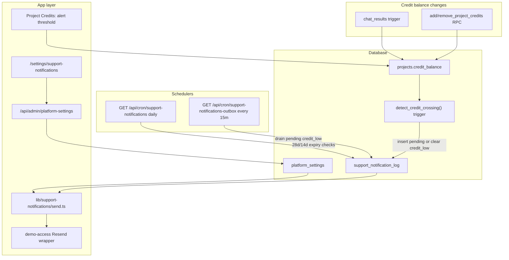

# Disrupt support email notifications — implementation spec

## Goal

Automated emails to the Disrupt support inbox for **low credits** and **access expiry** (28d / 14d), with **dashboard-admin** toggles and configurable support address. Per-project **credit alert threshold** only (no org overrides). Real-time credit crossing via DB trigger + outbox cron; dedicated expiry cron; Vitest coverage for pure helpers.

---

## Codebase alignment

These updates supersede stale assumptions in the original draft.

| Original draft claim | Actual codebase |
|---|---|
| "No outbound email in repo" | **Resend is live** for demo-access ([`lib/demo-access/email.ts`](lib/demo-access/email.ts), `resend@^6.12.3`) |
| New env `RESEND_API_KEY`, `RESEND_FROM` | Use existing **`EMAIL_PROVIDER_API_KEY`**, **`EMAIL_FROM_ADDRESS`**, **`EMAIL_RESEND_SANDBOX`** ([`lib/demo-access/config.ts`](lib/demo-access/config.ts), [README demo section](README.md)) |
| New `lib/email/send-support-notification.ts` in isolation | **Extend** demo-access email stack: shared `sendEmail()` wrapper, `getFromAddressForRecipients()` (noreply→support pattern), [`lib/demo-access/templates/shared.ts`](lib/demo-access/templates/shared.ts) for branded HTML |
| Support inbox from constant only | [`getSupportNotificationEmail()`](lib/support-notification-email.ts) already exists — extend to read `platform_settings.support_email` with `DEMO_NOTIFICATION_EMAIL` env override kept for local testing |
| Credit charge hook in `n8n-complete` / persist routes | Billing is a **Postgres trigger** on `chat_results` → updates `projects.credit_balance` ([`202604132000_chat_results_project_credit_charge.sql`](supabase/migrations/202604132000_chat_results_project_credit_charge.sql)); app routes only upsert rows |
| Platform settings via browser Supabase | [`lib/supabase/projects.ts`](lib/supabase/projects.ts) is `"use client"` — platform singleton writes should use **`/api/admin/platform-settings`** with [`requireDashboardAdmin`](lib/api/require-dashboard-admin.ts) (same pattern as [`app/api/admin/demo-requests/route.ts`](app/api/admin/demo-requests/route.ts)) |
| 2 Vercel crons | **Already 2** in [`vercel.json`](vercel.json) (`pause-expired-projects`, `expire-demo-requests`); this feature adds **2 more** — confirm Vercel plan cron limits |

---

## Product scope

| Topic | Decision |
|---|---|
| Recipients | Disrupt support inbox (default [`smart-arse@disrupt-insight.com`](lib/support-contact.ts)) |
| Who configures | Dashboard admins only — no org/client overrides |
| Credit alert | Once per threshold crossing; re-fires after balance restored **≥ threshold**, then drops below again |
| Credit threshold | Per project, Credits tab on [`app/(dashboard)/projects/[id]/page.tsx`](app/(dashboard)/projects/[id]/page.tsx) (admin-gated today) |
| Expiry reminders | **28** and **14** UTC calendar days before `access_until`; **live** projects with date set ([`utcCalendarDaysUntil`](lib/project-status.ts)) |
| Visuals | Match [`SettingsBlock`](components/settings/settings-block.tsx) + [`NotificationsSection`](components/settings/notifications-section.tsx) toggle pattern |

**Out of scope:** client `/settings` mock toggles, emails to client users, weekly summaries, aligning in-app meter warning (`CREDIT_BALANCE_WARNING_THRESHOLD = 50` in [`project-credits-meter.tsx`](components/dashboard/project-credits-meter.tsx)) with per-project threshold.

Settings are **platform-wide for Disrupt admins**, not per-organization. Per-project config is limited to the **credit alert threshold** only.

---

## Architecture



### Credit crossing detection

Because chat billing is **DB-triggered**, real-time detection belongs in the database, not in Next route handlers.

**Approach:**

1. **`AFTER UPDATE OF credit_balance` trigger on `projects`** calling `SECURITY DEFINER` function `support_notify_on_credit_balance_change()`:
   - If `NEW.credit_balance >= NEW.credit_alert_threshold` (or threshold is null): **delete** `support_notification_log` row where `event_key = 'credit_low'` for that project (enables re-crossing)
   - Else if threshold set and `NEW.credit_balance < NEW.credit_alert_threshold` and (`OLD.credit_balance >= threshold` OR no existing `credit_low` log): **upsert** log row with `status = 'pending'`
2. **Outbox poller cron** (every 15m): load pending rows, check platform toggle, send via Resend, mark `sent_at`
3. **Belt-and-suspenders:** after successful `addProjectCredits` / `removeProjectCredits` in project settings UI, call `POST /api/admin/projects/[id]/evaluate-credit-alert` to re-run crossing reset logic server-side (covers edge cases if trigger missed)

Do **not** rely solely on `n8n-complete` / `persist` routes — they do not own credit math.

### Expiry reminders

New daily cron **`GET /api/cron/support-notifications`** (02:30 UTC to stagger from pause job at 02:00):

- Query live projects with `access_until` set where `utcCalendarDaysUntil(access_until)` is **28** or **14**
- Respect platform toggles + dedupe log (`event_key`: `access_28d`, `access_14d`)
- Send via shared send helper

Keep existing [`pause-expired-projects`](app/api/cron/pause-expired-projects/route.ts) unchanged.

### Data model

1. **`platform_settings`** (singleton row, id fixed e.g. `'default'`)
   - `support_email text not null`
   - `notify_credit_balance_low boolean default true`
   - `notify_access_expires_4_weeks boolean default true`
   - `notify_access_expires_2_weeks boolean default true`
   - RLS: `is_dashboard_admin()` read/write; service role for cron reads
2. **`projects.credit_alert_threshold`** — `integer null` (null = no low-credit email)
3. **`support_notification_log`** — unique `(notification_type, project_id, event_key)`; columns: `status` (`pending`/`sent`), `sent_at`, `created_at`
   - Event keys: `credit_low`, `access_28d`, `access_14d`

Seed singleton with default support email matching [`SUPPORT_EMAIL`](lib/support-contact.ts).

### Email delivery (reuse, don't reinvent)

Create [`lib/support-notifications/`](lib/support-notifications/):

- `send.ts` — thin wrapper calling the same Resend send pattern as demo-access (extract shared `sendEmail` from demo-access into `lib/email/send-transactional.ts` **only if** duplication exceeds ~30 lines; otherwise import helpers from demo-access config)
- `templates.ts` — 3 notification bodies using `renderEmailLayout` + `escapeHtml`
- `get-recipient.ts` — async `getSupportNotificationEmail()` reading DB with env override fallback

**From/To pattern:** internal notifications to support inbox use **`noreply@<domain>` From** (already handled by `getFromAddressForRecipients`) so forwarding rules work — same as demo approve/reject emails.

### Admin UI

| Surface | Path | Notes |
|---|---|---|
| Platform toggles + support email | [`app/(dashboard)/settings/support-notifications/page.tsx`](app/(dashboard)/settings/support-notifications/page.tsx) | Admin gate `user.role === "admin"`; sidebar link in [`sidebar.tsx`](components/layout/sidebar.tsx) with `roles: ["admin"]` |
| Project threshold | Credits tab on project detail page | Numeric input "Email support when balance below"; null/empty = disabled |
| API | `GET/PATCH /api/admin/platform-settings` | `requireDashboardAdmin` + service role |
| Project threshold update | Extend existing `updateProject` path or dedicated admin PATCH | Map to `credit_alert_threshold` in [`ProjectRow`](lib/supabase/projects.ts) type + select |

Reuse [`NotificationsSection`](components/settings/notifications-section.tsx) layout pattern (or inline three Switch rows like it) — **do not wire** the user-facing `/settings` mock toggles.

### Cron wiring ([`vercel.json`](vercel.json))

```json
{ "path": "/api/cron/support-notifications", "schedule": "30 2 * * *" },
{ "path": "/api/cron/support-notifications-outbox", "schedule": "*/15 * * * *" }
```

Both use existing `Authorization: Bearer CRON_SECRET` pattern.

### Standards

- `javascript/auth-rbac` — admin-only surfaces
- `global/app-routing-protected-shell` — new dashboard route
- `global/project-conventions` — UI patterns
- Cron pattern from [`app/api/cron/pause-expired-projects/route.ts`](app/api/cron/pause-expired-projects/route.ts)

### Dependencies / risks

- **Resend:** verified sending domain + API key (existing `EMAIL_PROVIDER_API_KEY` setup)
- **Copy:** subject lines and body content for three emails
- **Timezone:** `access_until` is UTC calendar day in DB — email copy should say so
- **Vercel cron limits** on hobby vs pro (two additional cron entries)

---

## Execution tasks

### Task 1: Save spec documentation

Create `agent-os/specs/2026-05-19-HHMM-disrupt-support-email-notifications/` modeled on [`agent-os/specs/2026-05-19-1200-demo-access-flow/`](agent-os/specs/2026-05-19-1200-demo-access-flow/):

- `plan.md`, `shape.md`, `standards.md`, `references.md`, `visuals/README.md`

**Key references for `references.md`:**

- [`lib/demo-access/email.ts`](lib/demo-access/email.ts) — Resend send pattern
- [`lib/support-notification-email.ts`](lib/support-notification-email.ts) — recipient stub to extend
- [`app/api/cron/pause-expired-projects/route.ts`](app/api/cron/pause-expired-projects/route.ts) — cron auth
- [`lib/project-status.ts`](lib/project-status.ts) — UTC date math
- [`supabase/migrations/202604132000_chat_results_project_credit_charge.sql`](supabase/migrations/202604132000_chat_results_project_credit_charge.sql) — why crossing is DB-side
- [`components/settings/notifications-section.tsx`](components/settings/notifications-section.tsx) — toggle UI
- [`app/(dashboard)/projects/[id]/page.tsx`](app/(dashboard)/projects/[id]/page.tsx) — Credits tab

### Task 2: Schema + RLS + credit crossing trigger

### Task 3: Send helper + templates (reuse Resend stack)

### Task 4: `/api/admin/platform-settings` + admin notifications page

### Task 5: Per-project `credit_alert_threshold` field

### Task 6: Outbox cron + optional evaluate API hook on admin credit changes

### Task 7: Expiry cron (`support-notifications`)

### Task 8: Vitest + README

---

## Product alignment

From [`agent-os/product/mission.md`](agent-os/product/mission.md) and [`roadmap.md`](agent-os/product/roadmap.md): aligns with **credits & access lifecycle** already shipped (auto-pause, `access_until`, cron). This adds **ops visibility** for Disrupt when pools run low or engagements near end — supports admin-run client projects without client org self-service.

---

## Known follow-ups

- Align in-app credit meter warning with per-project threshold
- Extend `ACCESS_UNTIL_WARNING_DAYS` UI (14d) to also signal at 28d
- Consolidate/delete duplicate plan at [`.cursor/plans/disrupt_support_email_notifications.plan.md`](.cursor/plans/disrupt_support_email_notifications.plan.md) once agent-os spec is saved
