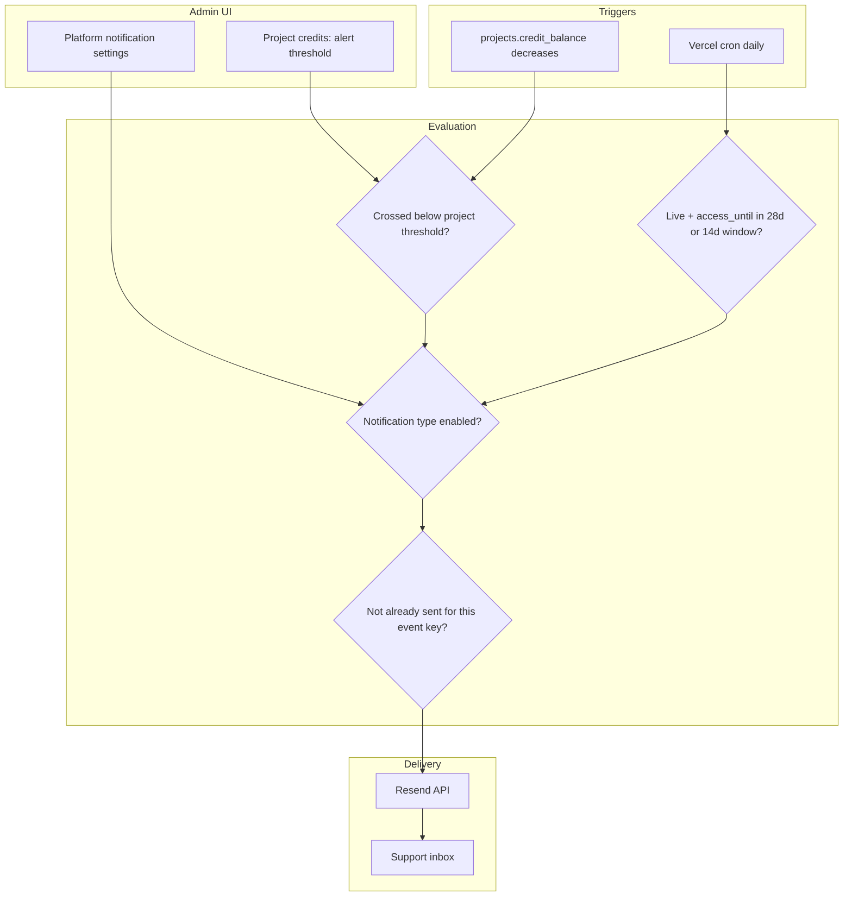

# Disrupt support email notifications — estimate & shaped plan

## Goal

Give the Disrupt team a **reviewable estimate** for three automated emails to the support inbox (default [`smart-arse@disrupt-insight.com`](lib/support-contact.ts)), plus **dashboard-admin** controls to toggle notification types and change the support address. **Spec documentation** (`agent-os/specs/…`) is **Task 1 but blocked** until estimate approval.

## Confirmed scope (from shaping)

| Topic            | Decision                                                                                                                                                                                 |
| ---------------- | ---------------------------------------------------------------------------------------------------------------------------------------------------------------------------------------- |
| Recipients       | Disrupt support inbox (configurable by **dashboard admins only**)                                                                                                                        |
| Org overrides    | **None** — client orgs cannot override email or toggles                                                                                                                                  |
| Credit alert     | **Once per threshold crossing** — re-fires only after balance is topped back **at or above** threshold, then drops below again                                                           |
| Credit threshold | **Per project**, set in project Settings (admin project detail today: [`app/(dashboard)/projects/[id]/page.tsx`](<app/(dashboard)/projects/[id]/page.tsx>), credits section)             |
| Expiry reminders | **28 days** and **14 days** before `access_until` (UTC calendar, aligned with existing [`lib/project-status.ts`](lib/project-status.ts)); **live projects only** with `access_until` set |
| Email provider   | **Resend** (new integration; no outbound email in repo today)                                                                                                                            |
| Visuals          | None — match existing settings / project settings patterns ([`components/settings/notifications-section.tsx`](components/settings/notifications-section.tsx) is UI-only mock today)      |

**Clarification vs initial “hybrid” answer:** Settings are **platform-wide for Disrupt admins**, not per-organization. Per-project config is limited to the **credit alert threshold** only.

## What exists today (reduces risk)

- **Support email constant:** [`lib/support-contact.ts`](lib/support-contact.ts)
- **Credits:** `projects.credit_balance`, charge on terminal chat ([`supabase/migrations/202604132000_chat_results_project_credit_charge.sql`](supabase/migrations/202604132000_chat_results_project_credit_charge.sql)); UI warning uses hardcoded `CREDIT_BALANCE_WARNING_THRESHOLD = 50` ([`components/dashboard/project-credits-meter.tsx`](components/dashboard/project-credits-meter.tsx)) — **not** persisted per project yet
- **Expiry:** `projects.access_until` + auto-pause triggers/RPCs; daily cron [`app/api/cron/pause-expired-projects/route.ts`](app/api/cron/pause-expired-projects/route.ts) + [`vercel.json`](vercel.json)
- **Notifications UI:** Mock toggles on [`app/(dashboard)/settings/page.tsx`](<app/(dashboard)/settings/page.tsx>) — not wired to DB or email

## Proposed architecture

### Data model (recommended)

1. **`platform_settings`** (singleton row) — `support_email`, JSON toggles for:
   - `credit_balance_low`
   - `access_expires_4_weeks`
   - `access_expires_2_weeks`
2. **`projects.credit_alert_threshold`** — `integer null` (null = no email for that project)
3. **`support_notification_log`** — idempotency: `(notification_type, project_id, event_key)` unique; e.g. event keys `credit_low`, `access_28d`, `access_14d`; for credit crossing, clear or supersede `credit_low` when balance returns `>= threshold`

**Credit crossing detection:** Prefer **database trigger** on `projects` after `credit_balance` decreases (same transaction as chat billing), calling a small **SECURITY DEFINER** function that inserts into a `notification_outbox` queue **or** relies on log table + server cron — trigger-only email from Postgres is awkward; **pragmatic approach:** trigger writes `pending_support_notifications` row; **daily + on-demand API** or **immediate** send via Next route invoked from trigger is not ideal. **Recommended:** trigger only **records intent** in log/outbox; **send in app layer** via:

- Option A: Extend existing daily cron + new cron every 15m for outbox (simpler ops)
- Option B: After `chat_results` credit RPC path, server-side check in [`app/api/chat/n8n-complete/route.ts`](app/api/chat/n8n-complete/route.ts) / persist routes (misses manual admin credit edits unless those routes also call helper)

**Estimate assumes Option A + hook admin credit RPC paths** (`add_project_credits` / `remove_project_credits` browser calls) so manual top-ups reset crossing logic.

### Expiry cron

Extend [`vercel.json`](vercel.json) with e.g. `GET /api/cron/support-notifications` (same `CRON_SECRET` pattern as pause job):

- Query live projects where `utcCalendarDaysUntil(access_until)` is **28** or **14** (reuse [`utcCalendarDaysUntil`](lib/project-status.ts))
- Respect toggles + dedupe log
- Send via Resend

### Resend

- Add `resend` package, `lib/email/send-support-notification.ts`, HTML/text templates per type
- Env: `RESEND_API_KEY`, `RESEND_FROM` (verified domain — **Disrupt must provision**; risk if domain not ready)

### Admin UI

- New **admin-only** page under dashboard, e.g. [`app/(dashboard)/settings/support-notifications/page.tsx`](<app/(dashboard)/settings/support-notifications/page.tsx>) (or `/platform/notifications`) — gate with `user.role === "admin"` per [auth-rbac](agent-os/standards/javascript/auth-rbac.md)
- List three notification types with description + Switch; support email input with validation
- Sidebar link for admins only ([`components/layout/sidebar.tsx`](components/layout/sidebar.tsx))
- Project Settings → Credits: numeric **“Alert when balance below”** field (admin-only, alongside existing credit add/remove)

### Standards (for spec when saved)

- `javascript/auth-rbac` — admin-only surfaces
- `global/app-routing-protected-shell` — new dashboard route
- `global/project-conventions` — UI patterns
- **Cron pattern** from [`app/api/cron/pause-expired-projects/route.ts`](app/api/cron/pause-expired-projects/route.ts)

---

## Estimate for Disrupt (implementation only)

Assumes one experienced full-stack dev familiar with the repo, Resend domain ready, no major scope creep.

| Workstream                                                | Days (range)         | Notes                                            |
| --------------------------------------------------------- | -------------------- | ------------------------------------------------ |
| DB migrations (settings, threshold, notification log)     | 0.5–1                | Includes RLS: admin read/write platform settings |
| Resend integration + 3 email templates                    | 1–1.5                | Depends on copy approval                         |
| Credit threshold — project settings UI + persistence      | 0.5–1                | Extend existing credits settings tab             |
| Low-credit detection + send + dedupe                      | 1.5–2                | Trigger/log + hooks on credit-changing paths     |
| Expiry cron (4w / 2w) + dedupe                            | 1–1.5                | Shares cron auth pattern                         |
| Platform admin notifications page                         | 1–1.5                | Toggles + support email                          |
| Tests (unit for date/dedupe helpers; smoke for cron auth) | 0.5–1                |                                                  |
| README / env docs + staging verification                  | 0.5                  |                                                  |
| **Total**                                                 | **6.5–9.5 dev-days** | **~1.5–2 weeks** calendar with review/QA         |

**Rounded proposal for stakeholders:** **8 dev-days** (~2 calendar weeks including review), **+2–3 days** if Resend domain verification or email copy/legal review slips.

### Out of scope (call out in estimate)

- Client-facing notification prefs (existing mock user settings)
- Emails to client users / org leads
- Weekly usage summary or “new query” emails
- Replacing in-app `CREDIT_BALANCE_WARNING_THRESHOLD` UI with per-project threshold (optional follow-up; can stay at 50 for meter styling or align later)

### Dependencies / risks

- **Resend:** verified sending domain + API key from Disrupt
- **Copy:** subject lines and body content for three emails
- **Timezone:** `access_until` is UTC calendar day in DB — email copy should say so
- **Vercel cron limits** on hobby vs pro (second cron job)

---

## Plan structure (execution after estimate approval)

### Task 1: Save spec documentation (blocked until estimate approved)

Create `agent-os/specs/2026-05-19-HHMM-disrupt-support-email-notifications/` with:

- `plan.md`, `shape.md`, `standards.md`, `references.md`, `visuals/` (empty README)

**References to capture in `references.md`:**

- [`app/api/cron/pause-expired-projects/route.ts`](app/api/cron/pause-expired-projects/route.ts) — cron auth
- [`lib/project-status.ts`](lib/project-status.ts) — UTC date math
- [`components/settings/notifications-section.tsx`](components/settings/notifications-section.tsx) — toggle UI pattern
- [`app/(dashboard)/projects/[id]/page.tsx`](<app/(dashboard)/projects/[id]/page.tsx>) — project settings / credits

### Task 2: Schema + RLS

Migrations for `platform_settings`, `projects.credit_alert_threshold`, `support_notification_log` (+ optional outbox).

### Task 3: Resend + send helper + templates

`lib/email/…`, env vars, typed notification payloads.

### Task 4: Platform admin settings page

Load/save singleton settings; admin gate.

### Task 5: Per-project credit threshold

Admin project settings field + Supabase update.

### Task 6: Low-credit notification pipeline

Crossing detection, dedupe, send, reset on top-up.

### Task 7: Expiry notification cron

28d / 14d windows, dedupe, wire `vercel.json`.

### Task 8: Tests + documentation

Vitest for date/dedupe; document cron URL and env in root README.

---

## Product alignment

From [`agent-os/product/mission.md`](agent-os/product/mission.md) and [`roadmap.md`](agent-os/product/roadmap.md): aligns with **credits & access lifecycle** already shipped (auto-pause, `access_until`, cron). This adds **ops visibility** for Disrupt when pools run low or engagements near end — supports admin-run client projects without client org self-service.

---

## Next step

**Disrupt reviews the 8 dev-day estimate** (and risks). On approval, run Task 1 to persist this shape, then implementation Tasks 2–8.
