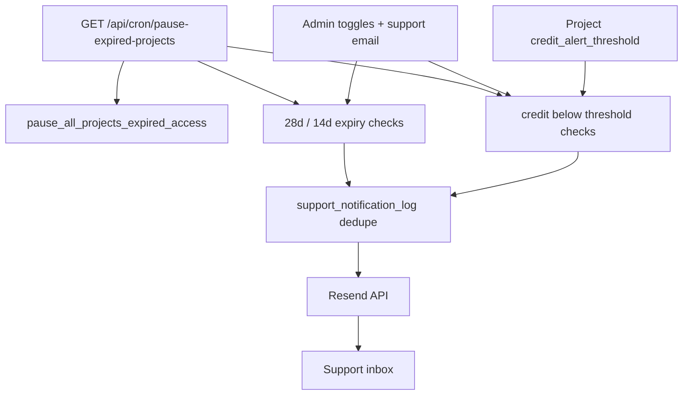

# Disrupt support email notifications — estimate & shaped plan

## Goal

Disrupt-facing **support inbox emails** for low credits and access expiry (4w / 2w), with **dashboard-admin** toggles and configurable support address. **Spec folder** (`agent-os/specs/…`) saved only **after estimate approval**.

**Estimate (revised): 1 dev-day** — tight MVP; polish and deferred items listed below.

---

## Confirmed scope

| Topic | Decision |
|-------|----------|
| Recipients | Disrupt support inbox (default [`smart-arse@disrupt-insight.com`](lib/support-contact.ts)) |
| Who configures | **Dashboard admins only** — no org/client overrides |
| Credit alert | Once per crossing — re-alert after balance restored **≥ threshold**, then drops below again |
| Credit threshold | Per project in project Settings → Credits ([`app/(dashboard)/projects/[id]/page.tsx`](app/(dashboard)/projects/[id]/page.tsx)) |
| Expiry reminders | 28d and 14d before `access_until` (UTC); **live** projects with date set |
| Provider | Resend |
| Visuals | Match existing settings patterns ([`components/settings/notifications-section.tsx`](components/settings/notifications-section.tsx)) |

---

## 1-day MVP (what ships)

### In scope (~8 hours)

1. **One migration** — `platform_settings` (singleton: `support_email`, three boolean toggles), `projects.credit_alert_threshold` (nullable int), `support_notification_log` (dedupe: `notification_type`, `project_id`, `event_key` unique).
2. **Resend** — `lib/email/send-support-notification.ts`, plain-text bodies, `RESEND_API_KEY` + `RESEND_FROM` env.
3. **Single daily cron** — extend [`app/api/cron/pause-expired-projects/route.ts`](app/api/cron/pause-expired-projects/route.ts) (or rename internally) to, in order:
   - Existing: `pause_all_projects_expired_access`
   - Send expiry emails when `utcCalendarDaysUntil(access_until)` is 28 or 14 (live + date set + toggle on + not logged)
   - Send credit-low emails when `credit_balance < credit_alert_threshold` and project not yet flagged in log; clear `credit_low` log row / flag when balance **≥ threshold** (enables re-crossing)
   - **No second Vercel cron entry**
4. **Admin page (minimal)** — one route, admin gate: support email field + 3 toggles with short descriptions; load/save singleton via Supabase (service role or admin RLS).
5. **Project settings** — one numeric field on Credits tab (admin only): “Email support when balance below”.
6. **README** — env vars + manual test steps (no Vitest suite in 1-day box).

### Credit alert timing (1-day tradeoff)

Emails are evaluated on the **daily cron** (same schedule as pause-expired: `0 2 * * *` UTC in [`vercel.json`](vercel.json)), not synchronously on every chat credit charge. Low-credit notice may arrive **up to ~24h** after the balance crosses the threshold. Acceptable for 1-day estimate; real-time send is post-MVP.

---

## Deferred (post–1-day / if Disrupt wants more)

| Item | Was in original ~8d plan |
|------|-------------------------|
| Real-time credit alert on `chat_results` / admin credit RPC paths | Immediate crossing detection |
| Separate cron route / 15m outbox poller | Faster credit alerts |
| Rich HTML templates + copy review cycle | Plain text only in MVP |
| Vitest coverage for date/dedupe helpers | Manual QA checklist |
| Align in-app meter warning (`CREDIT_BALANCE_WARNING_THRESHOLD = 50`) with per-project threshold | UI stays at 50 for now |
| Client/user notification settings | Out of scope |

---

## Architecture (1-day)

---

## Estimate for Disrupt

| | |
|--|--|
| **Total** | **1 dev-day** (~8 hours focused implementation) |
| **Calendar** | 1 day dev + Disrupt providing Resend domain/API key and approving plain-text copy |
| **Risk** | Resend domain not verified → emails blocked until ops ready |

**Stakeholder line:** “One day to wire Resend, daily checks for the three alerts, admin toggles, and per-project credit threshold; alerts run on the existing nightly job (not instant on each query).”

---

## Execution tasks (after estimate approval)

### Task 1: Save spec documentation (blocked until approved)

`agent-os/specs/2026-05-19-HHMM-disrupt-support-email-notifications/` — plan, shape, standards, references.

### Task 2: Migration + RLS (~1.5h)

Singleton settings, `credit_alert_threshold`, notification log.

### Task 3: Resend helper + 3 text templates (~1h)

### Task 4: Extend daily cron (~2h)

Pause + expiry + credit-low with dedupe / crossing reset logic.

### Task 5: Admin notifications page (~2h)

Toggles + support email.

### Task 6: Project credits threshold field (~1h)

### Task 7: README + manual QA (~0.5h)

---

## Product alignment

Supports admin-operated **credits & access lifecycle** already on the roadmap ([`agent-os/product/roadmap.md`](agent-os/product/roadmap.md)) — ops visibility when pools run low or engagements near end.

## Standards (for spec when saved)

- `javascript/auth-rbac`, `global/app-routing-protected-shell`, `global/project-conventions`
- Cron auth pattern from [`app/api/cron/pause-expired-projects/route.ts`](app/api/cron/pause-expired-projects/route.ts)

## Next step

Disrupt approves **1 dev-day** estimate → save spec (Task 1) → implement Tasks 2–7.
