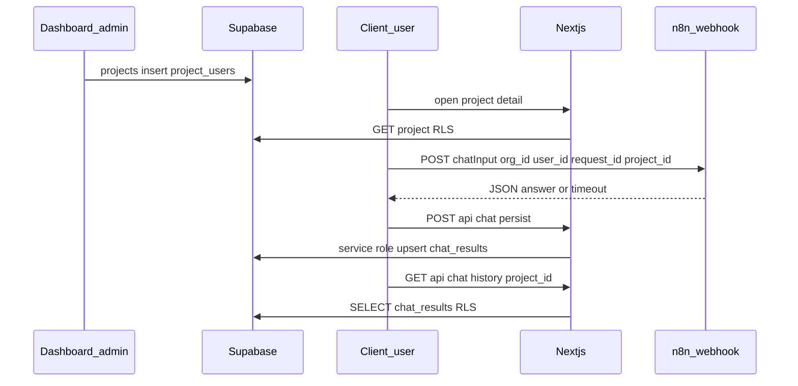

# From today to project-scoped chat history (with n8n)

## What is already built in the repo

- **Projects and assignment:** `[lib/supabase/projects.ts](lib/supabase/projects.ts)` (`createProject`, `assignProjectUser`, etc.) and dashboard UI (e.g. `[components/dashboard/project-create-dialog.tsx](components/dashboard/project-create-dialog.tsx)`, `[components/projects/project-users.tsx](components/projects/project-users.tsx)`). RLS in `[supabase/migrations/202603241900_projects_project_users_rls.sql](supabase/migrations/202603241900_projects_project_users_rls.sql)` and `[202603251200_fix_projects_rls_recursion.sql](supabase/migrations/202603251200_fix_projects_rls_recursion.sql)`: **role `user`** only sees projects they are on via `project_users`; **role `client`** can see all org projects.
- **Chat pipeline:** `[hooks/useChatQuestion.ts](hooks/useChatQuestion.ts)` — POST JSON to `NEXT_PUBLIC_N8N_URL` (or `NEXT_PUBLIC_N8N_WEBHOOK_URL`), then fire-and-forget `[POST /api/chat/persist](app/api/chat/persist/route.ts)`, then refresh history. On **85s timeout**, it polls `[GET /api/chat/poll](app/api/chat/poll/route.ts)` (expects an existing `chat_results` row updated to `complete` / `error_fallback`).
- **Project detail wiring:** `[app/client/projects/[id]/page.tsx](app/client/projects/[id]/page.tsx)` uses real chat when Supabase + user + project + `orgId` (`project.clientId` === `organization_id`) are present; `[useChatHistory](hooks/useChatHistory.ts)` calls `/api/chat/history?project_id=`.
- **Persistence:** `[app/api/chat/persist/route.ts](app/api/chat/persist/route.ts)` uses **service role** (`getSupabaseAdminClient`), validates the project exists and is **live** via the user-scoped Supabase client (so users who cannot `SELECT` the project get **404**), upserts on `request_id`, sets `user_id` from the session.

---

## 1. Environment (Vercel + local)

You already set the public webhook URL. Also confirm on **Vercel** (and locally for `/api/chat/persist`):

| Variable                                                     | Why                                                                                                                            |
| ------------------------------------------------------------ | ------------------------------------------------------------------------------------------------------------------------------ |
| `SUPABASE_SERVICE_ROLE_KEY`                                  | **Required** for persist (and `[/api/chat/n8n-complete](app/api/chat/n8n-complete/route.ts)`). Without it, upserts return 500. |
| `NEXT_PUBLIC_SUPABASE_URL` + `NEXT_PUBLIC_SUPABASE_ANON_KEY` | Already needed for auth and RLS-backed reads.                                                                                  |
| `CHAT_N8N_CALLBACK_SECRET` (or `N8N_CHAT_CALLBACK_SECRET`)   | **Only if** runs can exceed ~85s — enables the callback route (otherwise 503).                                                 |

Redeploy after changing server env vars.

---

## 2. Operational checklist (people/process)

1. **Dashboard admin:** Create org users (`[app/api/admin/users/route.ts](app/api/admin/users/route.ts)`), create project under that org, set project **live** (persist rejects **paused** / **archived** with `[PROJECT_NOT_LIVE_CHAT_MESSAGE](lib/project-status.ts)`).
2. **Assign users:** Add target **role `user`** accounts to `project_users` so they can open the project (RLS).
3. **End user:** Sign in → `/client/projects` → open project → send message. History should show rows where `user_id` matches and `project_id` matches (see `[app/api/chat/history/route.ts](app/api/chat/history/route.ts)`).

---

## 3. Supabase `chat_results` vs this app (your DDL)

Your pasted schema is **compatible in spirit** (unique `request_id`, `project_id` FK, `user_id`, `result_payload`, `status`). Watch these **drift risks**:

- **Primary key type:** Repo migration `[202603311200_chat_results.sql](supabase/migrations/202603311200_chat_results.sql)` uses `id uuid`; your table uses `**bigint identity`**. The app upserts on `**request_id\*\`only, so bigint`id`is fine as long as`request_id`is unique and columns used in`[persist/route.ts](app/api/chat/persist/route.ts)` exist.
- `**user_id` FK: You reference `auth.users`; repo uses `public.users`. In typical Supabase setups both IDs match; ensure your `public.users` row exists for each auth user (your app already relies on `public.users` for org/role).
- **Status vocabulary:** Poll treats `pending` / `processing` as in-flight; terminal states `**complete`** / `**error_fallback`**. Your default `complete`is fine for simple flows. Avoid a separate value like`**completed`**unless you extend the app — your partial index uses`status = 'completed'`, which **does not match** `complete` and may be a Disrupt typo (worth fixing in SQL for cache indexing only).
- **RLS:** Ensure policies like `[chat_results_select_visible](supabase/migrations/202603311200_chat_results.sql)` (org + `project_id` null or `auth_user_can_read_project`) are applied on the real DB so history matches the spec.

If the live DB predates smart-arse migrations, compare column nullability to what persist sends (e.g. `user_query`, `result_payload`, `weighted`, `data_source_mode`).

---

## 4. What the AI / n8n engineer should do

Point them at `**[agent-os/specs/2026-03-26-1400-project-chat-n8n-integration/disrupt-n8n-coordination.md](agent-os/specs/2026-03-26-1400-project-chat-n8n-integration/disrupt-n8n-coordination.md)`. Summary:

1. **Do not** INSERT/UPDATE `**public.chat_results` from n8n (Option B — Next owns writes).
2. **Webhook input:** Accept JSON with `chatInput`, `**org_id` (not `organization_id`), `user_id`, `request_id`, `sessionId`, `project_id`, `weighted`, `data_source_mode`, `qual_enabled` (see doc §2).
3. **Webhook response:** Return JSON with assistant text in `**answer`** (preferred), or legacy `**output`**/`\*\*response\*\`; optional `sources`, `status`, etc. (doc §3).
4. **Sync path:** Respond within ~**85s** with 200 + JSON so the browser can persist immediately.
5. **Long-running path:** If the workflow can exceed 85s, configure `**CHAT_N8N_CALLBACK_SECRET`** on Next and call `**POST https://<your-app>/api/chat/n8n-complete`**with the documented headers/body — ideally early with`status: "processing"`then final`complete`/`error_fallback`(doc §4). Without this, the client’s poll loop **never sees a row unless something else creates/updates`chat_results`for that`request_id`.

---

## 5. Optional product/engineering follow-ups (not blocking a first happy path)

- **Org settings:** `[app/client/projects/[id]/page.tsx](app/client/projects/[id]/page.tsx)` hardcodes `orgSettings` (`weighted`, `data_source_mode`, `qual_enabled`). For production parity, load real org flags from your DB or org profile when you have a source of truth.
- **Stricter persist (defense in depth):** Persist uses admin client; project visibility is enforced by the pre-check `SELECT` on `projects`. You could add an explicit `**project_users` check for role `user` if you want server-side parity beyond RLS.

---

## Shape-spec note

You invoked `**/agent-os/shape-spec`**. This response is the **plan**; it does not create a new dated spec folder under `agent-os/specs/` unless you want an addendum (e.g. “production rollout checklist”). The existing `**[2026-03-26-1400-project-chat-n8n-integration](agent-os/specs/2026-03-26-1400-project-chat-n8n-integration/)` folder already holds the n8n contract and plan.
