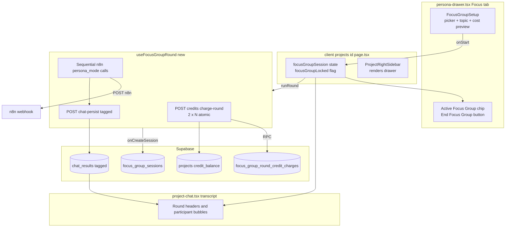

## Decisions locked in shaping

- **Credits**: match prototype exactly — `2 credits × participants` per round, atomic pre-deduction. Needs a new credit-charging path because the existing `chat_results` trigger ([`202604132000_chat_results_project_credit_charge.sql`](supabase/migrations/202604132000_chat_results_project_credit_charge.sql)) is hard-wired to `+1 per row` and follow-up turns use a separate `apply_project_credit_for_thread_merge` RPC ([`202604151200_merge_thread_credit_charge.sql`](supabase/migrations/202604151200_merge_thread_credit_charge.sql)). We'll add a new `apply_project_credit_for_focus_group_round` RPC that charges `2 × participants` idempotently per `round_request_id`, and we'll mark the per-response `chat_results` rows non-billable (`credits_charged = 0` from the start) so the existing trigger doesn't double-charge.
- **Webhook**: live n8n with client-side fan-out — one `persona_mode: true` call per participant per round, sequential, with prior-round + current-round context spliced into `persona_brief`. Reuse our existing `useChatQuestion` plumbing path but route through a new `useFocusGroupRound` hook (separate from `useChatQuestion` because of pre-flight credit deduction + multi-call orchestration).
- **Persistence**: extend `chat_results` — one row per participant response, plus a new `focus_group_sessions` parent table (for participants list + topic + round counter), and new tagging columns on `chat_results` (`focus_group_session_id`, `focus_group_round_number`, `focus_group_participant_index`). Each session keeps its own `thread_anchor_request_id` so rounds appear grouped in [`chat-history-card.tsx`](components/client/project-detail/chat-history-card.tsx).

## Reference implementations to mirror

- Picker UI scaffold already exists in [`components/client/project-detail/persona-drawer.tsx`](components/client/project-detail/persona-drawer.tsx) lines 1865–1987 (participant checkbox list, country pills, topic textarea, Start button).
- Active-state card pattern: mirror `AppliedCustomAudienceChip` ([`persona-drawer.tsx`](components/client/project-detail/persona-drawer.tsx) line 1247) and `appliedPersona` chip (lines 1215–1245) for the "Focus Group" sidebar card seen in the screenshot.
- Chat fan-out reference: [`agent-os/product/notes-archive/disrupt-mvp-frontend-handover_may-7-26/components/FocusGroupView.tsx`](agent-os/product/notes-archive/disrupt-mvp-frontend-handover_may-7-26/components/FocusGroupView.tsx) lines 128–278 (executeRound loop with prior-context splicing and stance modifiers).
- Brief composition reference: [`lib/persona-webhook-brief.ts`](lib/persona-webhook-brief.ts) — extend with a `buildFocusGroupParticipantBrief` helper that wraps the single-segment brief with the round context (`PREVIOUS DISCUSSION`, `OTHER PARTICIPANTS IN THIS ROUND SAID`, `RESPONSE STYLE` stance modifier).
- Credit-charge RPC pattern: model the new focus-group RPC on `apply_project_credit_for_thread_merge` ([`202604151200_merge_thread_credit_charge.sql`](supabase/migrations/202604151200_merge_thread_credit_charge.sql)) — idempotent insert into a charges table keyed by `round_request_id`, then `update projects set used_credits += N, credit_balance -= N`.
- Webhook payload composer: [`hooks/useChatQuestion.ts`](hooks/useChatQuestion.ts) lines 35–64 — reuse `ChatQuestionWebhookPayload` shape with `persona_mode: true` + `persona_brief`.

## Architecture

## Must-have user stories (in build order)

1. Open Personas drawer, Focus Group tab, see picker with 4 segments (size, concern, qual interview count) — already present.
2. Select 2–4 segments; 5th is blocked; Start button gated.
3. Country context pills (UK / KSA / Both, default Both) — already present.
4. Topic textarea capped at 300 chars with counter — already present.
5. See live credit-cost preview ("`N × 2 = X` credits per round") before starting.
6. Click Start; credits deducted atomically; if insufficient, no fan-out runs and a clear error shows.
7. Participants respond sequentially in the transcript with per-segment colored bubbles, round header, and "X is thinking…" indicator on the active speaker.
8. Right-rail shows active Focus Group chip (participant chips + Rounds/Voices counters + End Focus Group button) — matches the supplied screenshot.
9. Ask a follow-up question that becomes Round N+1, debiting credits again, building on prior rounds.
10. End Focus Group from the active chip clears session state and returns drawer to setup.
11. Focus group conversations appear in chat history with a focus-group icon/badge so users can revisit (basic — full restoration deferred).
12. Focus group rounds bypass citation rendering (responses are opinions, not RAG-grounded answers).
13. Cannot start a focus group while a single-segment or custom-audience session is active and vice versa — reuse the existing `personaLocked` / `customAudienceLocked` gating.

## Task breakdown

Task 1 is always "Save spec documentation" per `agent-os/shape-spec`.

## Task 1 — Save spec documentation

Create `agent-os/specs/2026-05-12-2305-focus-groups-mvp/` with:

- `plan.md` (this plan)
- `shape.md` (scope + decisions + visuals/references context)
- `standards.md` (full content of `domain-data-layer`, `project-conventions`, `ui-styling` from `agent-os/standards/`)
- `references.md` (pointers: handover bundle, persona-drawer Focus tab scaffold, custom-audience drawer pattern, useChatQuestion hook, chat_results migrations)
- `visuals/` containing the three screenshots already saved to `/Users/royalnashef/.cursor/projects/Users-royalnashef-Desktop-smart-arse/assets/` (setup state, active state, active state with sidebar card)

## Task 2 — Schema: focus group sessions + tagged chat_results + credit RPC

Add migration `supabase/migrations/<ts>_focus_groups.sql`:

- `create table public.focus_group_sessions (id uuid pk, project_id uuid, organization_id uuid, created_by uuid, participants jsonb, country_context text, initial_topic text, created_at, ended_at)` with RLS via `auth_user_can_read_project`, mirroring `project_custom_audiences` policies in [`202605072335_custom_audience_persistence_and_chat_metadata.sql`](supabase/migrations/202605072335_custom_audience_persistence_and_chat_metadata.sql).
- `alter table public.chat_results add column focus_group_session_id uuid references focus_group_sessions(id) on delete set null, add column focus_group_round_number int, add column focus_group_participant_index int` (all nullable; existing chats unaffected).
- Extend the `chat_context_mode` check constraint to allow `'focus_group'`.
- `create table public.focus_group_round_credit_charges (round_request_id uuid pk, project_id uuid, user_id uuid, charged_amount int, charged_at)` — idempotency table mirroring `chat_merge_credit_charges`.
- `create function public.apply_project_credit_for_focus_group_round(p_round_request_id uuid, p_project_id uuid, p_participant_count int) returns void` — `security definer`, inserts into the idempotency table with `charged_amount = 2 * p_participant_count`, decrements `projects.credit_balance` by that amount, returns updated balance via OUT param. Raises if `credit_balance < charged_amount` (so client gets 402-equivalent).
- Update the trigger function `chat_results_apply_project_credit` to **skip** rows with `focus_group_session_id is not null` (so per-response rows do not double-charge). Document in the comment.

## Task 3 — `/api/credits/charge-focus-group-round` API route

Create `app/api/credits/charge-focus-group-round/route.ts`:

- `POST` body: `{ project_id, session_id, round_request_id, participant_count }`.
- Auth: same Supabase client pattern as [`app/api/chat/persist/route.ts`](app/api/chat/persist/route.ts).
- Validates 2 ≤ participant_count ≤ 4 and `round_request_id` is a UUID.
- Calls `apply_project_credit_for_focus_group_round` RPC. Returns `200 { success: true, charged: 2*N, balance }` or `402 { success: false, error: "Insufficient credits", balance }` on shortage. Idempotent if the same `round_request_id` is replayed (returns `200 { idempotent: true }`).

## Task 4 — `/api/focus-group/sessions` API route

Create `app/api/focus-group/sessions/route.ts` (POST) and `app/api/focus-group/sessions/[id]/end/route.ts` (POST):

- `POST /sessions` body: `{ project_id, participants, country_context, initial_topic }` → inserts a `focus_group_sessions` row, returns the new session id. RLS-protected.
- `POST /sessions/[id]/end` sets `ended_at = now()`. No credit refund — matches prototype behavior.

## Task 5 — Brief composer + types

- Add to [`lib/persona-webhook-brief.ts`](lib/persona-webhook-brief.ts): `buildFocusGroupParticipantBrief(persona, { priorRounds, thisRoundResponsesSoFar, country, simulationMode: false })` returning the brief string. Uses the existing per-segment archetype + `STANCE_MODIFIERS` map (port from handover bundle [`FocusGroupView.tsx`](agent-os/product/notes-archive/disrupt-mvp-frontend-handover_may-7-26/components/FocusGroupView.tsx) lines 91–96).
- Add to [`lib/types.ts`](lib/types.ts): `FocusGroupParticipant`, `FocusGroupResponse`, `FocusGroupRound`, `FocusGroupSession` mirroring the handover types but using our `PersonaMock` for the persona reference (not the legacy `SegmentProfile`).
- Add `lib/credits.ts` (new file): `FOCUS_GROUP_CREDIT_COST_PER_PARTICIPANT = 2` and `getFocusGroupRoundCost(n) = n * 2`.

## Task 6 — `useFocusGroupRound` hook

Create `hooks/useFocusGroupRound.ts` modeled on [`hooks/useChatQuestion.ts`](hooks/useChatQuestion.ts):

- `executeRound({ session, topic, roundNumber, priorRounds, onParticipantStart, onParticipantResponse }) → Promise<FocusGroupRound>`.
- Step 1: generate one `round_request_id` (uuid). POST `/api/credits/charge-focus-group-round` — bail with typed error on 402.
- Step 2: for each participant `i` in sequence, call the n8n webhook via `getN8nWebhookUrl()` with `persona_mode: true`, `persona_brief = buildFocusGroupParticipantBrief(...)`, `request_id = ${round_request_id}-${i}`, and the standard project/org/user fields. Reuse the polling logic from `useChatQuestion`.
- Step 3: after each participant's answer arrives, POST `/api/chat/persist` with `focus_group_session_id`, `focus_group_round_number`, `focus_group_participant_index`, `chat_context_mode: "focus_group"`, `thread_anchor_request_id = ${round_request_id}-0` (so all participants in a round group under one anchor in chat history).
- Errors on individual participants insert a placeholder response (matching prototype) and do not refund credits.

## Task 7 — Wire focus group state into the page

Edit [`app/client/projects/[id]/page.tsx`](app/client/projects/[id]/page.tsx):

- Add `focusGroupSession: FocusGroupSession | null` state and a `focusGroupLocked = focusGroupSession !== null` flag.
- Add `handleStartFocusGroup(participants, topic, country)`: POSTs to `/api/focus-group/sessions`, sets state, triggers first round via `useFocusGroupRound`.
- Add `handleFocusGroupFollowUp(topic)` and `handleEndFocusGroup()`.
- Pass `personaLocked || customAudienceLocked || focusGroupLocked` into both drawers and into `ProjectRightSidebar` so the three modes remain mutually exclusive.
- Pass session + handlers down through `ProjectRightSidebar` → `ProjectSidebarTabs` → `PersonaDrawer`.

## Task 8 — Persona drawer: wire Start button + active chip

Edit [`components/client/project-detail/persona-drawer.tsx`](components/client/project-detail/persona-drawer.tsx):

- Wire the existing Start button (line 1974) to `onStartFocusGroup(focusParticipants, focusTopic, focusCountryContext)`.
- Add a credit-cost preview line above the button: "`N × 2 = X` credits per round" (port from [`FocusGroupSetup.tsx`](agent-os/product/notes-archive/disrupt-mvp-frontend-handover_may-7-26/components/FocusGroupSetup.tsx) lines 146–155).
- Add a new `appliedFocusGroup` branch in the chip header block at line 1247: render a `Focus Group` chip with stacked participant dots + `End Focus Group` button, matching the screenshot. Disable the three tab triggers when `focusGroupSession` is active, mirroring `personaLocked` gating already present at lines 1280, 1292.

## Task 9 — Render focus group rounds in the chat transcript

Edit [`components/client/project-detail/project-chat.tsx`](components/client/project-detail/project-chat.tsx) (and message renderer):

- Group adjacent messages sharing the same `focus_group_session_id` + `focus_group_round_number` under a `Round N: "topic"` sticky header.
- Render each participant response as a colored bubble (avatar = first letter on persona color disk; bubble border tinted with persona color), matching prototype `ResponseBubble` lines 56–87.
- Show a "X is thinking…" indicator during the round (driven by the `useFocusGroupRound` `onParticipantStart` callback).
- Suppress citation chips / source bar for `chat_context_mode === "focus_group"` rows (the existing context_mode check at the renderer level is the gate).

## Task 10 — Chat history surface

Edit [`components/client/project-detail/chat-history-card.tsx`](components/client/project-detail/chat-history-card.tsx) and the underlying history fetcher:

- Add a focus-group badge/icon (Users glyph) on rows where `chat_context_mode === "focus_group"`.
- Group by `focus_group_session_id`: one entry per session, showing initial topic + participant count + round count.
- Selecting a focus-group history entry restores the read-only session into the transcript (Must-have minimum: render the historical rounds; full re-entry into a live drawer state is a stretch story).

## Task 11 — Verification

- Smoke test: open a project, switch to Focus Group tab, pick 2 segments, type a topic, see "4 credits per round", click Start.
- Confirm `projects.credit_balance` drops by exactly 4 on Round 1, again on Round 2.
- Confirm `chat_results` rows are written with `focus_group_session_id` and `chat_context_mode = "focus_group"` and that `credits_charged` stays at 0 on those rows (trigger correctly skips them).
- Confirm the active chip renders in the right rail; End Focus Group clears state and the drawer returns to setup.
- Confirm tab triggers for Segments + Custom Audience are disabled while a focus group is live.
- Confirm rounds are visible in chat history with the focus-group badge.

## Out of scope for this iteration (stretch list)

- Real-interviewee participants (Digital Twin) — the type contract supports it, but UI only exposes segments.
- Simulation Mode toggle (HIGH/MEDIUM/LOW confidence labelling).
- Removing a participant mid-session.
- Full live re-restoration of a historical focus group into the drawer's active state.
- Per-segment tone variation testing — we'll port `STANCE_MODIFIERS` but won't tune them further.
