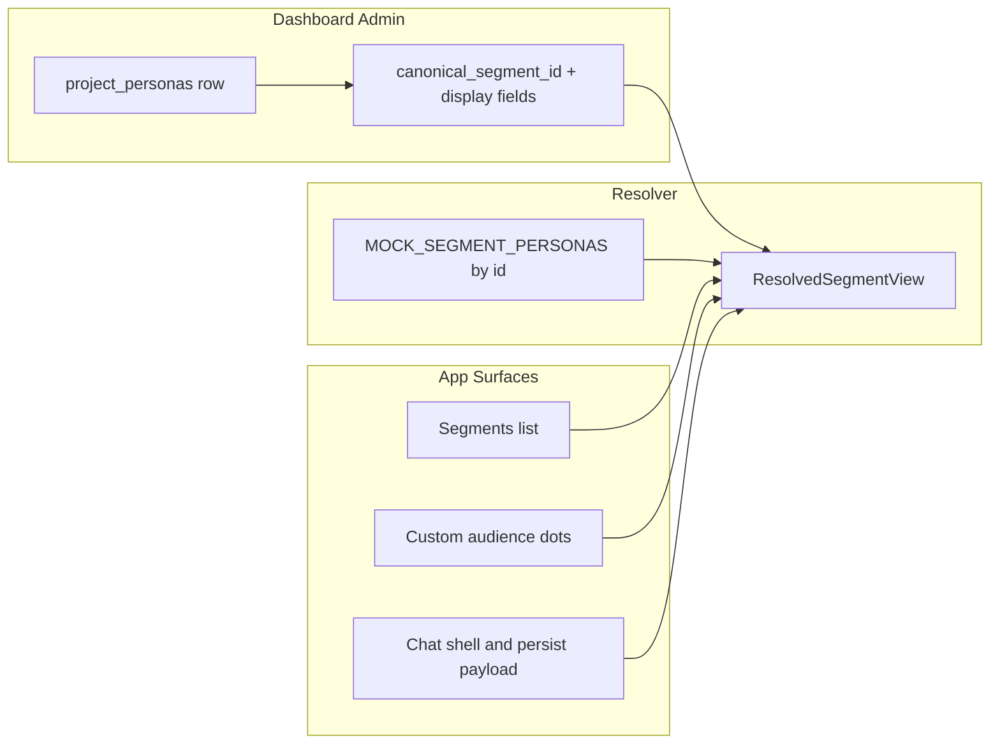

# Persona-backed segment display (fixed four slots)

## Product intent

- **Canonical segment identity** stays the existing four slugs ([`MOCK_SEGMENT_PERSONAS`](components/client/project-detail/persona-drawer.tsx) `id` values: `seg-do-nothing`, `seg-minimalists`, `seg-muddled-middle`, `seg-do-their-bit`). All filters, `chat_results.persona_segment_id`, custom-audience `childSegments[].id`, and dominant-segment logic keep using these ids—no UUID migration for segment identity.
- **Uploaded persona files** ([`project_personas`](supabase/migrations/202603311600_project_personas_storage.sql)) gain optional **binding** to exactly one canonical segment per project, plus admin-editable **display name**, **color token**, and **description** that override what users see in the Segments list and anywhere else those fields are resolved (dot stacks, chips, chat composer accents, denormalized `persona_segment_*` / audience snapshot fields when sending new messages).
- **Research-only mock fields** (survey n/pct, concern scores, voice quotes, suggested questions) remain sourced from [`MOCK_SEGMENT_PERSONAS`](components/client/project-detail/persona-drawer.tsx) by canonical id until a future spec moves them to the DB.

## Data model (Supabase)

Add columns on `public.project_personas` (single migration + comments + CHECK where needed):

| Column                 | Purpose                                                                                                                                                                                                                                                                                                            |
| ---------------------- | ------------------------------------------------------------------------------------------------------------------------------------------------------------------------------------------------------------------------------------------------------------------------------------------------------------------ |
| `canonical_segment_id` | Nullable. One of the four slug strings; **unique per `project_id` when not null** so at most one file binds a slot.                                                                                                                                                                                                |
| `display_name`         | Optional label for the segment card / UI (same semantics as [`project_documents.display_name`](supabase/migrations/202604131600_project_documents_display_name.sql)).                                                                                                                                              |
| `segment_description`  | Optional admin prose for list cards; when null, use mock `shortDescription`.                                                                                                                                                                                                                                       |
| `segment_color_token`  | Optional Tailwind palette token for dots/shell; **reuse the same allowlist** as [`project_documents.cite_color_token`](supabase/migrations/202605072220_expand_project_documents_cite_color_token_shades.sql) (single source of truth in app: [`lib/theme/cite-color-tokens.ts`](lib/theme/cite-color-tokens.ts)). |

RLS already allows project readers to `select` and admins to `update` ([`project_personas_*` policies](supabase/migrations/202603311600_project_personas_storage.sql)); no policy change unless you add a dedicated “client cannot change binding” constraint (admins-only updates already enforce edits).

## Resolution layer (single place to merge mock + DB)

Introduce a small module (e.g. `lib/personas/segment-display.ts` or extend [`lib/supabase/personas.ts`](lib/supabase/personas.ts)) that, given `canonicalSegmentId` + optional bound row:

- Returns a **resolved segment view** used by UI: `id` (canonical), `title`, `shortDescription`, `dotClassName` / `colorToken`, plus pass-through mock fields for stats/detail.
- **Fallback order**: DB `display_name` → mock `title`; DB `segment_description` → mock `shortDescription`; DB `segment_color_token` → [`PERSONA_SEGMENT_COLOR_TOKEN_BY_ID`](lib/theme/persona-segment-theme.ts) → product default.

Wire [`personaSegmentColorTokenForId`](lib/theme/persona-segment-theme.ts) (or a thin wrapper) to consult the same resolver so chat history helpers like [`chatHistoryPrimaryPersonaColorToken`](lib/theme/custom-audience-dominant-persona.ts) stay correct when tokens are no longer only the four hardcoded map entries.

## Admin dashboard (pattern parity with Documents)

- Extend [`lib/supabase/personas.ts`](lib/supabase/personas.ts): widen `personaSelect`, map new columns into [`UploadedFile`](lib/types.ts) (add optional fields with JSDoc mapping to DB, same style as document `displayName` / `citeColorToken`).
- Add update helpers mirroring [`updateProjectDocumentDisplayName`](lib/supabase/documents.ts) / [`updateProjectDocumentCiteColor`](lib/supabase/documents.ts): patch `display_name`, `segment_color_token`, `segment_description`, and `canonical_segment_id` with validation (allowed segment ids; uniqueness errors surfaced as friendly copy).
- UI: extend the Personas tab table in [`app/(dashboard)/projects/[id]/page.tsx`](<app/(dashboard)/projects/[id]/page.tsx>) / upload components (follow [`components/upload/sortable-project-documents-table.tsx`](components/upload/sortable-project-documents-table.tsx) patterns: swatch column, row actions / dialogs). Include a **“Represents segment”** control (four-way select + clear). Reuse the existing cite-color picker UX where practical to avoid two divergent palettes.

## Client app (Segments + chat)

- **Fetch** `project_personas` for the project on [`app/client/projects/[id]/page.tsx`](app/client/projects/[id]/page.tsx) (browser Supabase client; RLS already permits read for project members). Keep list ordered by `sort_order` for binding UI if needed; segment **cards** always render the **four canonical rows** merged with resolver output (unbound slot = pure mock display).
- Thread **resolved segments** (or the merge map) into [`PersonaPanel`](components/client/project-detail/persona-drawer.tsx) / [`MobilePersonaDrawer`](components/client/project-detail/mobile-persona-drawer.tsx) / [`project-chat.tsx`](components/client/project-detail/project-chat.tsx) so every `MOCK_SEGMENT_PERSONAS.map(...)` that drives labels or dots uses resolved data.
- **Dots / tokens**: replace the narrow [`customAudienceDotClass`](components/client/project-detail/persona-drawer.tsx) switch with a shared helper that maps any allowed `CiteColorToken` to `bg-{family}-{shade}` (or reuse an existing cite helper) so admin-picked shades beyond the original four render correctly.
- **Chat shell tone**: [`PERSONA_CHAT_TONE_BY_ID`](lib/theme/persona-chat-tone.ts) / drawer [`PERSONA_TONE_BY_ID`](components/client/project-detail/persona-drawer.tsx) should follow **resolved color**—either generate tone classes from the token’s family (similar to existing shadow CSS var usage) or fall back to `DEFAULT_CHAT_TONE` when token is null/unknown.
- **Persistence**: when sending chat / persist payloads ([`useChatQuestion`](hooks/useChatQuestion.ts), [`app/client/projects/[id]/page.tsx`](app/client/projects/[id]/page.tsx) persona segment block), set `persona_segment_name` and `persona_segment_color_token` from the **resolved** values so history rows match what the user saw. Custom-audience [`draftToSnapshot`](components/client/project-detail/persona-drawer.tsx) should emit `colorToken` / names from the resolver so new saves match UI.
- **Restore**: update [`page.tsx`](app/client/projects/[id]/page.tsx) logic that checks `MOCK_SEGMENT_PERSONAS.some(...)` for `persona_segment_id` so unknown ids still fail safe, but **known canonical ids always restore** even when display rows change later (name/color come from latest resolver at render time for “live” UI; historical row columns hold snapshot for past messages).

## Spec folder (Task 1 from /agent-os/shape-spec)

On approval, create `agent-os/specs/2026-05-11-1500-persona-segment-display-bindings/` with `plan.md`, `shape.md`, `standards.md`, `references.md`, and `visuals/` copies of:

- [`/Users/royalnashef/.cursor/projects/Users-royalnashef-Desktop-smart-arse/assets/image-8f9dc8ff-4039-40d2-bf9c-539b7d858304.png`](/Users/royalnashef/.cursor/projects/Users-royalnashef-Desktop-smart-arse/assets/image-8f9dc8ff-4039-40d2-bf9c-539b7d858304.png) (client Segments)
- [`/Users/royalnashef/.cursor/projects/Users-royalnashef-Desktop-smart-arse/assets/image-5e3149d9-83de-4190-b8b2-7fee5a9d50f5.png`](/Users/royalnashef/.cursor/projects/Users-royalnashef-Desktop-smart-arse/assets/image-5e3149d9-83de-4190-b8b2-7fee5a9d50f5.png) (admin Personas table)

Embed in `standards.md` the relevant bits from [`agent-os/standards/global/domain-data-layer.md`](agent-os/standards/global/domain-data-layer.md) (types + migration discipline).

## Mermaid: data flow

## Risks / edge cases

- **Unique binding**: inserting/updating a duplicate `canonical_segment_id` for the same project must show a clear error (“Another persona already represents this segment”).
- **Tailwind JIT**: new dynamic `bg-{token}` class strings may need to appear as static-friendly patterns (follow how cite colors are applied elsewhere) so production builds do not purge needed classes.
- **Optional `segment_description` length**: mirror document display name length guard (~500) or define a sensible max in migration CHECK.
