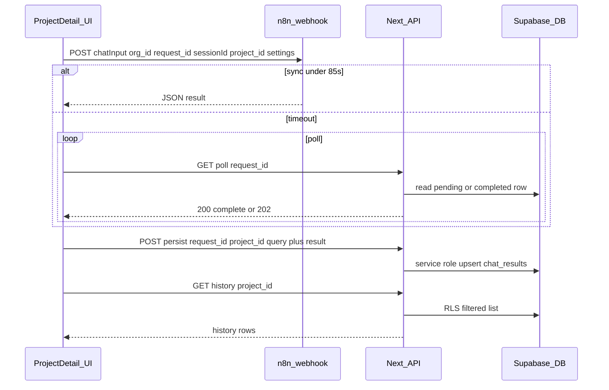

# Project-scoped smartA.R.S.E. chat integration

## Context (what exists today)

- **UI shell is ready:** `[app/client/projects/[id]/page.tsx](app/client/projects/[id]/page.tsx)` uses `[ProjectChat](components/client/project-detail/project-chat.tsx)` and `[ProjectRightSidebar](components/client/project-detail/project-right-sidebar.tsx)` → `[ChatHistoryMockList](components/chat/chat-history-mock-list.tsx)`. Sending a message only updates local React state; history is mocked (`MOCK_CHAT_HISTORY` / optimistic `chatHistoryItems` on first user message only).
- **No chat API in this repo yet:** `[app/api/](app/api/)` only has admin user routes. The flows in `[agent-os/product/dev-notes/chat-history-spec.md](agent-os/product/dev-notes/chat-history-spec.md)` and `[agent-os/product/dev-notes/original-developer-guidelines.md](agent-os/product/dev-notes/original-developer-guidelines.md)` describe routes that still need to be implemented here (`/api/chat/history`, `/api/chat/poll`, `/api/chat/persist`).
- `**chat_results` is not in repo migrations:** The sample schema in `[agent-os/product/data-examples/summary_chat_result_rows.md](agent-os/product/data-examples/summary_chat_result_rows.md)` / `[chat_results_rows.csv](agent-os/product/data-examples/chat_results_rows.csv)` is the target contract (`request_id`, `organization_id`, `user_query`, `status`, `result_payload`, `user_id`, flags, etc.) but **no `project_id` — that association is new work.
- **Product fit:** `[agent-os/product/mission.md](agent-os/product/mission.md)` and `[roadmap.md](agent-os/product/roadmap.md)` call for project-centric chat and Disrupt-coordinated AI integration.

## Locked decision: Option B (Next.js owns `chat_results`)

- **n8n:** Returns the AI JSON only (no Supabase insert/update). It may still use `project_id` / `org_id` / `request_id` inside the workflow for routing, logging, or calling other services — but **must not** be the writer of `chat_results`.
- **Next.js:** Uses **service role** (or a single server path) to **insert or upsert** each completed turn: `user_id` and `project_id` come from the authenticated session + validated project; `result_payload` and denormalized flags match the sample CSV contract.
- **Original “claim” step:** Replace with `**POST /api/chat/persist` (name can match legacy `/claim` if preferred): after the client receives a complete answer (direct webhook or via poll), it calls this route so the server writes one authoritative row. Fire-and-forget from the client remains acceptable; failures can be logged and optionally retried without blocking the UI message.
- **Poll (`GET /api/chat/poll`):** With Option B, polling must read **state that Next or a Disrupt callback maintains** — e.g. a `pending` row inserted by Next when the query starts, later completed by a server-side poller or an **n8n → Next webhook** on workflow completion. Document the chosen async path when Disrupt’s n8n is not strictly synchronous; do not assume n8n wrote to `chat_results`.

## Data model changes (Supabase)

1. **Table `chat_results`** (if not already present on the shared DB): align columns with the sample export; add:

- `**project_id uuid null references public.projects(id) on delete set null**` (or `cascade` if you prefer hard delete) — nullable for legacy/orphan pipelines.
- Ensure `**user_id**` is set on every row by **Next** at persist time (session-derived), not by n8n.

1. **RLS** (follow patterns in `[supabase/migrations/202603241900_projects_project_users_rls.sql](supabase/migrations/202603241900_projects_project_users_rls.sql)`):

- Users may **read** rows where `organization_id` matches their org **and** (`project_id` is null **or** they are in `project_users` for that project).
- **Writes** from the client should go through **route handlers with service role** or trusted server actions — not broad anon insert.

1. **Indexes:** `(user_id, project_id, created_at desc)` for history queries; `(request_id)` unique if not already.

## API surface (Next.js App Router)

Implement server routes consistent with [chat-history-spec.md](agent-os/product/dev-notes/chat-history-spec.md):

| Route                                     | Role                                                                                                                                                                                                                           |
| ----------------------------------------- | ------------------------------------------------------------------------------------------------------------------------------------------------------------------------------------------------------------------------------ |
| `GET /api/chat/history?page=&project_id=` | Paginated past questions for the session user, **filtered by `project_id` when present** (project detail tab). Reuse spec pagination (page size 5, max 20) and server-side dedupe rules.                                       |
| `GET /api/chat/poll?request_id=`          | Return completed result or 202 while pending by reading **DB state that Next maintains** (pending row + completion) or a thin proxy to Disrupt’s store — not “whatever n8n wrote to `chat_results`”.                           |
| `POST /api/chat/persist` (or `/claim`)    | Authenticated body: `request_id`, `project_id`, `user_query`, and normalized **result** (or enough to build `result_payload`). Server **upserts** `chat_results` with service role. Idempotent on `request_id` where possible. |

**Auth:** Use existing Supabase server client + session. Validate `project_id` belongs to the user’s org and `project_users` before persist/history. **Never** expose service role to the browser.

## Webhook + n8n contract

**Environment:** Align naming (`NEXT_PUBLIC_N8N_URL` vs `N8N_WEBHOOK_URL` from [tech-stack.md](agent-os/product/tech-stack.md) / developer guide) in one place in code.

**Payload (extend the documented body):**

- Existing: `chatInput`, `**org_id` (not `organization_id`), `request_id`, `sessionId`, `weighted`, `data_source_mode`, `qual_enabled`.
- **Add:** `project_id` (UUID string) for n8n routing/logging or future RAG context — **not** for n8n to write `chat_results`.
- **Optional later (out of this spec’s minimum):** selected document IDs for project RAG — only if Disrupt’s workflow supports it; mission mentions document-scoped chat.

**Response normalization:** Developer guide uses `output` for markdown; chat-history-spec uses `answer`. The **client adapter** should accept both and map to one internal `ChatWebhookResponse` shape (also handle bypass routes that use `response` per [summary_chat_result_rows.md](agent-os/product/data-examples/summary_chat_result_rows.md)).

**Timeouts:** 85s client timeout → poll with backoff per spec (80 attempts, 3s / 5s / 8s tiers).

## Client implementation (project detail)

1. `**sessionId`: One `useRef(crypto.randomUUID())` per project detail mount; reuse for all sends and re-runs on that page ([chat-history-spec.md](agent-os/product/dev-notes/chat-history-spec.md)).
2. **New/ported modules:** `sanitiseQuery` (spec — file not in repo yet); `[lib/group-by-date.ts](lib/group-by-date.ts)` already exists — align with spec if needed.
3. **Hooks:** `useChatHistory({ projectId })` fetching `/api/chat/history?project_id=…`; shared send + rerun logic (webhook POST → poll if needed → **persist** to save the turn).
4. **Wire `[ClientProjectDetailPage](app/client/projects/[id]/page.tsx)`:**

- On send: append user message, show loading state, call webhook flow, append assistant message from normalized payload (markdown rendering can stay minimal initially if UI is plain text today).
- On success: `refresh()` history so **Chat History** shows the new question (fix current behavior that only pushes history on “first” user message).
- Pass **live `chatHistoryItems`** from API into `[ChatHistoryMockList](components/chat/chat-history-mock-list.tsx)` (rename later if desired).
- **History click:** re-run same pipeline with sanitised `user_query` (spec).

## Out of scope (per your brief)

- Credits balance / consume.
- Persona mode payloads and UI (keep existing shell; do not integrate persona webhook fields).

## Coordination checklist (Disrupt / n8n)

- Confirm `chat_results` lives in the **same Supabase** project as auth/projects (smart-arse migrations + RLS).
- Confirm n8n workflows **do not** insert/update `chat_results` (remove or avoid that node if it exists).
- Confirm stable webhook response shape for the **persist** mapper (`answer` vs `output`, `response`, `sources`, `route`, flags).
- If queries can outlive the HTTP request: agree how completion reaches Next (e.g. n8n HTTP Request → `POST /api/chat/n8n-complete` with shared secret, or internal poll of a Disrupt endpoint) so `/api/chat/poll` and DB stay consistent.

## Diagram (target flow)

---

## Task 1 (spec folder — after approval)

Create `agent-os/specs/YYYY-MM-DD-HHMM-project-chat-n8n-integration/` with:

- **plan.md** — this plan (implementation tasks below).
- **shape.md** — scope, decisions (project-scoped history, **Option B persistence**), out-of-scope list.
- **standards.md** — excerpts from `[agent-os/standards/global/domain-data-layer.md](agent-os/standards/global/domain-data-layer.md)` and relevant project/RLS notes.
- **references.md** — links to dev-notes, CSV summary, and code paths above.
- **visuals/** — empty or placeholder if none.

## Implementation tasks (post–Task 1)

1. **Migration:** `chat_results` + `project_id` + indexes + RLS policies consistent with org + `project_users`.
2. **API routes:** `history`, `poll`, `persist` with validation; **service role only inside persist** (and poll if reading/updating pending rows server-side).
3. **Lib + hooks:** `sanitise.ts`, `chat-history.ts` client fetcher, `useChatHistory`, `useChatQuestion` (send + rerun + poll + persist).
4. **Types:** Extend `[lib/chat-history-types.ts](lib/chat-history-types.ts)` / `[lib/types.ts](lib/types.ts)` for webhook response normalization.
5. **Client project page:** Replace mock send/history with hooks; loading/error states per [chat-history-spec.md](agent-os/product/dev-notes/chat-history-spec.md) error table.
6. **n8n + Disrupt:** Ensure workflows do not write `chat_results`; align webhook JSON with the persist mapper; add callback or polling contract if async completions are required.
