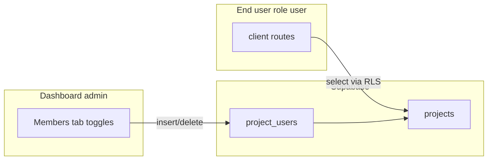

# Project member assignment and client access

## Current state

- **Schema:** `[public.project_users](supabase/migrations/202603241800_projects_project_users.sql)` links `(project_id, user_id)` to `[public.projects](supabase/migrations/202603241800_projects_project_users.sql)`.
- **Reads:** `[lib/supabase/projects.ts](lib/supabase/projects.ts)` already loads `assignedUserIds` from `project_users` for `listProjectsForAuthUser` and `getProjectById`.
- **RLS:** Admins can insert/delete `project_users` (`[project_users_insert_admin` / `project_users_delete_admin](supabase/migrations/202603241900_projects_project_users_rls.sql)`). Project visibility for end-users is centralized in `[auth_user_can_read_project](supabase/migrations/202603251200_fix_projects_rls_recursion.sql)`: `**client`** = same org (all org projects); `**user`** = same org **and a `project_users` row for that project. Document read access follows the same helper.
- **UI gap:** `[components/projects/project-users.tsx](components/projects/project-users.tsx)` only updates React state; copy still says Supabase save is unwired.
- **Client shell gap:** `[app/client/layout.tsx](app/client/layout.tsx)` only allows `user.role === "client"`. `[app/page.tsx](app/page.tsx)` sends any non-admin to `/client/projects`, so `**user` accounts bounce (`/` ↔ `/client/projects`). Assigned `user` rows in the DB never get a working client UI until this is fixed.

## Implementation

### 1. Supabase helpers for membership writes

In `[lib/supabase/projects.ts](lib/supabase/projects.ts)`, add small functions (same patterns as `createProject` / `deleteProject`: browser client, throw on error with clear messages):

- `**assignProjectUser(projectId, userId)**` — `insert({ project_id, user_id })` into `project_users`. Optionally ignore duplicate-key errors (idempotent assign).
- `**unassignProjectUser(projectId, userId)**` — `delete().eq('project_id', ...).eq('user_id', ...)`.

No migration required if policies are already deployed as in repo.

### 2. Wire `[ProjectUsers](components/projects/project-users.tsx)`

- On popover **Assign** / **Remove** confirm: call the appropriate helper, then update local state on success (or refetch `assignedUserIds` via a callback from the parent if you prefer a single source of truth).
- Handle errors with `toast.error` (already used on project pages).
- Add per-row or global **saving** state so toggles are not double-fired while a request is in flight; rollback optimistic state if the request fails.
- Replace the disclaimer with accurate copy (e.g. changes save immediately; inactive-user rules unchanged).

Optional: pass `onAssignmentsChange?: () => void` from `[app/(dashboard)/projects/[id]/page.tsx](<app/(dashboard)`/projects/[id]/page.tsx>) to refetch `getProjectById` after mutations so the rest of the page stays in sync with the database.

### 3. Allow `user` role in the client layout

In `[app/client/layout.tsx](app/client/layout.tsx)`:

- Treat `**client` and `user`** as allowed (still redirect `**admin\*\`to`/dashboard`).
- Redirect disallowed roles to `/` (or keep current behavior for anything else).

No change to RLS is required for the stated goal: `**user` visibility is already driven by `project_users`.

### 4. Product note (no code unless you want it)

- `**client`-role** org members already see **all org projects via RLS; rows in `project_users` for them are redundant unless you later tighten policies.
- If you ever want **assignment to restrict `client` accounts too**, that would be a **follow-up migration** changing `auth_user_can_read_project` and matching policies—not part of the minimal fix above.

## Verification

- As **admin:** toggle a `**user`-role org member on the Members tab; confirm row appears in `project_users` (Supabase table editor or SQL).
- As that **user:** sign in, land on `/client/projects`, see **only** assigned projects; open detail; confirm document list/download still respects RLS (same helper as projects).
