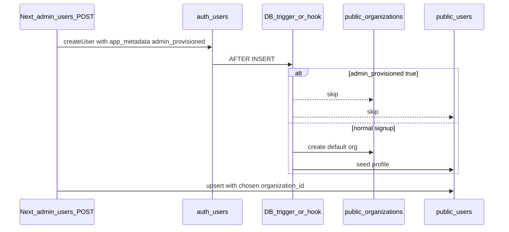

# Prevent duplicate organizations when admin creates users

## What the app already does

`[app/api/admin/users/route.ts](app/api/admin/users/route.ts)` calls `adminClient.auth.admin.createUser(...)` then `adminClient.from("users").upsert({ ..., organization_id: payload.organizationId, ... })`. There is **no** insert into `public.organizations` anywhere in this flow. The UI sends the selected org id from `[components/users/user-form-modal.tsx](components/users/user-form-modal.tsx)` via `[app/(dashboard)/users/page.tsx](<app/(dashboard)`/users/page.tsx>).

So the extra organizations (often named like the new person, e.g. "paul", "roy") are **not** coming from this repository’s application code.

## Likely root cause

A **Supabase-side** routine that runs on **new `auth.users` rows**—typically:

- A `TRIGGER` on `auth.users` `AFTER INSERT` calling a function that creates a default `public.organizations` row and/or seeds `public.users`, **or**
- An **Auth Hook** (HTTP or database) that does the same.

That runs for **both** self-signup and `auth.admin.createUser`, so admin provisioning still creates the “default” org. Your subsequent `upsert` then points `public.users` at the **chosen** org, leaving the auto-created org unused.

This logic is **not** present in `[supabase/migrations/](supabase/migrations/)` in the repo, so it was likely added in the Supabase SQL editor, an older template, or another branch—worth pulling into version control as part of the fix.

## Recommended fix (two parts)

### 1. Tag admin-created auth users in the API

In `[app/api/admin/users/route.ts](app/api/admin/users/route.ts)`, pass `**app_metadata` (not only `user_metadata`) on `createUser`, e.g. a boolean like `admin_provisioned: true`.

- **Why `app_metadata`:** It is not editable by the end user via normal client APIs, so it is a safer signal than `user_metadata` for “this row was created by our admin API.”

### 2. Change the Supabase trigger (or hook) to no-op for that tag

**First, capture what you have today** (Supabase SQL editor or CLI), for example:

- List triggers on `auth.users` and open the function body, **or**
- Check **Authentication → Hooks** if provisioning is done there.

**Then** add a **new migration** under `[supabase/migrations/](supabase/migrations/)` that:

- Replaces the trigger function so that **when** `coalesce((NEW.raw_app_meta_data->>'admin_provisioned')::boolean, false)` is true (or whatever key name you choose), the function **returns without** inserting into `public.organizations` and **without** inserting a conflicting `public.users` row (let the admin API own the profile row entirely).
- Keeps existing behavior for normal signups (no `admin_provisioned` flag).

Exact SQL depends on your current function; the migration should be a **drop/create or replace** of that function plus re-attach trigger if needed.

## Verification

- In staging: create a user via **Add User** with a known org; confirm **one** new `public.users` row and **no** new `public.organizations` row (or no new org named after the user).
- Regression: if you still use **email/password self-signup**, confirm a new signup **still** gets the intended default org + profile behavior (only if you rely on that path).

## Optional follow-up

- **Backfill:** Manually identify orphan orgs (0 members / 0 projects) and archive or delete—out of scope unless you want a scripted cleanup.
- **Version control:** Save the final trigger function into `supabase/migrations/` so local and remote stay aligned.
