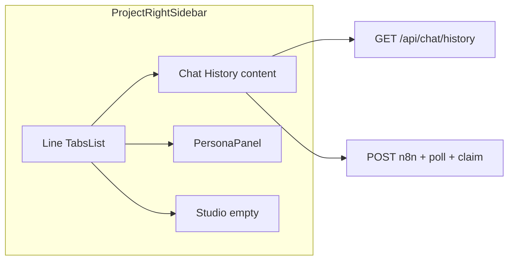

# Tabbed right sidebar + chat history

## Product and standards context

- **Feature spec:** [agent-os/product/dev-notes/chat-history-spec.md](agent-os/product/dev-notes/chat-history-spec.md) defines data contracts, components (`ChatHistorySidebar`, `HistoryGroup`, `HistoryItem`, skeletons), hooks (`useChatHistory`, `useRerunQuestion`), lib helpers, pagination, session id (`useRef(crypto.randomUUID())`), refresh rules, and webhook payload rules (**JSON key `org_id`**, sanitise before POST, claim fire-and-forget, polling 80 attempts).
- **API surface (documented, not yet present in repo):** [agent-os/standards/global/developer-guide.md](agent-os/standards/global/developer-guide.md) lists `/api/chat/history`, `/api/chat/poll`, `/api/chat/claim`, and `/api/org/settings` — **no `app/api/chat/*` routes exist today**; phase 2 must add or verify them against Supabase.
- **UI standards:** [agent-os/standards/css/ui-styling.md](agent-os/standards/css/ui-styling.md) (compose from `components/ui/*`, `cn`, feature folder for domain UI), [agent-os/standards/global/project-conventions.md](agent-os/standards/global/project-conventions.md) (`@/` imports, client boundaries, `sonner` for errors where appropriate).

## Current code (what changes)

- Right column: `[components/client/project-detail/personas-column.tsx](components/client/project-detail/personas-column.tsx)` — collapse rail + `[PersonaPanel](components/client/project-detail/persona-drawer.tsx)` with `onCollapseToRail` chevron.
- Page wiring: `[app/client/projects/[id]/page.tsx](app/client/projects/[id]/page.tsx)` — `personasColumnCollapsed` toggles `lg:grid-cols-*`; passes collapse props into `PersonasColumn`.
- Primitives: `[components/ui/tabs.tsx](components/ui/tabs.tsx)` — **default shadcn pill list only**; needs a `**variant="line"` on `TabsList` (and trigger styles) matching [shadcn Tabs — Line](https://ui.shadcn.com/docs/components/radix/tabs) (underline active tab, muted inactive).
- Mobile: `[components/client/project-detail/mobile-persona-drawer.tsx](components/client/project-detail/mobile-persona-drawer.tsx)` renders `PersonaPanel` only; `[project-chat.tsx](components/client/project-detail/project-chat.tsx)` exposes a mobile “Personas” control.

**Your choices (locked in):** default tab = **Chat History**; mobile = **same three tabs** (reuse one shell component).

---

## Task 1: Save spec documentation

Create `agent-os/specs/2026-03-26-tabbed-sidebar-chat-history/` with:

| File            | Purpose                                                                                                                                                                                                                                                                                                                     |
| --------------- | --------------------------------------------------------------------------------------------------------------------------------------------------------------------------------------------------------------------------------------------------------------------------------------------------------------------------- |
| `plan.md`       | This plan (or a shortened execution checklist)                                                                                                                                                                                                                                                                              |
| `shape.md`      | Scope, decisions (default tab, mobile parity, collapse removed temporarily), link to spec                                                                                                                                                                                                                                   |
| `standards.md`  | Full text or excerpts of `css/ui-styling`, `global/project-conventions`, and relevant `developer-guide` API rows                                                                                                                                                                                                            |
| `references.md` | Pointers to `personas-column`, `persona-drawer`, prior spec `[agent-os/specs/2026-03-19-1000-personas-right-column/](agent-os/specs/2026-03-19-1000-personas-right-column/)` if useful                                                                                                                                      |
| `visuals/`      | Copy workspace assets: `image-21014ce8-e4cb-470a-8a84-6550bfd18022.png`, `image-f4902d63-80e9-4880-8586-f766d0fb881d.png`, `image-de3e7f7b-3e6f-4388-b9d8-6b06be14d659.png` from `[.cursor/projects/.../assets/](file:///Users/royalnashef/.cursor/projects/Users-royalnashef-Desktop-smart-arse/assets/)` into this folder |

---

## Task 2: Line variant on `TabsList` / triggers

- Extend `[components/ui/tabs.tsx](components/ui/tabs.tsx)` using the same **cva** pattern as `[components/ui/button.tsx](components/ui/button.tsx)`: `TabsList` accepts `variant` (`default` `line`). For `line`: transparent background, no pill padding, bottom border on list; `TabsTrigger` uses **bold + bottom border / underline when `data-[state=active]`**, muted text when inactive.
- Keep **default variant** unchanged so existing usages (e.g. Segments / Audience / Focus inside `PersonaPanel`) stay pixel-stable.

---

## Task 3: Tabbed right-column shell (front-end only)

- Add a single client component (e.g. `project-right-sidebar.tsx` next to `personas-column.tsx`) that owns the **pink bordered shell** (`PERSONA_CHAT_SHELL_CLASS` + `border-arse-pink` — same as today’s column).
- Structure:
  - `Tabs` with `defaultValue="chat-history"`.
  - `TabsList variant="line"` with triggers: **Chat History**, **Personas**, **Studio** (labels can match title case in UI; triggers need stable `value` strings).
  - **Chat History** `TabsContent`: placeholder UI only — short description + use spec **empty state** copy (`"No questions yet. Ask something to get started."`) in an `EmptyPane`-style block consistent with `[EmptyPane` in persona-drawer](components/client/project-detail/persona-drawer.tsx) (dashed border, arse tokens).
  - **Personas** `TabsContent`: render `PersonaPanel` with `**onCollapseToRail` omitted (chevron already conditional in `[persona-drawer.tsx` ~365–374](components/client/project-detail/persona-drawer.tsx)).
  - **Studio** `TabsContent`: empty state (reuse `EmptyPane` or duplicate minimal pattern).
- **Layout:** `Tabs` should be `flex min-h-0 flex-1 flex-col`; content areas `min-h-0 flex-1 overflow-hidden` so inner `PersonaPanel` scroll regions keep working.

---

## Task 4: Remove collapsibility and simplify grid

- In `[app/client/projects/[id]/page.tsx](app/client/projects/[id]/page.tsx)`: remove `personasColumnCollapsed` / `setPersonasColumnCollapsed` and the **narrow rail** grid branch; use a single `lg:grid-cols-[minmax(0,1fr)_minmax(0,2fr)_minmax(0,1fr)]` (or equivalent) always.
- Replace `PersonasColumn` with the new tabbed shell component (or slim `PersonasColumn` down to a thin re-export if you prefer minimal churn).
- Delete unused collapse UI from `[personas-column.tsx](components/client/project-detail/personas-column.tsx)` if fully superseded, or keep file only as a barrel — **avoid dead code**.

---

## Task 5: Mobile — same three tabs

- Refactor so **desktop column and mobile drawer** both render the **same tabbed inner component** (props: `appliedPersonaId`, persona handlers; no collapse).
- Update `[mobile-persona-drawer.tsx](components/client/project-detail/mobile-persona-drawer.tsx)` to host that shell inside the existing slide-over (keep backdrop / transition behavior).
- Update `[project-chat.tsx](components/client/project-detail/project-chat.tsx)` mobile trigger: label/aria should reflect **sidebar/panel** scope (e.g. “Panel” or “Chat & personas”), not only “Personas”, since opening now lands on **Chat History** by default.

---

## Task 6: API routes and server behavior

- Implement (or align with existing backend if added elsewhere) `**GET /api/chat/history?page=`** returning `HistoryResponse` per spec; handle **401** / **400** / **500 as spec table.
- Ensure `**GET /api/chat/poll`** and `**POST /api/chat/claim\*\` exist and match the hook behavior in the spec (developer guide expectations).
- Use Supabase session from cookies; scope history by authenticated user / org as your schema requires (spec assumes server-side dedup and max 20 items, page size 5).

---

## Task 7: Lib + hooks

- Add `[lib/chat-history.ts](lib/chat-history.ts)`, `[lib/sanitise.ts](lib/sanitise.ts)`, `[lib/group-by-date.ts](lib/group-by-date.ts)` as specified.
- Add `[hooks/useChatHistory.ts](hooks/useChatHistory.ts)` and `[hooks/useRerunQuestion.ts](hooks/useRerunQuestion.ts)` per spec (env `NEXT_PUBLIC_N8N_URL`, timeout + poll backoff).

---

## Task 8: Chat history UI + page integration

- Add components under `components/chat/` (or `components/client/project-detail/` if you want colocation — spec suggests `components/chat/`; follow spec unless you document a deviation in `shape.md`):
  - `ChatHistorySidebar.tsx`, `HistoryGroup.tsx`, `HistoryItem.tsx`, `HistoryItemSkeleton.tsx`
- **Replace** the Chat History tab placeholder with `ChatHistorySidebar`.
- On `[app/client/projects/[id]/page.tsx](app/client/projects/[id]/page.tsx)`:
  - `sessionId` via `useRef(crypto.randomUUID()).current`.
  - Pass `**orgId`** from auth profile (`organization_id` from `[lib/auth-context.tsx](lib/auth-context.tsx)` / Supabase user row — value maps to webhook `**org_id\*\` key per spec).
  - Fetch org settings from `**GET /api/org/settings` (or existing hook if present) for `weighted`, `data_source_mode`, `qual_enabled`.
- `**onQuestionResult`: append assistant (and any user echo if needed) to `messages` using the webhook response shape from the spec; today’s `onSend` only pushes user messages — extend state updates so re-runs match the eventual production chat shape (markdown `content`, citations if your `ChatMessage` type supports them — adjust types minimally).
- **Refresh:** call history `refresh()` after successful new answer and after re-run completes (spec).
- **401 from history:** redirect to login (match existing app pattern).

---

## Task 9: QA checklist

- Desktop: line tabs match reference (active underline, inactive muted); Personas inner Segments/Audience/Focus tabs unchanged.
- No collapse chevron / rail; grid stable at `lg`.
- Mobile: opens to **Chat History**; can switch tabs; persona apply/clear still works.
- History: loading skeleton, empty state, pagination when `totalPages > 1`, error + retry; re-run disables all rows while in flight; `org_id` in JSON payload verified (network tab).

