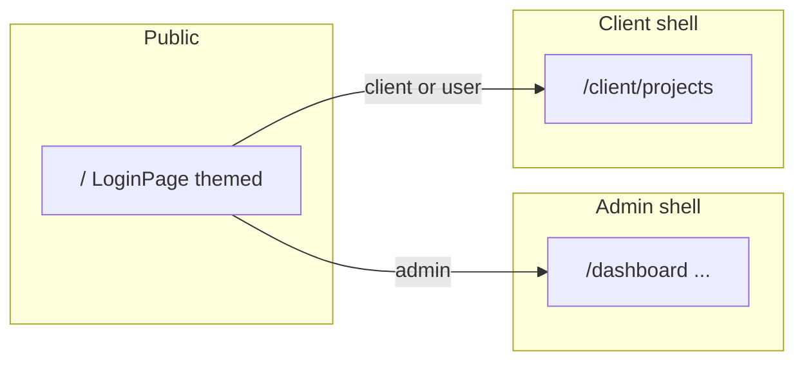

# Sign-in redesign, theme foundation, and client project list

## Decisions

- **Single sign-in UI** for everyone — replace the old split-screen login; both admin and client use the new smart A.R.S.E themed design (wireframe-level; no final illustration assets yet).
- **Post-login routing by role:** **admin** → existing `app/(dashboard)/` (sidebar, mint/dark). **client** and **user** → `/client/projects` (themed project list).
- **Auth** stays mock (`lib/auth-context.tsx`); this work only changes UI, theme tokens, routes, and redirects.

## Architecture

- **Theme split:** Login + client routes use Vivid Cyan `#00ffff`, Vivid Magenta `#ff0099`, black/white; fonts Vintage Goods (smart), Raleway (A.R.S.E / titles), DM Sans (body). Admin dashboard keeps current tokens (`mint-*`, `dark-*`, Inter).

## Tasks

| # | Task | Status |
|---|------|--------|
| 1 | Spec folder (`plan`, `shape`, `standards`, `references`, `visuals/`) | Done |
| 2 | Theme tokens + fonts (Tailwind/CSS, Raleway, DM Sans, Vintage Goods) | Done |
| 3 | Replace `components/login-page.tsx` + role-based redirect after login | Done |
| 4 | Client layout + `/client/projects` + `/client/projects/[id]` placeholder | Done |
| 5 | Dashboard layout: redirect client/user to `/client/projects` | Done |
| 6 | `app/page.tsx`: authenticated users — admin → `/dashboard`, client/user → `/client/projects` | Done |

## Out of scope

- Real auth / Supabase / middleware.
- Full project detail chat UI (reference mockup only).
- Final brand assets (robot, planet logo, etc.).

## Standards

See [standards.md](./standards.md). Honor `cn()`, lucide, protected-shell redirect patterns.
