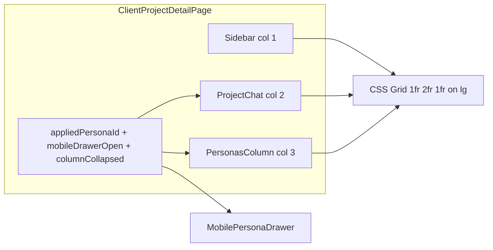

# Personas right column — Plan

## Goal

Move the **Personas** UI from an **in-chat overlay drawer** on desktop to a **dedicated third grid column** (1 : 2 : 1) on the client project detail page, with a **collapsible narrow rail** when collapsed. Below `lg`, keep an **overlay drawer** (closed by default). **Segments** remains the default tab. Lift **`appliedPersonaId`** (and apply/clear) to the page so chat and personas stay in sync.

## Non-goals

- Admin dashboard project chat (`app/(dashboard)/projects/[id]/`).
- Backend persistence, webhooks, or real segment data.

---

## Task 1: Save spec documentation

**Status:** Done — this folder contains `plan.md`, `shape.md`, `standards.md`, `references.md`, and `visuals/`.

## Task 2: Layout and state

- Update [`app/client/projects/[id]/page.tsx`](../../../app/client/projects/[id]/page.tsx): `lg` grid **three columns** `minmax(0,1fr) minmax(0,2fr) minmax(0,1fr)` (or equivalent 1-2-1).
- Add **`PersonasColumn`** (or similar) in `components/client/project-detail/`: expanded panel + **~48px rail** when collapsed; align height with **`ProjectChat`**.
- Lift **`appliedPersonaId`** and handlers to the page; pass props into chat and personas.

## Task 3: Panel and chat refactor

- Refactor [`components/client/project-detail/persona-drawer.tsx`](../../../components/client/project-detail/persona-drawer.tsx): desktop panel **without** X / `onClose`; optional close for **mobile** only.
- Strip drawer, overlay, and desktop reopen button from [`components/client/project-detail/project-chat.tsx`](../../../components/client/project-detail/project-chat.tsx); add **mobile-only** open control wired to page-level drawer.

## Task 4: QA

- Verify persona apply/clear, timeline events, input placeholder, **Segments** default, `lg` vs `<lg` behavior.

---

## Context summary

| Area | Detail |
|------|--------|
| Page | [`app/client/projects/[id]/page.tsx`](../../../app/client/projects/[id]/page.tsx) — today `lg:grid-cols-[20rem,1fr]` |
| Chat + drawer | [`components/client/project-detail/project-chat.tsx`](../../../components/client/project-detail/project-chat.tsx) |
| Personas content | [`components/client/project-detail/persona-drawer.tsx`](../../../components/client/project-detail/persona-drawer.tsx) — `defaultValue="segments"` |
| Prior work | [`../2026-03-18-1400-persona-drawer-chat/`](../2026-03-18-1400-persona-drawer-chat/) |

## Architecture

