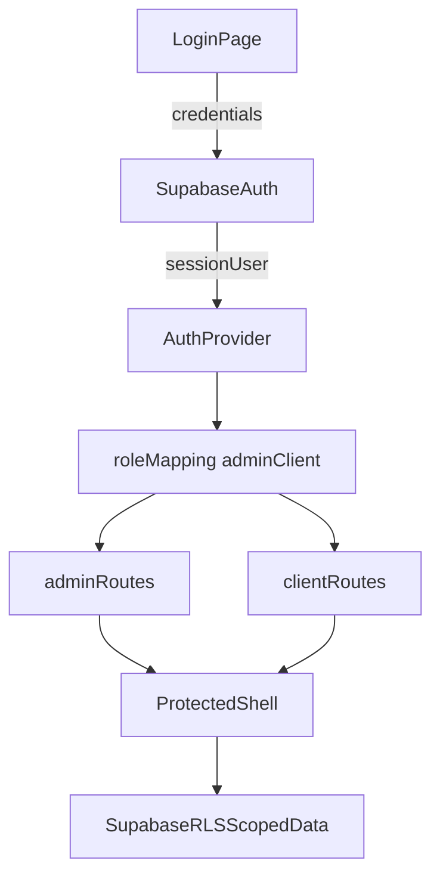

# Authentication RBAC Foundation Plan

## Scope

Implement authentication and role foundations for two active user types:

- `admin` (disrupt)
- `client` (researcher)

Out of scope for this spec:

- Admin dashboard UI for creating users (future spec)

## Product Alignment

This plan aligns with:

- [agent-os/product/mission.md](/Users/royalnashef/Desktop/smart-arse/agent-os/product/mission.md): role-separated admin/client experience.
- [agent-os/product/roadmap.md](/Users/royalnashef/Desktop/smart-arse/agent-os/product/roadmap.md): MVP Auth & access (login/session/RBAC/protected routes).
- [agent-os/product/tech-stack.md](/Users/royalnashef/Desktop/smart-arse/agent-os/product/tech-stack.md): Supabase Auth + RLS target, no service-role exposure in browser.

## Standards To Apply

- [agent-os/standards/javascript/auth-rbac.md](/Users/royalnashef/Desktop/smart-arse/agent-os/standards/javascript/auth-rbac.md)
- [agent-os/standards/global/app-routing-protected-shell.md](/Users/royalnashef/Desktop/smart-arse/agent-os/standards/global/app-routing-protected-shell.md)
- [agent-os/standards/global/project-conventions.md](/Users/royalnashef/Desktop/smart-arse/agent-os/standards/global/project-conventions.md)

## Reference Implementations

- [lib/auth-context.tsx](/Users/royalnashef/Desktop/smart-arse/lib/auth-context.tsx): current client-side auth API (`login/logout/isLoading`) and role-aware visibility helpers.
- [components/login-page.tsx](/Users/royalnashef/Desktop/smart-arse/components/login-page.tsx): current sign-in UX, role-based post-login routing, quick demo role entries.

## Visuals

- Existing reference screenshot:
  - `agent-os/specs/2026-03-17-1200-sign-in-client-theme/visuals/login-92f86370-3347-4a71-902c-6279755c3bea.png`

## Implementation Sequence

### Task 1: Save spec documentation (completed)

Create `agent-os/specs/2026-03-23-1200-auth-rbac-foundation/` with:

- `plan.md` - this execution plan
- `shape.md` - scope, decisions, product alignment, deferred items
- `standards.md` - included standards content + key constraints
- `references.md` - analyzed auth/login references + patterns to preserve
- `visuals/` - login screenshot reference

### Task 2: Define canonical auth role model and mapping (completed)

Update auth/domain types to explicitly support target roles and naming:

- Preserve technical role IDs for policy checks (`admin`, `client`)
- Add display labels/mapping for business names (`disrupt`, `researcher`)
- Remove reliance on legacy `user` role in primary app paths (keep temporary compatibility only where necessary during migration)

Target files:

- [lib/types.ts](/Users/royalnashef/Desktop/smart-arse/lib/types.ts)
- [lib/auth-context.tsx](/Users/royalnashef/Desktop/smart-arse/lib/auth-context.tsx)
- any role-dependent nav/page config discovered during implementation

### Task 3: Replace mock login session with Supabase-authenticated session source (completed)

Migrate authentication in app shell from mock lookup/sessionStorage payloads to Supabase session/user retrieval:

- Keep `useAuth` surface stable where possible (`user`, `isAuthenticated`, `isLoading`, `logout`)
- Rework `login` to use Supabase credentials flow
- Ensure hydration/loading and redirect behavior remain consistent with protected-shell standard
- Stop using mock-only session key as source of truth

Target files:

- [lib/auth-context.tsx](/Users/royalnashef/Desktop/smart-arse/lib/auth-context.tsx)
- [app/layout.tsx](/Users/royalnashef/Desktop/smart-arse/app/layout.tsx)
- [app/page.tsx](/Users/royalnashef/Desktop/smart-arse/app/page.tsx)
- [app/(dashboard)/layout.tsx](/Users/royalnashef/Desktop/smart-arse/app/(dashboard)/layout.tsx)

### Task 4: Enforce page-level role gating for admin/client routes (completed)

Add/align client-side route gates so:

- Admin-only surfaces are blocked for non-admins
- Client surfaces route only to authenticated client-role users
- Redirect behavior uses `router.replace` to avoid history loops

Target areas:

- `app/(dashboard)/**/page.tsx` (role-sensitive pages)
- sidebar/nav role filters to keep nav visibility in sync with route access

### Task 5: Align login flow to two-role model and destination routing (completed)

Update sign-in behavior for the active role model:

- Admin (`disrupt`) -> admin destination
- Client (`researcher`) -> client destination
- Keep UX/error behavior coherent during Supabase transition

Target file:

- [components/login-page.tsx](/Users/royalnashef/Desktop/smart-arse/components/login-page.tsx)

### Task 6: Verify and document deferred auth enhancements

Capture explicit follow-ups to prevent scope bleed:

- Deferred: admin dashboard user-creation UI/workflow
- Add acceptance checks for this spec's done-state (successful sign-in, role-appropriate redirect, protected-route denial)

## Data/Auth Flow (Target)

## Acceptance Criteria

- Users can sign in with Supabase-backed auth.
- Only two active roles are supported in app paths: `admin` and `client`.
- Role-based redirects route users to correct entry pages.
- Protected routes deny unauthorized roles with predictable redirect/blocked UX.
- Existing login shell behavior remains stable during hydration and redirects.
- Admin-created-user UI is documented as an explicit follow-up item, not implemented here.

## Task Status

- Task 1 - completed
- Task 2 - completed
- Task 3 - completed
- Task 4 - completed
- Task 5 - completed
- Task 6 - pending
