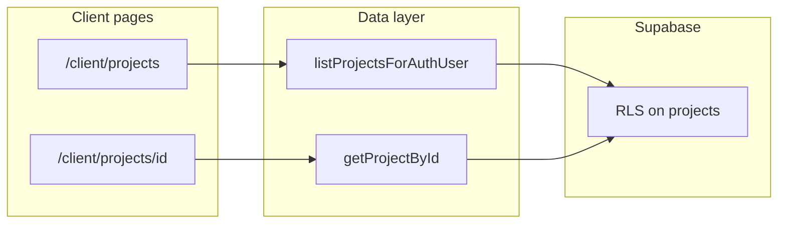

# Spec: Client projects list + detail (Supabase data)

## Visuals (from your screenshots)

Your list and detail screens align with the established client-theme mocks already in the repo. For Task 1 documentation, **save copies** (or reference paths) under the new spec’s `visuals/`:

- List: [agent-os/specs/2026-03-17-1200-sign-in-client-theme/visuals/project-list-9d8faa74-b076-455f-afed-467ed6121ad0.png](../2026-03-17-1200-sign-in-client-theme/visuals/project-list-9d8faa74-b076-455f-afed-467ed6121ad0.png)
- Detail: [agent-os/specs/2026-03-17-1545-client-project-detail/visuals/project-detail-d65f8e9f-8542-44c4-92a6-f17dc32071e5.png](../2026-03-17-1545-client-project-detail/visuals/project-detail-d65f8e9f-8542-44c4-92a6-f17dc32071e5.png)

If you pasted **different** files in chat, drop them into `visuals/` as `01-client-project-list.png` and `02-client-project-detail.png` when executing Task 1.

## Scope and constraints

**In scope (data for card + detail shell):**

| UI (screenshot)              | `Project` / Supabase source                                                                                                                                                                                                                                       |
| ---------------------------- | ----------------------------------------------------------------------------------------------------------------------------------------------------------------------------------------------------------------------------------------------------------------- |
| Pink date bar on card        | `createdAt` ← `projects.created_at`                                                                                                                                                                                                                               |
| Project title                | `name`                                                                                                                                                                                                                                                            |
| “Overview of project: …”     | `description`                                                                                                                                                                                                                                                     |
| Sources subline on card      | [components/client/client-project-card.tsx](../../../components/client/client-project-card.tsx) `sourceLine()` — today uses `uploadedFileIds.length`; Supabase path keeps `uploadedFileIds: []` until files are wired, so copy stays **“Sources: configure in dashboard”** |
| Detail “PROJECT DETAIL” card | [components/client/project-detail/project-detail-card.tsx](../../../components/client/project-detail/project-detail-card.tsx) — `name`, `description` only                                                                                                                 |

**Reference implementation:** Mirror loading/error/fallback pattern from [components/dashboard/projects-workspace.tsx](../../../components/dashboard/projects-workspace.tsx) and detail flow from [app/(dashboard)/projects/[id]/page.tsx](../../../app/(dashboard)/projects/[id]/page.tsx) using [lib/supabase/projects.ts](../../../lib/supabase/projects.ts) (`listProjectsForAuthUser`, `getProjectById`). **RLS** already restricts rows by role; no new policies for this spec.

**Out of scope unless added later:** Chat, persona column, Sources checkboxes, Chat history — remain mock ([app/client/projects/[id]/page.tsx](../../../app/client/projects/[id]/page.tsx)). **CREDITS** header block still uses `getClientForUser()` (mock org) unless you add a follow-up task to load `organizations.credit_balance` for the signed-in client.

**RBAC note:** [app/client/layout.tsx](../../../app/client/layout.tsx) only allows `role === "client"` on `/client/`. End users with `role === "user"` are redirected away; this spec targets **client** sessions only for these routes.

## ✅ Task 1: Save spec documentation — **DONE**

Create `agent-os/specs/2026-03-24-1800-client-projects-supabase-data/` with:

- **plan.md** — This plan
- **shape.md** — Scope, screenshot references, decision: project data first; credits/sources/chat deferred
- **standards.md** — Full text of: [agent-os/standards/global/domain-data-layer.md](../../standards/global/domain-data-layer.md), [agent-os/standards/javascript/auth-rbac.md](../../standards/javascript/auth-rbac.md), [agent-os/standards/global/app-routing-protected-shell.md](../../standards/global/app-routing-protected-shell.md), [agent-os/standards/global/project-conventions.md](../../standards/global/project-conventions.md)
- **references.md** — Links to dashboard wiring spec [agent-os/specs/2026-03-24-1600-projects-supabase-dashboard/plan.md](../2026-03-24-1600-projects-supabase-dashboard/plan.md), `projects.ts`, `projects-workspace.tsx`, client pages/components above
- **visuals/** — Screenshots (copied from paths above or your new files) + short README listing them

## ✅ Task 2: Wire client project list — **DONE**

**Delivered:** [app/client/projects/page.tsx](../../../app/client/projects/page.tsx) · [components/client/client-project-card.tsx](../../../components/client/client-project-card.tsx) (`ClientProjectCardSkeleton`)

- [x] When `getSupabaseBrowserClient()` and session `user` exist, load `listProjectsForAuthUser()` via `useEffect` + state (same `useRemoteProjects` pattern as [components/dashboard/projects-workspace.tsx](../../../components/dashboard/projects-workspace.tsx)).
- [x] Loading: grid of `ClientProjectCardSkeleton` (3 placeholders, one row at `lg`); errors: `toast.error`.
- [x] No Supabase or no user: fall back to `getVisibleProjects()` mock list.
- [x] Search still filters `name`, `description`, `clientName` over the resolved list.
- [x] Empty library vs search miss: **“No projects yet”** when the resolved list is empty; **“No projects match”** when search filters everything out.

## ✅ Task 3: Wire client project detail — **DONE**

**Delivered:** [app/client/projects/[id]/page.tsx](../../../app/client/projects/[id]/page.tsx) · [components/client/project-detail/client-project-detail-skeleton.tsx](../../../components/client/project-detail/client-project-detail-skeleton.tsx)

- [x] When `getSupabaseBrowserClient()` and session `user` exist, resolve project with `getProjectById(id)` (cancelled `useEffect`, `toast.error` on failure → treat as not found).
- [x] Loading: `ClientProjectDetailSkeleton` (client-themed layout; working **← Projects** link).
- [x] No Supabase / no user: fall back to mock `getVisibleProjects().find` by `id`.
- [x] **Not found** when remote returns `null`, fetch errors, missing mock id, or empty `id` param.
- [x] Chat, sources selector, personas, and CREDITS block unchanged (still mock where before).
- [x] Chat seed messages reset when `id` / `seededMessages` changes (fixes stale state when switching projects).

## Task 4: Narrow mock surface (optional cleanup)

Once client list/detail use live data, reduce reliance on `getVisibleProjects()` for real Supabase sessions (e.g. only used when client is null or Supabase missing). Document any remaining mock-only surfaces in `shape.md`.

## Task 5 (optional extension): CREDITS block

If product wants the screenshot **CREDITS** widget to match Supabase: add a small helper (e.g. fetch org row for `user.clientId` / `organization_id` with RLS-safe select) and replace `getClientForUser()` usage for **remaining/total** only—define numeric rules (`total` = `credit_balance`; `remaining` = balance minus aggregate used across projects or per product rule). **Skip** unless you confirm the billing semantics.

## Product alignment

[agent-os/product/mission.md](../../product/mission.md): client sees org-scoped projects; hybrid mock/Supabase state—this spec advances **project list/detail** toward Supabase without blocking on RAG/chat.

## Parent plan cross-link

After this spec ships, mark or link **Task 9** in [agent-os/specs/2026-03-24-1600-projects-supabase-dashboard/plan.md](../2026-03-24-1600-projects-supabase-dashboard/plan.md) to this folder for traceability.
