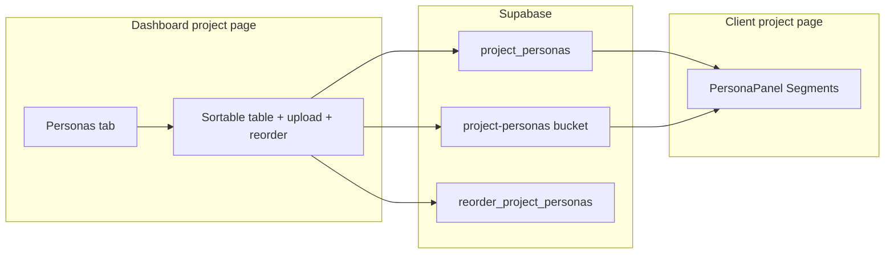

# Project Personas tab and Supabase

## Product alignment

This fits [agent-os/product/mission.md](../../product/mission.md): project-scoped artifacts that ground the assistant, with admins managing uploads and clients consuming project data within RLS.

## Visuals

- Reference screenshot: [visuals/01-dashboard-project-documents-tab-layout-reference.png](./visuals/01-dashboard-project-documents-tab-layout-reference.png) (Disrupt project page — Documents tab layout to mirror for Personas).

## Architecture

- **Parallel data path to documents**: Today [`lib/supabase/documents.ts`](../../../lib/supabase/documents.ts) implements list/upload/delete/reorder against `project_documents` + `project-documents` + `reorder_project_documents`. Personas will follow the same patterns in new [`lib/supabase/personas.ts`](../../../lib/supabase/personas.ts) (and a small helper for **signed read URLs** for client markdown preview).
- **UI reuse**: [`components/upload/sortable-project-documents-table.tsx`](../../../components/upload/sortable-project-documents-table.tsx) and [`app/(dashboard)/projects/[id]/page.tsx`](../../../app/(dashboard)/projects/[id]/page.tsx) (lines ~745–847) define the Documents experience. Add **optional string props** (or a single `labels` object) for section copy, empty state, and footer so one table component serves both resources without duplicating ~400 lines. Add `md` in `inferUploadedFileType` / icon map (e.g. `FileText`).
- **Upload**: Extend [`components/upload/file-dropzone.tsx`](../../../components/upload/file-dropzone.tsx) with optional `accept` + `typesDescription` (defaults = current document constants, which will include `.md` once `upload-config` is updated). New [`components/upload/persona-upload-config.ts`](../../../components/upload/persona-upload-config.ts) (or adjacent constants) restricting to `.md` only and same max size as documents. New hook [`use-supabase-project-personas-upload-flow.ts`](../../../components/upload/use-supabase-project-personas-upload-flow.ts) cloned from [`use-supabase-project-upload-flow.ts`](../../../components/upload/use-supabase-project-upload-flow.ts) but calling persona APIs and persona validation.

### Markdown (`.md`) support in upload components (shared + storage)

- **[components/upload/upload-config.ts](../../../components/upload/upload-config.ts)** — Add `md` to `ALLOWED_EXTENSIONS`, extend `FILE_UPLOAD_ACCEPT` (e.g. include `.md`), update `FILE_UPLOAD_TYPES_DESCRIPTION`, and extend `inferUploadedFileType` so validation, copy, and icons treat markdown like other research files. Any code path that calls `validateFileForUpload` / uses `FILE_UPLOAD_ACCEPT` (default `FileDropzone`, mock document hooks, `use-supabase-project-upload-flow`) then accepts `.md` without one-off bypasses.
- **[lib/supabase/documents.ts](../../../lib/supabase/documents.ts)** — In `uploadProjectDocument`, set `contentType` for `.md` uploads (e.g. `text/markdown` or `text/plain` when the browser leaves `file.type` empty) so Storage objects are labeled consistently.
- **Supabase `project-documents` bucket** — Add a small migration that updates `storage.buckets.allowed_mime_types` for `project-documents` to include `text/markdown` (and keep existing entries). `text/plain` may already cover some clients, but explicit `text/markdown` avoids rejects for strict MIME checks.
- **Personas tab** — Still use a **stricter** persona validator or `accept=".md"` on that dialog’s dropzone so only markdown lands in `project-personas`, while the **Documents** tab benefits from the shared `.md` allowlist above.
- **Mock/offline mode**: Mirror [`use-mock-project-documents.ts`](../../../components/upload/use-mock-project-documents.ts) with `useMockProjectPersonas` + optional seed rows in [`lib/mock-data.ts`](../../../lib/mock-data.ts) so the Personas tab behaves when Supabase is absent (same pattern as Documents).
- **Project delete**: [`lib/supabase/projects.ts`](../../../lib/supabase/projects.ts) `deleteProject` must also list `storage_path` from `project_personas` and remove them from the new bucket (same chunking pattern as documents).

## Supabase migration (new SQL file under [`supabase/migrations/`](../../../supabase/migrations/))

1. **`public.project_personas`** — same shape as `project_documents` ([`202603261200_project_documents_storage.sql`](../../../supabase/migrations/202603261200_project_documents_storage.sql)): `id`, `project_id` FK `on delete cascade`, `name`, `storage_path` unique, `size_bytes`, `mime_type`, `uploaded_by`, `uploaded_at`, `status` with same check, **`sort_order` `not null` default 0** (avoid a second migration).
2. **Indexes** — mirror document indexes (`project_id`, `(project_id, sort_order)`, `(project_id, uploaded_at desc)`).
3. **RLS** — same policy intent as `project_documents`: `select` for `auth_user_can_read_project(project_id)`; `insert`/`update`/`delete` for `is_dashboard_admin()`.
4. **Storage** — new private bucket `project-personas`, path shape `{project_id}/{persona_id}/{filename}`; `allowed_mime_types` including `text/markdown`, `text/plain`, `application/octet-stream` (browser MIME for `.md` is often empty/plain).
5. **Storage RLS** — copy pattern from `project_documents_storage_*` policies onto `project-personas`.
6. **`reorder_project_personas(p_project_id uuid, p_persona_ids uuid[])`** — same validation logic as [`reorder_project_documents`](../../../supabase/migrations/202603311500_project_documents_sort_order.sql), targeting `project_personas`.
7. **Extend `project-documents` MIME allowlist** — update `storage.buckets.allowed_mime_types` for `project-documents` to include `text/markdown` (preserve existing array) so Documents-tab `.md` uploads are not rejected at Storage.

## Dashboard UI ([`app/(dashboard)/projects/[id]/page.tsx`](../../../app/(dashboard)/projects/[id]/page.tsx))

- Insert tab `{ id: "personas", label: "Personas", icon: …, adminOnly: true }` **immediately after** `"uploads"` in the `tabs` array (order is Documents → **Personas** → Members).
- Duplicate the Documents tab’s state machine for personas: `remotePersonas`, merge hook, `personaOrderUnlocked`, `draftStablePersonaIds`, save/cancel/beforeunload + link interception (reuse messages with “persona order” wording or extract shared hook later — acceptable small duplication to stay focused).
- New upload dialog copy (“Upload personas”, markdown-only dropzone).
- `activeTab === "personas"` section mirroring layout of `"uploads"` (heading **Personas**, Sort Rows / Save Order / Upload, table).

## Client PersonaPanel ([`components/client/project-detail/persona-drawer.tsx`](../../../components/client/project-detail/persona-drawer.tsx) + [`app/client/projects/[id]/page.tsx`](../../../app/client/projects/[id]/page.tsx))

- Load `listProjectPersonas(id)` when `useRemoteDetail` (same pattern as [`listProjectDocuments`](../../../app/client/projects/[id]/page.tsx) ~129–154).
- **When remote + at least one persona**: In the **Segments** tab, replace `MOCK_SEGMENT_PERSONAS` list with rows ordered by `sort_order` (then `uploaded_at` as tiebreaker — matches list query). Cards show display name (e.g. filename without `.md`) and a compact status line.
- **When a markdown persona is applied**: Show a **new detail view** (not `PersonaDetailCard`, which assumes `PersonaMock` survey fields): title, optional markdown body loaded via `createSignedUrl` + `fetch`, loading/error states, clear/end session still calls `onClearPersona`.
- **When remote + zero personas**: Empty state in Segments (short copy pointing admins to upload personas).
- **When not remote** (demo): Keep existing `MOCK_SEGMENT_PERSONAS` behavior.
- Widen types: `appliedPersona` becomes a small discriminated union or parallel props (`appliedMockPersona` | `appliedMarkdownPersona`) so TypeScript stays honest; avoid forcing fake `PersonaMock` fields onto file-backed personas.

## Types / standards

- Reuse [`UploadedFile`](../../../lib/types.ts) for table rows if the persona mapper matches the document mapper (same UI shape). Note in [agent-os/standards/global/domain-data-layer.md](../../standards/global/domain-data-layer.md) that personas are project-scoped files analogous to documents.
- RLS/admin rules follow [agent-os/standards/javascript/auth-rbac.md](../../standards/javascript/auth-rbac.md) patterns already used for `project_documents`.

## Follow-ups (out of scope unless you want them in the same PR)

- Passing selected **persona id** (and eventually file content or storage path) into the real chat/n8n payload — only ensure **UUID `personaId`** in existing `personaEvents` refers to `project_personas.id` when a file persona is active.
- YAML frontmatter parsing for richer titles/descriptions on the client.
