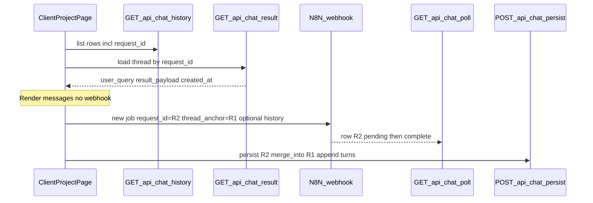

# Chat history: load thread and continue without a new row

Condensed execution plan. Scope, decisions, and product contradictions live in [`shape.md`](shape.md). Pointers in [`references.md`](references.md).

## Problem (current behavior)

- [`components/client/project-detail/chat-history-card.tsx`](../../../components/client/project-detail/chat-history-card.tsx) calls `onQuestionSelect?.(item.user_query)` on click.
- [`app/client/projects/[id]/page.tsx`](../../../app/client/projects/[id]/page.tsx) `handleHistoryQuestionSelect` appends a **user** message and calls `submitQuestion(question)` when `useRealChat` is true — which runs a **new** n8n job with a **new** `request_id` and [`useChatQuestion`](../../../hooks/useChatQuestion.ts) always `postPersist`s a **new** [`chat_results`](../../../supabase/migrations/202603311200_chat_results.sql) row.
- The history API strips identity: [`buildHistoryResponse`](../../../lib/api/chat-history-server.ts) maps rows to a **numeric** `id` via `stableIdFromRequestId` and does **not** return `request_id`, so the client cannot fetch “this exact row” (and dedupes by **trimmed `user_query`**, which collapses distinct threads with the same text).

## Target behavior

1. **Click history item** → fetch that stored result, replace (or hydrate) the center timeline with the **saved** user + assistant turn(s) for that item — **no** webhook call, **no** new DB row.
2. **Send a follow-up** while a thread is active → still use a **fresh** `request_id` for polling/async (unchanged contract with [`/api/chat/poll`](../../../app/api/chat/poll/route.ts)), but **persist** merges the new assistant outcome into the **anchor** `chat_results` row so the sidebar does not gain a new line for that continuation.
3. **Product/data note:** Today each row is effectively **one** Q/A pair ([`summary_chat_result_rows.md`](../../product/data-examples/summary_chat_result_rows.md)). “Full conversation” for **legacy rows** = that pair until multi-turn data exists.

## n8n: two paths

| Path | What we ship | AI context quality |
| ---- | ------------ | ------------------- |
| **A (recommended default)** | App sends a **thread anchor** (`request_id` of first row) and a **structured prior messages** array (or minimal transcript) in the webhook body; n8n updated to feed the model | Best |
| **B (interim)** | App merges DB/history only; n8n still gets isolated `chatInput` per message until the workflow changes | Weaker until n8n catches up |

The implementation ships **server + client persistence and hydration** so Path B works structurally; add a **documented webhook payload extension** for Path A in this spec and [`../2026-03-26-1400-project-chat-n8n-integration/`](../2026-03-26-1400-project-chat-n8n-integration/) handoff-style notes.

## Architecture (high level)

**Merge rule (conceptual):** Upsert the **job** row by `R2` for polling if the pipeline still writes per-job rows, **or** (cleaner long-term) only update **R1** after completion and avoid a durable second row — exact choice depends on whether [`/api/chat/n8n-complete`](../../../app/api/chat/n8n-complete/route.ts) always inserts by `request_id`. The implementation must **reconcile client `persist` with n8n callback** so you do not end up with duplicate or orphan rows (inspect current write paths and pick one idempotent strategy).

## Task checklist

| Task | Description |
| ---- | ----------- |
| **1** | This folder: `plan.md`, `shape.md`, `standards.md`, `references.md`, `visuals/` |
| **2** | History API and types: `request_id` on items; stop query-text dedupe; order by `created_at` desc |
| **3** | Thread hydration: e.g. `GET /api/chat/result?request_id=&project_id=` + `lib/chat-result.ts` helper |
| **4** | Persist merge: optional `thread_anchor_request_id`; merge into anchor; align with n8n-complete |
| **5** | Transcript in `result_payload.messages[]` + serialize/deserialize/append helpers |
| **6** | Client: history passes `request_id` / item; `activeThreadRequestId`; no `submitQuestion` on history click |
| **7** | QA: update smoke checklist — history click no duplicate row; follow-up single sidebar line |

## Product alignment

- Matches mission: **auditable, project-scoped** chat ([`mission.md`](../../product/mission.md)).
- Supersedes the “click re-runs webhook” behavior in [`chat-history-spec.md`](../../product/dev-notes/chat-history-spec.md) for the **client** project page (keep or adapt any admin/dashboard rerun behavior separately if it still exists).
