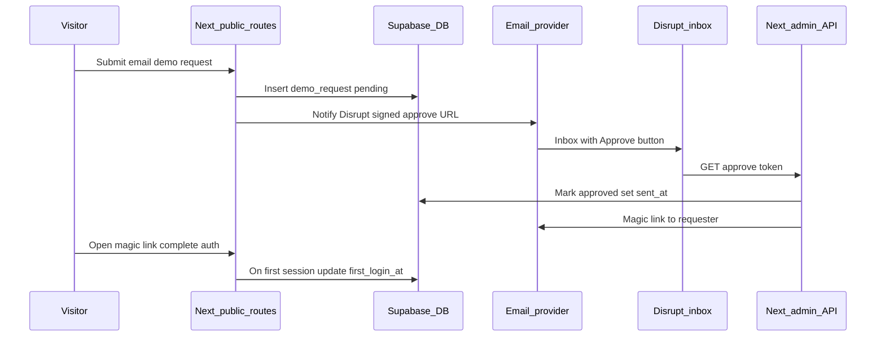

# Demo magic-link signup with manual approval and minimal analytics

Condensed execution plan. Scope and decisions live in [`shape.md`](shape.md). Standards in [`standards.md`](standards.md). Code pointers in [`references.md`](references.md).

## Context from the codebase

- **Auth today:** Email/password via [`components/login-page.tsx`](../../../components/login-page.tsx) and [`lib/auth-context.tsx`](../../../lib/auth-context.tsx); password reset uses `resetPasswordForEmail` (Supabase). **No OTP/magic-link flow exists yet.**
- **Admin provisioning:** [`app/api/admin/users/route.ts`](../../../app/api/admin/users/route.ts) uses the service-role client and sets `admin_provisioned` so [`handle_new_user`](../../../supabase/migrations/202603281000_auth_users_drop_all_custom_triggers_and_harden_skip.sql) **does not** auto-create an org. Approved demo users should follow the same pattern: create/link `auth.users` with `admin_provisioned`, then upsert `public.users` with the **shared demo `organization_id`** (fixed org seeded in DB or configured via env).
- **RBAC:** Roles and routing follow [`agent-os/standards/javascript/auth-rbac.md`](../../standards/javascript/auth-rbac.md); new admin-only UI must use existing patterns (e.g. [`requireDashboardAdmin`](../../../lib/api/require-dashboard-admin.ts) for APIs, page-level gates for admin routes).

## Product alignment

- Fits mission: controlled access to a **project-centric workspace** for a website-advertised demo, without opening self-serve org sprawl.
- **Shared demo org:** All approved users share one org and the same seeded demo project(s); RLS continues to scope by `organization_id`.

## Proposed end-to-end flow

**Approve action (recommended):** Server route validates a **signed, expiring token** (HMAC/JWT with server secret) embedded in the Disrupt email link—**no Disrupt login required** for the click (simplest for “button in email”). Optionally add a second confirmation in-dashboard later.

**Magic link delivery:** Use **Supabase Admin** [`generateLink`](https://supabase.com/docs/reference/javascript/auth-admin-generatelink) with `type: 'magiclink'` (or equivalent) after approval, then send that URL via your transactional email provider (Resend, SendGrid, etc.—**new integration** unless you standardize on Supabase-only emails for one leg only). Alternatively, Supabase SMTP for the user magic link only and a separate provider for Disrupt notifications—document the choice when implementing.

**User creation on approve:** `auth.admin.createUser` (or `inviteUserByEmail` if you prefer invites) with **`admin_provisioned: true`** so the existing trigger does not create a stray org; immediately **upsert `public.users`** with role appropriate for demo (likely `user` or `client`) and **`organization_id` = demo org**.

**First login timestamp:** Update `first_login_at` once—e.g. in a small server hook on session establishment, or a DB trigger on first `auth.users` sign-in if available; simplest is an API called from the post-auth redirect handler when `first_login_at` is null.

## Data model (minimal analytics)

New table, e.g. `demo_access_requests` (exact name in migration):

| Column | Purpose |
|--------|---------|
| `id` (uuid) | Primary key |
| `email` (citext or normalized text) | Requester |
| `status` | `pending` / `approved` / `rejected` (optional for v1) |
| `requested_at` | Default now |
| `approved_at` | Set when Disrupt approves |
| `magic_link_sent_at` | When link emailed to requester (**minimal “sent”**) |
| `first_login_at` | First successful auth completion (**minimal “used”**) |
| `reject_reason` / `notes` | Optional; skip if out of scope |

Indexes on `email`, `status`, `requested_at`. **RLS:** public insert only via controlled RPC or service role from Next API; no broad anon read. Admin read via existing admin patterns + policies.

## Application work (high level)

1. **Public demo request page** — New route (e.g. `app/demo/request` or marketing path); **layout/copy modeled on** [`components/login-page.tsx`](../../../components/login-page.tsx) with email-only form and success state (“We’ll email you if approved”).
2. **API routes** — `POST` create request + send Disrupt notification; `GET` or `POST` approve (token); optional `reject`; rate limiting and generic responses (no email enumeration).
3. **Email** — Templates: (A) Disrupt: request details + approve button URL; (B) Requester: magic link body (or rely on Supabase template if using hosted magic link only).
4. **Dashboard** — Admin-only page listing requests with columns: email, status, requested, approved, link sent, first login; filter/sort; link to existing nav/sidebar pattern under admin shell.
5. **Config** — Env vars: `DEMO_ORGANIZATION_ID`, notification recipient(s), token signing secret, email provider keys; document in README/env example.

## Implementation tasks (remaining — not started)

1. **Task 2:** Add `demo_access_requests` table + RLS/policies; ensure shared demo org exists or document seed; optional unique/index rules for email+pending.
2. **Task 3:** Public demo request page + POST API + Disrupt notification email with signed approve URL.
3. **Task 4:** Approve route: verify token, createUser/invite with `admin_provisioned`, upsert `public.users` to `DEMO_ORG_ID`, `generateLink` magiclink, send email, set `magic_link_sent_at`.
4. **Task 5:** Set `first_login_at` on first authenticated session for demo users.
5. **Task 6:** Admin dashboard list UI + read API for `demo_access_requests` with filters.
6. **Task 7:** Env vars, Supabase redirect config, README notes; manual QA checklist.

## Risks / estimate notes

- **Transactional email:** If none exists in repo, factor setup + DNS (SPF/DKIM) and template iteration.
- **Supabase redirect URLs:** Add demo callback URLs to Supabase Auth settings for magic links.
- **Duplicate requests:** Same email re-requesting—define idempotency (reuse pending row vs new row).
- **Competitor friction:** Signed approve links must be unguessable and short-lived; consider optional second-factor for Disrupt (future).
