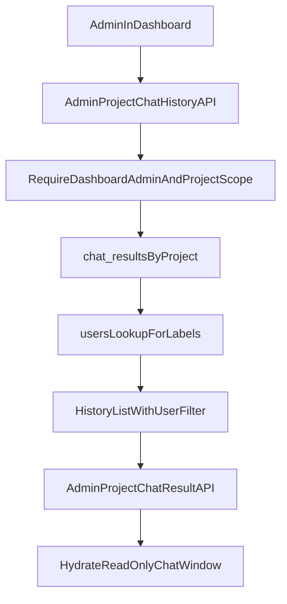

# Admin Project Chat History Plan

## Goal

Enable admins to open a project in the dashboard and view chat history for all users who chatted with smartARSE about that project, with user filtering/thread selection and read-only timeline hydration.

## Confirmed Scope

- New feature in the dashboard project detail Chat tab.
- Admin can view all project-user conversations.
- Admin can filter/switch by user.
- Admin can inspect full thread context per selected history item.
- Read-only behavior (no admin send/reply) remains.

## Key Existing Touchpoints

- Current dashboard chat tab is mock/local state in `app/(dashboard)/projects/[id]/page.tsx`.
- Current history/result APIs are user-scoped in:
  - `app/api/chat/history/route.ts`
  - `app/api/chat/result/route.ts`
- Reusable thread hydration exists in:
  - `lib/chat-thread.ts`
  - `components/chat/chat-window.tsx`

## Implementation Plan

### Task 1: Save spec documentation

Create `agent-os/specs/2026-04-09-0937-admin-project-chat-history/` with:

- `plan.md` (this plan)
- `shape.md` (scope/decisions/context)
- `standards.md` (confirmed standards content)
- `references.md` (prior specs + code references)
- `visuals/` (include provided screenshot reference)

### Task 2: Define admin history data contract

- Add an admin-specific history/result contract (separate from existing client self-history semantics).
- Include fields needed for cross-user visibility: `request_id`, `user_id`, user display label, `user_query`, `created_at`, `status`.
- Keep pagination explicit and deterministic for project-level history.

### Task 3: Add admin-only server APIs for project-wide chat visibility

- Add dedicated dashboard admin routes (do not repurpose existing client endpoints):
  - e.g. `GET /api/admin/projects/[id]/chat-history`
  - e.g. `GET /api/admin/projects/[id]/chat-result`
- Enforce admin + org/project checks with `requireDashboardAdmin` and project membership/org alignment.
- Query `chat_results` by `project_id` (not caller `user_id`), join/resolve user metadata safely.
- Preserve client `/api/chat/*` behavior unchanged.

### Task 4: Wire dashboard Chat tab to real history and thread hydration

- Replace mock conversation list in `app/(dashboard)/projects/[id]/page.tsx` with admin history fetch state.
- Reuse/extend `components/chat/chat-sidebar.tsx` to show per-row user attribution and filter/switch controls.
- On history selection, fetch full stored result and hydrate `components/chat/chat-window.tsx` using existing thread parsing utilities.
- Keep chat input hidden/disabled for admins.

### Task 5: UX states and constraints

- Add loading, empty, and error states for:
  - no project history
  - no matches for selected user filter
  - failed history/result fetch
- Maintain stable selected thread and clear selection behavior when filter/page changes.
- Ensure project paused/archived states still allow historical read visibility.

### Task 6: Validation and smoke coverage

- Extend `agent-os/specs/2026-03-26-1400-project-chat-n8n-integration/smoke-test-checklist.md` with admin cross-user checks.
- Verify:
  - admin sees all project users' history rows
  - user filter narrows correctly
  - selecting a row hydrates read-only timeline
  - non-admin users cannot access admin endpoints

## Data/Access Flow

## Standards Applied

- `global/domain-data-layer` - enforce typed history/result contracts and project/org data scoping.
- `javascript/auth-rbac` - admin-only visibility and server-side access enforcement.
- `global/app-routing-protected-shell` - dashboard route behavior and authenticated shell consistency.
- `global/project-conventions` - `@/` imports, client/server boundaries, naming/style consistency.

## Risks to control

- Avoid broadening existing `/api/chat/*` routes in ways that break client self-history behavior.
- Prevent cross-org leakage by enforcing project ownership/org checks server-side.
- Handle missing user display data gracefully (fallback labels) for historical rows.
