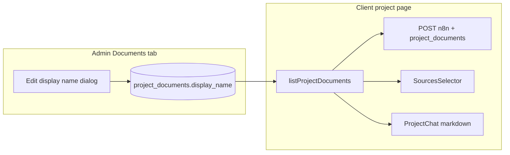

# Plan: Document display name

Spec folder: **2026-04-13-1600-document-display-name**  
Shaping notes: [shape.md](./shape.md) · Standards: [standards.md](./standards.md) · References: [references.md](./references.md)

## Goal

Optional **`display_name`** on project documents so admins can label files for humans. **Sources** and citation-related UI default to today’s filename behaviour when unset. **n8n** receives document metadata on each chat POST so Disrupt can prefer friendly names in prompts and responses.

## Task 1 — Save spec documentation (this folder)

- [x] `plan.md` (this file)
- [x] `shape.md`
- [x] `standards.md`
- [x] `references.md`
- [x] `visuals/` + README + PNGs

## Task 2: Database and domain mapping

- Migration: `alter table public.project_documents add column if not exists display_name text` (nullable); optional max-length check if desired.
- [`lib/supabase/documents.ts`](../../lib/supabase/documents.ts): extend row type, `documentSelect`, `rowToUploadedFile`; add **`updateProjectDocumentDisplayName`**.
- [`lib/types.ts`](../../lib/types.ts): `UploadedFile.displayName?: string | null`; update mocks / mock upload hook if needed.

## Task 3: Admin UX — edit display name

- [`components/upload/sortable-project-documents-table.tsx`](../../components/upload/sortable-project-documents-table.tsx): dropdown **Edit display name**, Dialog + field, Save/Cancel.
- Row title: prefer trimmed display name, else `file.name`; optional muted subtitle with original filename when display name is set.
- [`app/(dashboard)/projects/[id]/page.tsx`](../../app/(dashboard)/projects/[id]/page.tsx): wire update + optimistic state + toast on error.

## Task 4: Client Sources + shared label helper

- Shared helper e.g. **`sourceListLabel(file)`** — `trim(displayName) || fileNameWithoutExtension(name)`; refactor [`sources-selector.tsx`](../../components/client/project-detail/sources-selector.tsx).
- [`components/chat/document-selector.tsx`](../../components/chat/document-selector.tsx): align labels if that surface should match.

## Task 5: n8n inbound payload

- [`hooks/useChatQuestion.ts`](../../hooks/useChatQuestion.ts): extend `ChatQuestionWebhookPayload` with optional **`project_documents`** (e.g. `{ id, name, display_name }[]`); accept prop from caller; include in JSON body.
- [`app/client/projects/[id]/page.tsx`](../../app/client/projects/[id]/page.tsx): pass ready documents into the hook.
- Update [`disrupt-n8n-coordination.md`](../2026-03-26-1400-project-chat-n8n-integration/disrupt-n8n-coordination.md) and [`n8n-engineer-handoff.md`](../2026-03-26-1400-project-chat-n8n-integration/n8n-engineer-handoff.md).

## Task 6: Citation-friendly markdown (client)

- [`project-chat.tsx`](../../components/client/project-detail/project-chat.tsx): optional **`citationDocuments`** (or full ready list); maps for id/name → label; customize **`ReactMarkdown` `components.a`** (and `title`) for known document links. Fallback for legacy answers.

## Task 7: Verification

- See [verification.md](./verification.md) for the full manual checklist (admin, client, network payload, RLS, `tsc`).

## Architecture sketch

