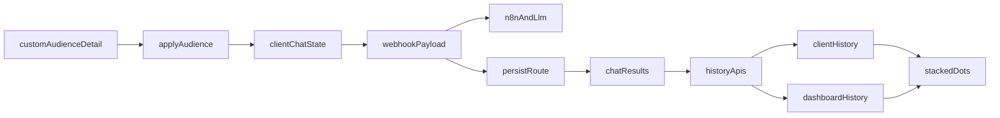

# Custom Audience Detail + Chat Integration Plan

## Scope Locked
- Build a production-ready Custom Audience detail flow that behaves like persona detail and uses the provided prototype visual for the detail state.
- Include full saved-audience persistence now (create/list/select/update path as needed by UX), not just session-only apply.
- Cover all relevant surfaces: persona/custom audience pickers, client chat history, and dashboard chat history panels.

## Product Alignment
- Roadmap fit: this work aligns with MVP AI chat integration and chat-history polish in [agent-os/product/roadmap.md](/Users/royalnashef/Desktop/smart-arse/agent-os/product/roadmap.md).
- Mission fit: audience-scoped chat behavior supports project-centric, context-aware answers in [agent-os/product/mission.md](/Users/royalnashef/Desktop/smart-arse/agent-os/product/mission.md).
- Persistence is not explicitly called out in roadmap bullets, but it is consistent with MVP chat workflow depth and existing audience/archive artifacts in [agent-os/product/notes-archive/disrupt-mvp-frontend-handover_may-7-26](/Users/royalnashef/Desktop/smart-arse/agent-os/product/notes-archive/disrupt-mvp-frontend-handover_may-7-26).

## Relevant Standards
- `global/project-conventions` → [agent-os/standards/global/project-conventions.md](/Users/royalnashef/Desktop/smart-arse/agent-os/standards/global/project-conventions.md)
- `global/domain-data-layer` → [agent-os/standards/global/domain-data-layer.md](/Users/royalnashef/Desktop/smart-arse/agent-os/standards/global/domain-data-layer.md)
- `css/ui-styling` → [agent-os/standards/css/ui-styling.md](/Users/royalnashef/Desktop/smart-arse/agent-os/standards/css/ui-styling.md)
- `global/developer-guide` (chat/audience backend expectations) → [agent-os/standards/global/developer-guide.md](/Users/royalnashef/Desktop/smart-arse/agent-os/standards/global/developer-guide.md)

## Reference Implementations
- Persona-detail behavior and current custom audience tab: [components/client/project-detail/persona-drawer.tsx](/Users/royalnashef/Desktop/smart-arse/components/client/project-detail/persona-drawer.tsx)
- Client chat apply/send flow (persona to webhook/persist): [app/client/projects/[id]/page.tsx](/Users/royalnashef/Desktop/smart-arse/app/client/projects/[id]/page.tsx)
- Webhook + persist contract: [hooks/useChatQuestion.ts](/Users/royalnashef/Desktop/smart-arse/hooks/useChatQuestion.ts), [app/api/chat/persist/route.ts](/Users/royalnashef/Desktop/smart-arse/app/api/chat/persist/route.ts)
- Client history row rendering: [components/client/project-detail/chat-history-card.tsx](/Users/royalnashef/Desktop/smart-arse/components/client/project-detail/chat-history-card.tsx)
- Dashboard history row rendering: [components/chat/chat-sidebar.tsx](/Users/royalnashef/Desktop/smart-arse/components/chat/chat-sidebar.tsx), [app/(dashboard)/projects/[id]/page.tsx](/Users/royalnashef/Desktop/smart-arse/app/(dashboard)/projects/[id]/page.tsx)
- Frontend handover contract and payload references:
  - [agent-os/product/notes-archive/disrupt-mvp-frontend-handover_may-7-26/WEBHOOK-CONTRACT.md](/Users/royalnashef/Desktop/smart-arse/agent-os/product/notes-archive/disrupt-mvp-frontend-handover_may-7-26/WEBHOOK-CONTRACT.md)
  - [agent-os/product/notes-archive/disrupt-mvp-frontend-handover_may-7-26/components/ChatInterface.tsx](/Users/royalnashef/Desktop/smart-arse/agent-os/product/notes-archive/disrupt-mvp-frontend-handover_may-7-26/components/ChatInterface.tsx)
  - [agent-os/product/notes-archive/disrupt-mvp-frontend-handover_may-7-26/components/AudienceBuilder.tsx](/Users/royalnashef/Desktop/smart-arse/agent-os/product/notes-archive/disrupt-mvp-frontend-handover_may-7-26/components/AudienceBuilder.tsx)
  - [agent-os/product/notes-archive/disrupt-mvp-frontend-handover_may-7-26/lib/audience-query.ts](/Users/royalnashef/Desktop/smart-arse/agent-os/product/notes-archive/disrupt-mvp-frontend-handover_may-7-26/lib/audience-query.ts)
  - [agent-os/product/notes-archive/disrupt-mvp-frontend-handover_may-7-26/lib/credits.ts](/Users/royalnashef/Desktop/smart-arse/agent-os/product/notes-archive/disrupt-mvp-frontend-handover_may-7-26/lib/credits.ts)

## Visual Source
- Treat current app visual language as primary; incorporate provided prototype detail visual for Custom Audience detail-state behavior/layout.
- Lock the newly shared visual as the Custom Audience detail screen reference from prototype: `/Users/royalnashef/.cursor/projects/Users-royalnashef-Desktop-smart-arse/assets/image-fe833935-8de0-4af3-8d81-7c038d9bd677.png`.
- Match persona-detail interaction behavior exactly for this screen (open/close, apply semantics, chat-context switch behavior).

## Delivery Sequence

### Task 1: Save Spec Documentation
Create `agent-os/specs/2026-05-08-0556-custom-audience-detail/` with:
- `plan.md` (this plan)
- `shape.md` (scope decisions, roadmap call, visual decisions)
- `standards.md` (applied standards content)
- `references.md` (mapped implementation references)
- `visuals/` (prototype/app screenshots supplied in shaping)

### Task 2: Define Custom Audience Domain Model + Persistence Contract
- Add/extend typed model for custom audiences and child-segment composition in shared types/history DTOs: [lib/types.ts](/Users/royalnashef/Desktop/smart-arse/lib/types.ts), [lib/chat-history-types.ts](/Users/royalnashef/Desktop/smart-arse/lib/chat-history-types.ts), [lib/admin-chat-history-types.ts](/Users/royalnashef/Desktop/smart-arse/lib/admin-chat-history-types.ts).
- Add migration(s) for saved custom audiences and chat-result denormalized audience metadata (including stacked color token payload shape).
- Implement repository/API surface for save/list/select/update of custom audiences (project/org scoped, RLS-safe).

### Task 3: Build Custom Audience Detail Screen Behavior (Persona-Detail Parity)
- Refactor right-sidebar persona/custom-audience UI so custom audience has:
  - list/select view
  - detail view (prototype-aligned structure using the locked reference visual)
  - apply action mirroring persona-detail semantics
  - save/update flow wired to persistence.
- Main implementation target: [components/client/project-detail/persona-drawer.tsx](/Users/royalnashef/Desktop/smart-arse/components/client/project-detail/persona-drawer.tsx) and related sidebar wrappers.

#### Task 3 Acceptance Criteria
- Opening a custom-audience row transitions from list state to detail state using the locked prototype visual hierarchy and control placement.
- Closing detail returns to the same list context without losing unsaved in-progress filter selections unless the user explicitly resets.
- Applying a custom audience follows persona-detail-equivalent behavior:
  - marks that audience as the active chat context,
  - starts a fresh chat context/session in the same way persona apply does,
  - updates visible applied-context chip/indicator in the sidebar and chat surfaces.
- Clearing active custom audience follows persona clear behavior (active context removed and chat context reset semantics preserved).
- On mobile drawer and desktop sidebar, behavior and state transitions are equivalent (no platform-specific divergence in apply/clear/open/close logic).
- If saved-audience persistence is available, re-opening a saved audience reproduces the same detail state values used at save-time.

### Task 4: Wire Apply-to-Chat + LLM Payload for Custom Audience
- Extend chat state to track active context mode (`persona_segment` vs `custom_audience`) and reset semantics when switching/new chat.
- Extend webhook payload builder and persist calls so custom audience metadata is passed and stored similarly to persona metadata.
- Main targets: [app/client/projects/[id]/page.tsx](/Users/royalnashef/Desktop/smart-arse/app/client/projects/[id]/page.tsx), [hooks/useChatQuestion.ts](/Users/royalnashef/Desktop/smart-arse/hooks/useChatQuestion.ts), [app/api/chat/persist/route.ts](/Users/royalnashef/Desktop/smart-arse/app/api/chat/persist/route.ts).

#### Task 4 Acceptance Criteria
- Custom-audience apply sends a webhook payload shape that remains compatible with handover contract expectations in [agent-os/product/notes-archive/disrupt-mvp-frontend-handover_may-7-26/WEBHOOK-CONTRACT.md](/Users/royalnashef/Desktop/smart-arse/agent-os/product/notes-archive/disrupt-mvp-frontend-handover_may-7-26/WEBHOOK-CONTRACT.md).
- Payload composition for custom-audience mode follows the same intent as handover `ChatInterface` patterns (mode-aware payload assembly, no persona regression).
- Persisted chat rows include custom audience metadata needed to restore context and render history indicators across user/admin surfaces.
- Existing persona-segment payload and persistence behavior remains unchanged for non-audience chats.

### Task 5: Extend History APIs for Audience Metadata
- Update user/admin history query selections and response mappers to include custom audience identifiers, names, and child-segment color tokens.
- Main targets: [app/api/chat/history/route.ts](/Users/royalnashef/Desktop/smart-arse/app/api/chat/history/route.ts), [lib/api/chat-history-server.ts](/Users/royalnashef/Desktop/smart-arse/lib/api/chat-history-server.ts), [app/api/admin/projects/[id]/chat-history/route.ts](/Users/royalnashef/Desktop/smart-arse/app/api/admin/projects/[id]/chat-history/route.ts), [lib/api/admin-chat-history-server.ts](/Users/royalnashef/Desktop/smart-arse/lib/api/admin-chat-history-server.ts).

### Task 6: Implement Stacked Child-Segment Dots Across History Surfaces
- Add a reusable theme helper for stacked-dot rendering from 1..N segment color tokens.
- Use it in:
  - Client history card: [components/client/project-detail/chat-history-card.tsx](/Users/royalnashef/Desktop/smart-arse/components/client/project-detail/chat-history-card.tsx)
  - Dashboard chat sidebar: [components/chat/chat-sidebar.tsx](/Users/royalnashef/Desktop/smart-arse/components/chat/chat-sidebar.tsx)
- Preserve persona single-dot behavior while rendering stacked dots for custom audiences.

### Task 7: Load/Restore Behavior + QA Matrix
- Ensure selecting historical chats restores persona/custom audience context correctly.
- Validate mobile drawer parity and desktop sidebar parity.
- Verify no regressions for persona segment flows, thread anchor merge, and chat-history pagination.

### Task 8: Handover Parity Validation (Custom Audience Scope)
- Verify this implementation against relevant handover files and capture any intentional deviations:
  - audience flow expectations in [agent-os/product/notes-archive/disrupt-mvp-frontend-handover_may-7-26/README.md](/Users/royalnashef/Desktop/smart-arse/agent-os/product/notes-archive/disrupt-mvp-frontend-handover_may-7-26/README.md)
  - webhook/query-mode contract in `WEBHOOK-CONTRACT.md`
  - audience builder/filter semantics in `AudienceBuilder.tsx` and `lib/audience-query.ts`
  - audience save/list semantics in handover `api/audience/saved/*` references.
- Ensure credits behavior for custom-audience queries is explicitly reviewed against handover `lib/credits.ts` and either matched or documented as an intentional difference.
- Ensure long-running response behavior (poll fallback) remains compatible with existing app chat flow and handover expectations.

## Integration Flow (Target)

## Test Plan (Execution Phase)
- Unit/logic tests for payload assembly and metadata normalization.
- API route tests for history and persist shape compatibility.
- UI verification for detail behavior parity and stacked-dot rendering in both history panels.
- Manual happy path: build audience -> save -> apply -> ask question -> verify LLM context + both history surfaces.
- Manual edge cases: 1-segment audience, all-segment audience, low `n` threshold, switching persona↔audience, loading historical threads.
- Manual behavior parity checklist (custom audience vs persona detail):
  - open detail,
  - close detail,
  - apply,
  - clear,
  - restore from history,
  - verify same reset and context outcomes.
- Handover-supportive checks:
  - confirm audience API flow parity (`filter-options` -> `preview` -> `profile` -> apply/save),
  - confirm webhook payload fields are mode-correct for custom audience,
  - confirm credit behavior for custom-audience mode is expected,
  - confirm any deliberate deviations from handover are documented in spec notes.

## Assumptions
- "Behave like persona detail" means same open/apply/selection semantics and chat reset model.
- Existing app design system remains primary; prototype visual informs the custom-audience detail state and hierarchy.
- Focus group tab is out of scope for this spec except preventing regressions.
- Digital twin and full focus-group implementation remain out of scope for this workstream unless explicitly expanded later; only shared chat/payload infrastructure should be kept regression-safe.
