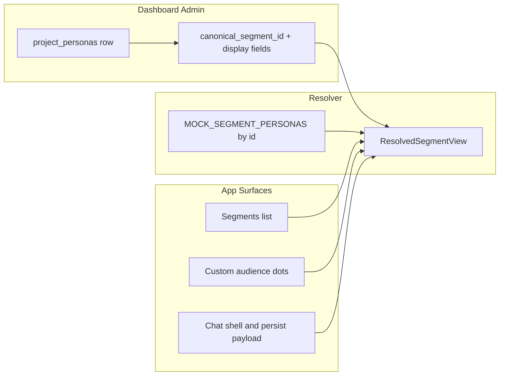

# Persona-backed segment display (fixed four slots)

## Progress

| Task | Description | Status |
| ---: | --- | :---: |
| **1** | Save spec documentation | **Done** |
| **2** | Supabase migration — `canonical_segment_id`, `display_name`, `segment_description`, `segment_color_token` + uniqueness + CHECK | **Todo** |
| **3** | Types + `lib/supabase/personas.ts` select/map + update helpers with validation | **Todo** |
| **4** | Admin dashboard Personas tab — binding + edit dialogs (documents table patterns) | **Todo** |
| **5** | Resolver module; client page fetch; wire PersonaPanel / mobile drawer / project-chat | **Todo** |
| **6** | Generalize dot/tone from color token; persist / webhook / custom-audience snapshot fields | **Todo** |
| **7** | QA — admin edits reflect across Segments, builder, chat, new row metadata | **Todo** |

**Legend:** **Done** = delivered in this folder or merged · **Todo** = not started · **In progress** = active implementation.

---

## Task 1 — **Done** · Save spec documentation

Create [`agent-os/specs/2026-05-11-1500-persona-segment-display-bindings/`](agent-os/specs/2026-05-11-1500-persona-segment-display-bindings/) with `plan.md`, `shape.md`, `standards.md`, `references.md`, and `visuals/` (see [visuals/README.md](visuals/README.md)).

---

## Task 2 — **Todo** · Data model (Supabase)

Add columns on `public.project_personas` (single migration + comments + CHECK where needed):

| Column | Purpose |
| --- | --- |
| `canonical_segment_id` | Nullable; one of the four slug strings; **unique per `project_id` when not null**. |
| `display_name` | Optional UI label (same semantics as `project_documents.display_name`). |
| `segment_description` | Optional admin prose for list cards; when null, use mock `shortDescription`. |
| `segment_color_token` | Optional token from the same allowlist as `project_documents.cite_color_token` (`lib/theme/cite-color-tokens.ts`). |

RLS: existing `project_personas_*` policies from [`supabase/migrations/202603311600_project_personas_storage.sql`](../../../supabase/migrations/202603311600_project_personas_storage.sql); adjust only if a dedicated “client cannot change binding” rule is required.

---

## Task 3 — **Todo** · Types and Supabase helpers

- Widen persona select in [`lib/supabase/personas.ts`](../../../lib/supabase/personas.ts); map new columns into [`UploadedFile`](../../../lib/types.ts) (or a dedicated persona type) with JSDoc aligned to DB columns, matching document `displayName` / `citeColorToken` style.
- Add update helpers mirroring [`updateProjectDocumentDisplayName`](../../../lib/supabase/documents.ts) / [`updateProjectDocumentCiteColor`](../../../lib/supabase/documents.ts): patch display fields and `canonical_segment_id` with validation (allowed segment ids; friendly copy on uniqueness violations).

---

## Task 4 — **Todo** · Admin dashboard

Extend the Personas tab in [`app/(dashboard)/projects/[id]/page.tsx`](../../../app/(dashboard)/projects/[id]/page.tsx) and related upload components using patterns from [`components/upload/sortable-project-documents-table.tsx`](../../../components/upload/sortable-project-documents-table.tsx): swatch column, row actions / dialogs, **“Represents segment”** four-way select + clear, reuse cite-color picker UX where practical.

---

## Task 5 — **Todo** · Resolver and client wiring

- Introduce a resolver (e.g. `lib/personas/segment-display.ts` or extend `lib/supabase/personas.ts`) that merges [`MOCK_SEGMENT_PERSONAS`](../../../components/client/project-detail/persona-drawer.tsx) with optional bound `project_personas` row: **DB `display_name` → mock `title`**; **DB `segment_description` → mock `shortDescription`**; **DB `segment_color_token` → [`PERSONA_SEGMENT_COLOR_TOKEN_BY_ID`](../../../lib/theme/persona-segment-theme.ts) → default**.
- Fetch `project_personas` on [`app/client/projects/[id]/page.tsx`](../../../app/client/projects/[id]/page.tsx); thread resolved segments through [`PersonaPanel`](../../../components/client/project-detail/persona-drawer.tsx), [`MobilePersonaDrawer`](../../../components/client/project-detail/mobile-persona-drawer.tsx), [`project-chat.tsx`](../../../components/client/project-detail/project-chat.tsx).
- [`personaSegmentColorTokenForId`](../../../lib/theme/persona-segment-theme.ts) (or wrapper) should consult the resolver so helpers like [`chatHistoryPrimaryPersonaColorToken`](../../../lib/theme/custom-audience-dominant-persona.ts) stay correct.

---

## Task 6 — **Todo** · Dots, tone, persistence

- Replace narrow [`customAudienceDotClass`](../../../components/client/project-detail/persona-drawer.tsx) logic with a shared helper mapping allowed `CiteColorToken` to `bg-{family}-{shade}` (Tailwind-safe patterns per cite-color usage elsewhere).
- Align [`PERSONA_CHAT_TONE_BY_ID`](../../../lib/theme/persona-chat-tone.ts) / drawer [`PERSONA_TONE_BY_ID`](../../../components/client/project-detail/persona-drawer.tsx) with **resolved** color (family-derived tone or `DEFAULT_CHAT_TONE` when unknown).
- On send/persist ([`useChatQuestion`](../../../hooks/useChatQuestion.ts), project page persona segment block), set `persona_segment_name` and `persona_segment_color_token` from **resolved** values; [`draftToSnapshot`](../../../components/client/project-detail/persona-drawer.tsx) should emit names/tokens from the resolver.
- Restore: known canonical `persona_segment_id` values always restore; unknown ids fail safe; live UI uses latest resolver, historical columns hold snapshots for past messages.

---

## Task 7 — **Todo** · QA / edge cases

- Duplicate `canonical_segment_id` per project surfaces clear messaging (“Another persona already represents this segment”).
- Verify Tailwind JIT does not purge classes needed for new token shades.
- Optional `segment_description` length: mirror document display name guard (~500) or define CHECK in migration.

---

## Data flow

