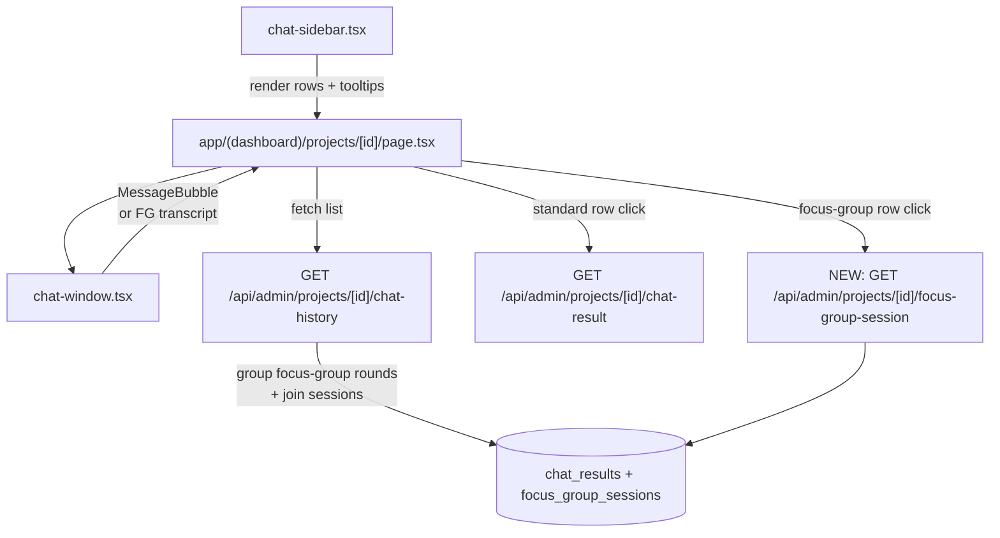

# Dashboard Chat History Parity

## Goal

Reflect the client-app's improved chat-history UX onto the dashboard project workspace without touching the visible metadata (user label, date, count rules). Two outcomes:

1. **Tooltips on every chat-history row** use a uniform two-line `LABEL: VALUE` format that mirrors `HistoryTooltipBody` from [components/client/project-detail/chat-history-card.tsx](components/client/project-detail/chat-history-card.tsx).
2. **Focus-group sessions collapse into one row** in the sidebar and into a **single chat thread** in the chat window — same as the client app.

The dashboard remains light-themed; we'll build a light-themed variant of the client app's round-based focus-group transcript.

## Current state (where parity is missing)

- Sidebar tooltip in [components/chat/chat-sidebar.tsx](components/chat/chat-sidebar.tsx) is single-line, only shown when there is a segment/audience name; default LLM rows have no tooltip.
- [app/api/admin/projects/[id]/chat-history/route.ts](app/api/admin/projects/[id]/chat-history/route.ts) + [lib/api/admin-chat-history-server.ts](lib/api/admin-chat-history-server.ts) don't select focus-group columns and don't group session rounds — each round currently shows up as its own line item.
- [components/chat/chat-window.tsx](components/chat/chat-window.tsx) only renders flat `ChatMessage[]` via `MessageBubble`; it has no focus-group transcript shape.
- Admin selection in [app/(dashboard)/projects/[id]/page.tsx](<app/(dashboard)/projects/[id]/page.tsx>) loads one row at a time via `getAdminProjectChatResult` — no way to hydrate a whole focus-group session.

## Data flow after the change

## Reference implementations to mirror

- [lib/api/chat-history-server.ts](lib/api/chat-history-server.ts) — already groups focus-group rounds per `focus_group_session_id`; we port the same grouping logic into `admin-chat-history-server.ts`.
- [app/api/focus-group/sessions/[id]/route.ts](app/api/focus-group/sessions/[id]/route.ts) — provides the session+rounds shape; we'll write a near-clone scoped by `project_id` and auth'd via `requireDashboardAdmin`.
- [components/client/project-detail/chat-history-card.tsx](components/client/project-detail/chat-history-card.tsx) lines 62-79 (`HistoryTooltipBody`) and the focus-group branch around lines 224-352 — pattern for tooltip body + dot stack.
- [components/client/project-detail/project-chat.tsx](components/client/project-detail/project-chat.tsx) `FocusGroupRoundTopicBubble` / `FocusGroupResponseBubble` / `FocusGroupTranscriptRound` — light-theme variants for admin.

## Tooltip contract (every row gets a tooltip)

- Default LLM row → `Agent: smartA.R.S.E.`
- Persona segment row → `Segment: <persona_segment_name>`
- Custom audience row → `Audience: <custom_audience_name>`
- Focus group row → `Focus group: N participants · M rounds`

Metadata under the title (user label, date, dot/dot-stack) stays as-is.

## Out of scope

- Visible metadata changes (user label, date, message counts).
- Theming changes on the dashboard outside the chat window's focus-group transcript.
- Client-app changes (already shipped).

## Validation

- `pnpm tsc --noEmit` clean.
- Manual UI smoke: open a project as admin where the client has run a focus group → sidebar shows 1 row per session with tooltip "Focus group: N participants · M rounds"; clicking it renders the full multi-round transcript inside the chat window; other rows show their new `LABEL: VALUE` tooltip.
