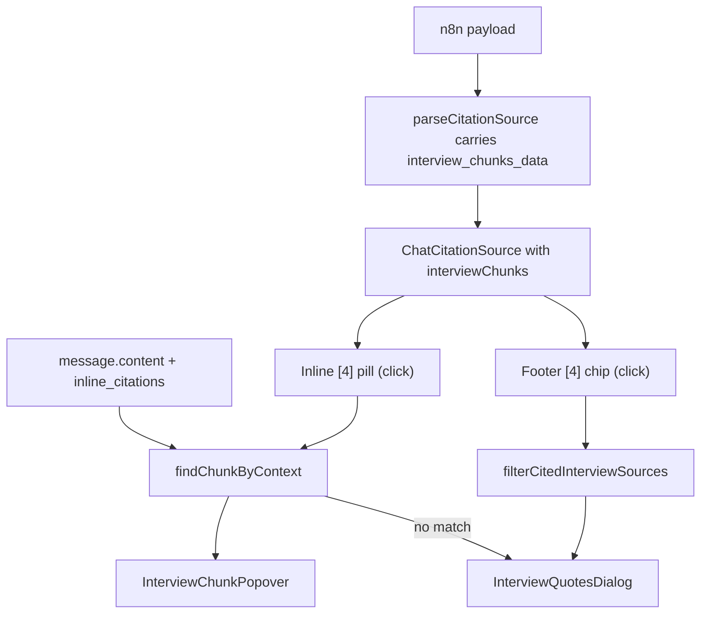

# Interview Citation Popover and Modal

## Overview

Bring source `[4]` (qualitative interviews) citations to parity with the reference prototype: a click-Popover on inline `[4]` pills showing the matched interview chunk (with modal fallback when no match), and a click-Dialog on the footer `[4]` chip showing all cited chunks aggregated.

## Shape

**What we're building.** Source `[4]` (qualitative interviews) currently renders a near-empty hover Tooltip ("Source type: interview"). We will match the prototype so that:

- **Inline `[4]` pills** in the answer body open a **click-Popover** showing the specific interview chunk (moderator question or quote excerpt, segment badge, country / gender / age) that matches the preceding text.
- **Footer `[4]` chip** opens a **click-Dialog** that aggregates all cited interview chunks.
- **Fallback for inline `[4]`** when no chunk matches the preceding text: open the same aggregated Dialog.

**Scope.** Only `[4]` interview citations. Inline pills for `[1]` / `[2]` / `[3]` and their footer chips keep their existing hover-Tooltip behaviour. Survey verbatim mode (`[3]` with `survey_chunks_data`) is **out of scope** here even though the same data plumbing would unlock it later.

## Decisions

- **Interaction:** Click-only Popover for inline `[4]`; click-Dialog for footer `[4]`. Other citation types unchanged.
- **Matching:** Reuse the inline citation's `marker_position` (already on `ChatInlineCitation`) plus the original `message.content` to slice `precedingText = content.slice(marker_position - 200, marker_position)` and feed it to a ported `findChunkByContext`.
- **Filtering:** Footer modal lists only chunks that were actually cited inline (port `filterCitedInterviewSources` to avoid the 50-chunk IQL pool leak).
- **Code reuse:** Port (do not rewrite) the matching helpers from [`agent-os/product/notes-archive/disrupt-mvp-citation-handoff/lib/citation-utils.ts`](../../product/notes-archive/disrupt-mvp-citation-handoff/lib/citation-utils.ts) — hardened across 30+ phases.

## Architecture

## Files of interest

- Types: [`lib/types.ts`](../../../lib/types.ts) — add `InterviewChunkData` + `interviewChunks?` / `quoteCount?` on `ChatCitationSource`.
- Parser: [`lib/api/chat-payload.ts`](../../../lib/api/chat-payload.ts) (`parseCitationSource` at L55, `resultPayloadToClientShape` at L348) — carry `interview_chunks_data` and `quote_count` through.
- New helper: `lib/citation-utils.ts` (port from notes-archive).
- Inline renderer: [`components/chat/message-bubble.tsx`](../../../components/chat/message-bubble.tsx) (L172-225) **and** [`components/client/project-detail/project-chat.tsx`](../../../components/client/project-detail/project-chat.tsx) (L172-240) — both need to branch on `sourceType === "interview"`.
- Footer renderer: [`components/chat/chat-citation-sources-footer.tsx`](../../../components/chat/chat-citation-sources-footer.tsx) (L67-105) — branch [4] to a Dialog trigger.
- Tooltip body: [`lib/chat/citation-tooltip.tsx`](../../../lib/chat/citation-tooltip.tsx) — small helper additions for icon / label only; the interview Popover and Dialog are new components.
- UI primitives already present: `components/ui/popover.tsx`, `components/ui/dialog.tsx`, `components/ui/scroll-area.tsx`.

## Reference behaviour

The prototype lives at [`agent-os/product/notes-archive/disrupt-mvp-frontend-handover_may-7-26/components/CitationChip.tsx`](../../product/notes-archive/disrupt-mvp-frontend-handover_may-7-26/components/CitationChip.tsx):
- `InlineCitationChip` (`source.type === "interview"` branch at L300-360) — per-chunk Popover with header icon, moderator question or chunk preview (≥20 chars guard), segment badge, demographics row.
- `InterviewQuotesDialog` (L27-105) — full-height Dialog (`h-[80vh] max-w-lg`), iterates `interview_chunks_data` with segment badge, demographics, moderator Q, italic quote.

## Out of scope

- Survey verbatim mode for `[3]` (would need `survey_chunks_data` plumbing, separate spec).
- Refactor of duplicated `a`-renderer between [`message-bubble.tsx`](../../../components/chat/message-bubble.tsx) and [`project-chat.tsx`](../../../components/client/project-detail/project-chat.tsx). We will touch both; consolidation is a separate concern.
- Reskinning [1]/[2]/[3] popovers to match prototype.

## Standards applied

See [`standards.md`](standards.md) for the full text of each.

- `agent-os/standards/global/domain-data-layer.md` — extend `lib/types` + parsing in one place.
- `agent-os/standards/global/project-conventions.md` — `@/` imports, client boundaries, `cn()` for layout.
- `agent-os/standards/css/ui-styling.md` — shadcn `Popover` / `Dialog` / `ScrollArea`; `lucide-react` icons; `cn()` for class merging.

---

## Tasks

### Task 1 — Save spec documentation

Create `agent-os/specs/2026-05-14-1202-interview-citation-popover-modal/` containing:

- `plan.md` (this file)
- `shape.md` — shaping notes (scope, decisions, context, visuals, references)
- `standards.md` — full content of the three relevant standards
- `references.md` — pointers to the prototype + handoff doc + in-app touch points
- `visuals/` — the three screenshots provided by the user

### Task 2 — Extend types and parser

- Add `InterviewChunkData` interface in [`lib/types.ts`](../../../lib/types.ts) covering `respondent_id`, `interview_country | gender | age`, `interview_segment` / `segment_name`, `moderator_question`, `chunk_preview`, `similarity`.
- Add optional `interviewChunks?: InterviewChunkData[] | null` and `quoteCount?: number | null` to `ChatCitationSource`.
- Teach `parseCitationSource` in [`lib/api/chat-payload.ts`](../../../lib/api/chat-payload.ts) to read `interview_chunks_data` / `interviewChunks` and `quote_count` / `quoteCount`. Keep behaviour stable for sources where the field is absent.

### Task 3 — Port `lib/citation-utils.ts`

- Port `findChunkByContext`, `filterCitedInterviewSources`, `extractLastQuote`, `deepNormalize` from [`agent-os/product/notes-archive/disrupt-mvp-citation-handoff/lib/citation-utils.ts`](../../product/notes-archive/disrupt-mvp-citation-handoff/lib/citation-utils.ts).
- Adapt imports to smart-arse types (`ChatCitationSource` + new `InterviewChunkData` + `ChatInlineCitation`).
- Do **not** rewrite the matching algorithm — it's been hardened across many phases.

### Task 4 — Add `isInterviewCitationSource` helper

- Add `isInterviewCitationSource` alongside `isSurveyCitationSource` in [`lib/documents/display-label.ts`](../../../lib/documents/display-label.ts).
- Teach `citationSourcePrimaryLabel` to return `"Qualitative Interviews"` (with optional `(N)` suffix when `quoteCount` is set) when the source is interview type.

### Task 5 — Build the inline interview Popover

- Create `lib/chat/interview-citation.tsx` exporting `InlineInterviewCitation` (click-Popover from `components/ui/popover.tsx`).
- Popover contents (matched chunk): header icon + `"Moderator Question"` / `"Interview Quote"` label, the matched chunk's text (clamp at ~320 chars), segment badge, demographics row.
- Source the matched chunk via `findChunkByContext(source.interviewChunks, content.slice(marker_position - 200, marker_position))`.
- When no match, the trigger button opens `InterviewQuotesDialog` instead (same button, opens modal).
- Pill keeps the existing `citeSourceIndexBadgeCn` styling driven by `source.citeColorToken`.

### Task 6 — Build the aggregated `InterviewQuotesDialog`

- In the same new file, using `components/ui/dialog.tsx` + `components/ui/scroll-area.tsx`.
- List each chunk with: segment badge, demographics (country / gender / age), moderator question (rendered only when ≥20 chars per prototype guard), italic chunk preview.
- Header reads `Interview Quotes (N)` where N = `interviewChunks.length`.

### Task 7 — Wire the new inline component into both bubble renderers

- [`components/chat/message-bubble.tsx`](../../../components/chat/message-bubble.tsx) L172-225 and [`components/client/project-detail/project-chat.tsx`](../../../components/client/project-detail/project-chat.tsx) L172-240.
- Branch on `source.sourceType === "interview"` BEFORE constructing the current `Tooltip` block: when true, render `InlineInterviewCitation` with the original `message.content`, the resolved `inlineCitation.marker_position` (fall back to 0), and the matched source.
- Other types continue to use the existing hover Tooltip path.

### Task 8 — Update footer to filter + modal trigger

- In [`components/chat/chat-citation-sources-footer.tsx`](../../../components/chat/chat-citation-sources-footer.tsx).
- Run sources through `filterCitedInterviewSources(messageContent, inlineCitations, sources)` before mapping.
- For `source.sourceType === "interview"`, replace the `Tooltip` wrapper with the `InterviewQuotesDialog` trigger; chip button keeps existing chip styling and shows the `Qualitative Interviews (N)` label.

### Task 9 — Smoke-test and typecheck

- Smoke-test locally with the demo chat that surfaced the three screenshots.
  - Inline `[4]` opens a popover with chunk-specific content.
  - Inline `[4]`s that can't be matched fall through to the modal.
  - Footer `[4]` chip opens the modal with only cited chunks (not the full IQL pool).
  - Other citation types are unchanged.
- Run `pnpm typecheck` and lint.
