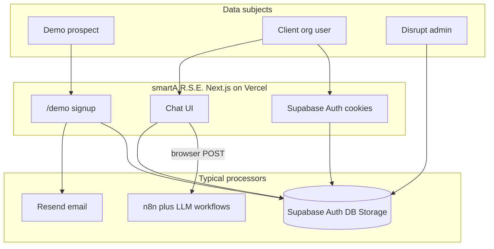

# smartA.R.S.E. — Client legal briefing (UK GDPR)

**Product:** smartA.R.S.E. (Disrupt Insight Ltd)  
**Document date:** 4 June 2026  
**Prepared for:** External legal counsel (Disrupt / client)  
**Related spec:** [Demo Signup v2](plan.md) — engineering Task 6 (GDPR) depends on legal outputs from this briefing  

---

## Important disclaimer

This document is a **factual description of the product and codebase** as reviewed by engineering. It is **not legal advice**. Counsel must determine legal bases, retention periods, controller/processor roles, international transfers, and final policy wording.

Features marked **(planned — Demo signup v2)** are specified but **not yet implemented** in production code unless stated otherwise.

---

## 1. Purpose and how to use this briefing

### Audience

External legal team advising **Disrupt Insight Ltd** on privacy, cookies, and contractual documentation for the smartA.R.S.E. platform and its public demo signup flow.

### What engineering has documented

- What personal data is collected, stored, and shared today
- What will change with Demo signup v2 (planned)
- Gaps between in-app policy text and actual product behaviour
- Copy **slots** and audit metadata shapes for consent UI (legal fills strings and version IDs)

### What legal should produce (checklist)

| Deliverable | UK / regulatory hook | Notes |
|-------------|----------------------|--------|
| **Privacy notice** (full) | UK GDPR Art. 13 | Logged-in users; reconcile with dashboard template |
| **Privacy notice** (layered summary) | Art. 13 + transparency | Public `/help/privacy` — currently MVP stub |
| **Cookie policy** | PECR + UK GDPR | Essential vs non-essential; v2 banner on `/demo` + `/auth/demo-setup` only |
| **Cookie / consent banner copy** | PECR prior consent for non-essential | See §9 copy slots |
| **Terms of service** | Contract law | **No dedicated route exists today** |
| **Demo signup consent strings** + **version IDs** | Consent (if basis = consent) | Required + optional marketing checkbox |
| **Processor / subprocessor list** | Art. 13(1)(e); Art. 28 DPAs | Supabase, Vercel, Resend, n8n, LLM vendors |
| **International transfer** wording | Art. 13(1)(f); Ch. V UK GDPR | Vendor regions not in repo — legal to confirm |
| **Retention schedule** per category | Art. 13(2)(a) | TBD — legal to define; see inventory |
| **DSAR / rights process** | Arts. 15–22 | No self-service export today |
| **Breach notification process** | Arts. 33–34 | Operational — legal to define |
| Optional: **DPIA** | UK GDPR Art. 35 | AI chat + client research uploads |
| Optional: **Legitimate interests assessment** | Art. 6(1)(f) | If used for any processing |

---

## 2. Controller identity and contacts (facts for legal to confirm)

| Item | Value in product / copy today | Legal action |
|------|-------------------------------|--------------|
| Controller name | **Disrupt Insight Ltd** (“Disrupt”) | Confirm registered entity |
| Registered address | Not in codebase | **TBD — legal to add** |
| DPO contact | **dpo@disrupt-insight.com** (dashboard privacy page) | Confirm formal DPO appointment |
| ICO registration | Not in codebase | **TBD — legal to confirm if required** |
| General support | **smart-arse@disrupt-insight.com** (`lib/support-contact.ts`) | Public “Contact the team” via Gmail compose link |
| Public privacy page | `/help/privacy` | MVP summary; disclaims legal advice |
| Internal policy page | `/privacy` (dashboard, admin/client roles) | Template dated 1 February 2026 |

---

## 3. UK GDPR — transparency requirements for public-facing documents

UK data protection is governed by the **UK GDPR** and the **Data Protection Act 2018**. See [GOV.UK: Data protection](https://www.gov.uk/data-protection) for an overview of principles and data subject rights.

Privacy notices must meet **Article 13 UK GDPR** (information to be provided where personal data are collected from the data subject). The table below maps each requirement to what legal must define and where the product touches it.

| UK GDPR transparency item | What legal must define | Where the product touches it |
|---------------------------|------------------------|------------------------------|
| Identity & contact of controller (+ DPO) | Legal entity, address, contact channels | Footer/help links; `app/(dashboard)/privacy/page.tsx` |
| **Purposes** of processing | Each purpose in plain language | Demo signup, auth, chat, uploads, emails, admin, support crons |
| **Legal basis** per purpose | Consent / contract / legitimate interests / legal obligation | Demo v2 checkboxes likely **consent**; account/chat — **TBD — legal to define** |
| **Categories of personal data** | Inventory in §5 | DB tables, webhooks, storage |
| **Recipients** (processors) | Named vendors + purpose | §10 processor table |
| **International transfers** | Countries + safeguards (UK IDTA, SCCs, etc.) | Supabase region + n8n/LLM hosting — **not in code** |
| **Retention** | Periods or criteria per category | Policy claims 30 days post-termination; demo pending expires at 7 days but **rows retained** |
| **Data subject rights** | How to exercise (email, portal, SLA) | §7 — limited automation |
| **Right to withdraw consent** | Process for marketing/demo consent | v2 `metadata.consents` (planned) |
| **Right to complain to ICO** | ICO contact details | Standard UK boilerplate |
| **Automated decision-making / profiling** (Art. 22) | Whether AI chat counts; safeguards | AI-generated answers; **human approval** for demo access |
| **Source of data** | If not from the individual | Admin-provisioned users; client-uploaded research corpora |
| **Consequences** of not providing data | For required fields | Demo form required fields (v2) |

### PECR and cookies

Under the **Privacy and Electronic Communications Regulations (PECR)** (as applied in the UK), **non-essential** cookies and similar technologies generally require **prior consent**. **Strictly necessary** cookies (e.g. session needed to provide a service the user requested) do not.

| Scope | Engineering plan |
|-------|------------------|
| Demo routes only (v2) | Cookie banner on `/demo` and `/auth/demo-setup` |
| Logged-in app | No site-wide cookie manager in v2 — legal may require follow-up |

**Cookie inventory today:** see §6.

### Special category and criminal offence data (Art. 9 / Schedule 1 DPA 2018)

Research uploads and AI chat citations may include **demographics, health-related, or other sensitive attributes** from survey/interview corpora (e.g. `InterviewChunkData` in `lib/types.ts`: country, gender, age, quotes tied to `respondent_id`).

Legal should determine:

- Whether Disrupt is **controller**, **processor**, or **joint controller** for client-uploaded research PII
- Whether Art. 9 conditions apply and how client MSAs/DPAs allocate responsibility

---

## 4. Product overview

**smartA.R.S.E.** is a B2B AI research assistant: organisation-scoped projects, document uploads, natural-language chat grounded in project data, and a **manually approved** public demo access path.

| Layer | Technology |
|-------|------------|
| Application hosting | **Vercel** (Next.js) |
| Database, auth, file storage | **Supabase** |
| Transactional email | **Resend** |
| AI orchestration | Customer-hosted **n8n** webhook (`NEXT_PUBLIC_N8N_URL`) — LLM providers configured in workflows, **not named in this repository** |



---

## 5. Data processing inventory

**Legal basis:** not assigned below — **TBD — legal to define** per purpose.

### A. Demo access — current (implemented)

| Data | Collected when | Stored | Shared / disclosed |
|------|----------------|--------|-------------------|
| Email | `POST /api/demo/request` | `demo_access_requests.email` | Resend → support notification inbox |
| IP address | Same request (`x-forwarded-for`) | `demo_access_requests.metadata` | — |
| User-Agent | Same request | `demo_access_requests.metadata` | — |
| Request status, timestamps | Server | Same table | Disrupt admin UI (`/demo-requests`) |
| Rate-limit counters | Server (3 requests/hour per email) | Logic only | — |

**Code:** `app/api/demo/request/route.ts`, `components/demo-request-page.tsx`, `lib/demo-access/request-service.ts`

**Behaviour:** API returns a **generic success message** even on validation failure or rate limit (anti-enumeration).

### B. Demo access — planned (Demo signup v2)

| Data | Notes |
|------|-------|
| First name, last name | New columns on `demo_access_requests` (preferred over metadata-only) |
| Organization name | Same |
| Business email | Replaces single “email” field on expanded form |
| Consent records | `metadata.consents` — see §9 |
| Cookie preferences | `localStorage` + optional versioned cookie record |
| Password | After approval: `/auth/demo-setup`; `app_metadata.requires_password_setup` |

Pending requests **expire** after `DEMO_REQUEST_TTL_DAYS` (default 7) via cron; status → `expired` but **rows are retained** (not deleted).

### C. Authentication and accounts

| Data | Storage / processing |
|------|----------------------|
| Email, password (hashed) | Supabase Auth |
| Name, role (`admin` / `client` / `user`), organisation | `public.users` |
| Session | Supabase SSR **cookies** via `middleware.ts` |
| Magic links, password reset | Supabase Auth (+ Resend for some demo emails) |
| Demo approval links | HMAC-signed tokens (`DEMO_APPROVAL_SECRET`) — no PII in token payload |

Admin-created users: `POST /api/admin/users` — email, password, name, role, `organizationId`.

### D. Chat and AI

| Data | Flow |
|------|------|
| User query (`chatInput`), session/request IDs, org/project IDs, org settings, chat history, project document metadata, persona/custom-audience fields | **Browser POST** to `NEXT_PUBLIC_N8N_URL` (`hooks/useChatQuestion.ts`) |
| Full query, AI response, citations, interview chunk metadata | Persisted to `chat_results` (`user_query`, `result_payload` jsonb) via `/api/chat/persist`, `/api/chat/n8n-complete` |

**Critical for legal and DPAs:** Chat payloads are sent **from the end-user browser directly to n8n**, not only through Vercel API routes. Subprocessor and transfer analysis **must** include:

- n8n hosting location and operator
- LLM provider(s) configured in n8n workflows (external to this repo)

Column `chat_results.query_embedding` exists in schema; **no application write path found** in TypeScript at time of review.

### E. Research content (client organisations)

| Data | Storage |
|------|---------|
| Uploaded files + metadata | Supabase Storage buckets `project-documents`, `project-personas`; `project_documents` table |
| Custom audiences, focus groups | Related tables/migrations |

May contain **third-party respondent PII** supplied by client organisations. Legal should define **controller/processor** roles in client contracts.

### F. Email and notifications

| Use | Provider | Personal data |
|-----|----------|---------------|
| Demo request notification, magic link / access, rejection | Resend | Recipient email; names in v2; link URLs |
| Support alerts (low credits, access expiry) | Resend | Internal support inbox only |
| In-app notification toggles (settings) | — | **UI only — not persisted** |
| SMS | — | **None** |

Default support inbox: `smart-arse@disrupt-insight.com` (override `DEMO_NOTIFICATION_EMAIL` for demo notifications).

### G. Payments

**None.** Credits are internal metering; billing UI is explicitly mock (`components/settings/billing-usage-section.tsx`).

---

## 6. Cookies and similar technologies

| Cookie / storage | Purpose | Essential? | Where used |
|------------------|---------|------------|------------|
| Supabase auth cookies | User session | Yes — strictly necessary for authenticated service | App-wide after login |
| `sidebar:state` (7-day) | UI layout preference | Arguably **non-essential** | Dashboard (`components/ui/sidebar.tsx`) |
| `localStorage` cookie consent (v2) | Record banner choice | N/A — preference storage | `/demo`, `/auth/demo-setup` (planned) |
| `sessionStorage` client settings mock | Password-save timestamp mock | — | Client settings page |
| Analytics SDKs (GA, Segment, PostHog, etc.) | — | — | **None integrated in codebase** |

### Policy / code mismatch (action required)

The dashboard **Data Protection Policy** (`app/(dashboard)/privacy/page.tsx`) states collection of **usage analytics** and use of **analytics services** as processors. **No analytics SDK** appears in `package.json` or application source.

Legal must either:

- Remove or qualify those statements in binding policies, or
- Document planned analytics and update policies before go-live

---

## 7. Data subject rights — product capabilities vs policy promises

| Right | UK GDPR | Product capability today |
|-------|---------|---------------------------|
| Access | Art. 15 | **No** user self-service export API |
| Rectification | Art. 16 | Partial — admin; user settings limited |
| Erasure | Art. 17 | Admin delete user (`DELETE /api/admin/users/[id]`) + `auth.admin.deleteUser`; **no** self-service |
| Restrict processing | Art. 18 | **Not automated** |
| Data portability | Art. 20 | **Not automated** |
| Object | Art. 21 | **Not automated** |
| Complain to ICO | — | Boilerplate only — legal to draft |
| Withdraw consent | Art. 7(3) | Demo v2 audit trail planned; process **TBD — legal to define** |

Dashboard policy claims **permanent deletion within 30 days** after account termination. This is **not automated** in code — legal should define operational process and SLA.

---

## 8. Existing legal surfaces and gaps

| Surface | Path | Status |
|---------|------|--------|
| Public privacy summary | `app/help/privacy/page.tsx` | MVP; states not legal advice |
| Internal data protection policy | `app/(dashboard)/privacy/page.tsx` | Template; several claims **unverified in code** (see §6) |
| Terms of service | — | **Missing** |
| Cookie policy / banner | — | **Missing** (v2: demo routes only) |
| FAQ | `app/help/faq/page.tsx` | High-level security/GDPR prose |

**Recommendation:** Reconcile public and dashboard policies into one **authoritative** version set before production marketing claims.

### Claims in dashboard policy — verify with Disrupt

| Claim in template | Verified in codebase? |
|-------------------|----------------------|
| SOC 2 Type II | **Not verified** |
| UK-based data centres only | **Not codified** — depends on Supabase project region |
| AES-256 at rest / TLS 1.3 | Standard expectations; **not verified** at application layer |
| Usage analytics collection | **Contradicted** — no analytics SDK |

---

## 9. Demo signup v2 — copy slots for legal

Engineering will implement UI **slots**; legal supplies **final wording** and **consent version IDs** before production go-live (Demo signup v2 Task 6).

### Copy slots (fill in below)

| # | Slot | Required? | Suggested version ID format | Final text (legal) |
|---|------|-----------|----------------------------|-------------------|
| 1 | Checkbox — processing personal data for demo request | **Yes** | e.g. `privacy-demo-YYYY-MM-DD` | _TBD_ |
| 2 | Checkbox — marketing contact | Optional | e.g. `marketing-demo-YYYY-MM-DD` | _TBD — confirm if needed_ |
| 3 | Link label — privacy notice | — | — | Target: `/help/privacy` (or replacement URL) |
| 4 | Link label — cookie policy | — | — | URL: _TBD_ |
| 5 | Cookie banner — essential category description | — | e.g. `cookie-policy-YYYY-MM-DD` | _TBD_ |
| 6 | Cookie banner — non-essential category description | — | — | _TBD_ |
| 7 | Cookie banner — Accept / Reject / Manage buttons | — | — | _TBD_ |
| 8 | Activation email — password setup CTA + expiry | — | — | _TBD_ |
| 9 | Business-email-only restriction | Product TBD | — | _TBD — legal/product decision_ |

### Consent audit metadata (engineering persistence)

Stored on demo signup in `demo_access_requests.metadata`:

```json
{
  "consents": {
    "privacy": {
      "acceptedAt": "2026-06-04T12:00:00.000Z",
      "version": "privacy-demo-2026-06-01"
    },
    "marketing": {
      "acceptedAt": "2026-06-04T12:00:00.000Z",
      "version": "marketing-demo-2026-06-01"
    }
  },
  "cookiePreferences": {
    "essential": true,
    "nonEssential": false,
    "recordedAt": "2026-06-04T12:00:00.000Z",
    "version": "cookie-policy-2026-06-01"
  }
}
```

Marketing block omitted if user does not opt in. Exact shape may be adjusted during implementation; legal should specify required fields for audit defensibility.

**Admin UI:** Consent is **not** displayed in the demo requests table; it remains in `metadata` for compliance audit only.

---

## 10. Processors — DPAs and subprocessor diligence

Legal should obtain DPAs, subprocessor lists, and transfer mechanisms from each vendor.

| Processor | Role | Personal data likely processed | Region / transfer |
|-----------|------|--------------------------------|-------------------|
| **Supabase** | Auth, Postgres, Storage | Accounts, chat results, uploads, demo requests | **TBD — confirm project region** |
| **Vercel** | Hosting, serverless, cron | Logs, IPs, request metadata | **TBD** |
| **Resend** | Transactional email | Recipient addresses, bodies, links | **TBD** |
| **n8n** (+ workflows) | AI orchestration | Chat queries, history, project context | **TBD — customer-hosted URL** |
| **LLM provider(s)** | Model inference | Same as chat payload | **TBD — not in repo** |
| **Client organisations** | Upload research | Respondent/survey PII | Client-controlled |

---

## 11. Security and breach (factual summary)

| Control | Implementation notes |
|---------|---------------------|
| Transport encryption | HTTPS/TLS for web app and APIs (standard SaaS) |
| At-rest encryption | Depends on Supabase/cloud configuration — **TBD — confirm with Supabase** |
| Access control | Row Level Security on org-scoped tables; role-based UI (`admin` / `client` / `user`) |
| Demo approve/reject links | HMAC-SHA256 signed tokens with expiry (`lib/demo-access/tokens.ts`) |
| Rate limiting | Demo requests: 3/hour per email |
| Breach notification | **TBD — legal/operations** (72-hour ICO notification where UK GDPR applies) |

---

## 12. Open questions for Disrupt and legal

1. Is Disrupt the **controller** for all processing, or **joint controller** / **processor** for client-uploaded research PII?
2. What is the Supabase project **region**? Where are **n8n** and **LLM** workloads hosted (countries)?
3. Are dashboard privacy claims (**SOC 2**, **UK-only data centres**, **analytics**) accurate, aspirational, or outdated?
4. Should demo signup require a **business email domain** (block consumer domains)?
5. What is the **retention period** for `demo_access_requests` after reject or expire (rows currently retained)?
6. Will **site-wide** cookie consent follow the demo-only v2 banner?
7. Is **marketing consent** required on the demo form?
8. Does AI chat constitute **solely automated decision-making** with legal or similarly significant effects (Art. 22)? If not, should profiling be disclosed anyway?
9. What is the **DSAR process** (contact, identity verification, response SLA)?
10. Is ICO **registration** required for Disrupt’s processing activities?

---

## 13. Appendix — key code and schema references

| Area | Location |
|------|----------|
| Demo public page | `app/demo/page.tsx`, `components/demo-request-page.tsx` |
| Demo request API | `app/api/demo/request/route.ts` |
| Demo access service | `lib/demo-access/request-service.ts`, `provision.ts`, `email.ts`, `tokens.ts` |
| Demo schema | `supabase/migrations/202605191200_demo_access_requests.sql` |
| Demo cron expiry | `app/api/cron/expire-demo-requests/route.ts` |
| Auth middleware / cookies | `middleware.ts`, `lib/supabase/server.ts`, `lib/supabase/client.ts` |
| Magic link / session | `app/auth/callback/page.tsx`, `lib/supabase/session-from-url.ts` |
| Login / reset password | `components/login-page.tsx`, `app/auth/reset-password/page.tsx` |
| Chat → n8n | `hooks/useChatQuestion.ts`, `lib/n8n-webhook-url.ts` |
| Chat persist | `app/api/chat/persist/route.ts`, `app/api/chat/n8n-complete/route.ts` |
| Admin delete user | `app/api/admin/users/[id]/route.ts` |
| Public privacy | `app/help/privacy/page.tsx` |
| Dashboard privacy template | `app/(dashboard)/privacy/page.tsx` |
| Support email | `lib/support-contact.ts` |
| Email send | `lib/email/send-transactional.ts` |
| Interview citation types | `lib/types.ts` (`InterviewChunkData`) |
| Demo signup v2 spec | `agent-os/specs/2026-06-03-1200-demo-signup-v2/plan.md`, `shape.md`, `references.md` |

---

## 14. Further reading for counsel

- [GOV.UK — Data protection](https://www.gov.uk/data-protection) — UK GDPR and DPA 2018 overview; data subject rights; ICO complaint route
- [ICO — Guide to the UK GDPR](https://ico.org.uk/for-organisations/uk-gdpr-guidance-and-resources/) — privacy notices, lawful basis, international transfers, DPIAs
- [ICO — Cookies and similar technologies](https://ico.org.uk/for-organisations/direct-marketing-and-privacy-and-electronic-communications/guide-to-pecr/cookies-and-similar-technologies/) — PECR consent requirements

---

## Document control

| Version | Date | Author | Changes |
|---------|------|--------|---------|
| 1.0 | 4 June 2026 | Engineering (codebase review) | Initial briefing for legal |
