# Demo Signup v2 — Execution Plan

Client estimate for layout refresh, richer signup data, secure onboarding with password creation, and UK GDPR consent plumbing on the demo flow.

Shaping in [`shape.md`](shape.md). Standards in [`standards.md`](standards.md). Code pointers in [`references.md`](references.md). Visuals in [`visuals/`](visuals/). **Client legal briefing:** [`client-legal-briefing.md`](client-legal-briefing.md) (UK GDPR / product data inventory for counsel — parallel to engineering tasks).

Cursor working spec: [`.cursor/plans/demo_signup_v2_spec_9aff1bf4.plan.md`](../../../.cursor/plans/demo_signup_v2_spec_9aff1bf4.plan.md). Legal briefing plan: [`.cursor/plans/uk_gdpr_legal_briefing_4b727b4e.plan.md`](../../../.cursor/plans/uk_gdpr_legal_briefing_4b727b4e.plan.md).

Supersedes the passwordless-only entry assumption in [`agent-os/specs/2026-05-19-1200-demo-access-flow/`](../2026-05-19-1200-demo-access-flow/) (Task 5 replaces magic-link auto-entry with mandatory password setup).

## Tasks

1. **Spec documentation** — this folder (done: `plan.md`, `shape.md`, `standards.md`, `references.md`, `visuals/`)
2. **Client legal briefing** — [`client-legal-briefing.md`](client-legal-briefing.md): factual data inventory + UK GDPR/PECR checklist for Disrupt’s legal team; feeds Task 6 copy slots (can be drafted in parallel with engineering)
3. **Split-layout demo page** — refactor `DemoRequestPage` to 50/50 marketing + form; 7 placeholder feature icons; client copy on left
4. **Expanded signup form + API** — 4 fields, migration (prefer columns), request API, support email, admin table columns
5. **Mandatory password creation** — `/auth/demo-setup`, `requires_password_setup`, provision redirect, email copy, callback guard
6. **GDPR — demo flow consent** — signup checkboxes (client legal slots), cookie banner on `/demo` + `/auth/demo-setup`, metadata persistence; **blocked on** final strings from legal (see `client-legal-briefing.md` § copy slots)
7. **Admin, emails, and QA** — admin name/org columns only; smoke checklist; end-to-end regression

## Current state (baseline)

```mermaid
flowchart LR
  Visitor["Visitor /demo"] --> RequestAPI["POST /api/demo/request"]
  RequestAPI --> Pending["demo_access_requests pending"]
  Pending --> SupportEmail["Support notification email"]
  SupportEmail --> Approve["GET /api/demo/approve"]
  Approve --> Provision["createUser + magic link"]
  Provision --> MagicEmail["Access email"]
  MagicEmail --> Callback["/auth/callback"]
  Callback --> DemoProject["Demo project"]
```

- UI: centered single email field on `/demo`
- API: `{ email }` only
- Schema: `demo_access_requests` — `email` + `metadata` jsonb
- Provision: `createUser` without password, `generateLink({ type: "magiclink" })`, redirect `/auth/callback`
- Prior non-goal (archived): multi-step onboarding after magic link — **superseded** by Task 5

## Target experience

```mermaid
flowchart LR
  Visitor["Visitor /demo split layout"] --> Signup["4 fields + GDPR checkboxes"]
  Signup --> RequestAPI["POST /api/demo/request"]
  RequestAPI --> Pending["pending row + consent metadata"]
  Pending --> Approve["Support approve"]
  Approve --> Provision["createUser requires_password_setup"]
  Provision --> AccessEmail["Access email"]
  AccessEmail --> DemoSetup["/auth/demo-setup login-styled"]
  DemoSetup --> SetPassword["Create password"]
  SetPassword --> DemoProject["Demo project via record-first-login"]
```

## Task 2: Client legal briefing (parallel)

- Add [`client-legal-briefing.md`](client-legal-briefing.md) to this folder (see `.cursor/plans/uk_gdpr_legal_briefing_4b727b4e.plan.md` for full outline)
- Hand to Disrupt legal; they return checkbox/banner copy + consent version IDs for Task 6

**Estimate:** Small (documentation only) + client legal turnaround.

## Task 3: Split-layout demo page (UI)

- Refactor `DemoRequestPage` into responsive 50/50 split (marketing left, form card right)
- Left: logo/disrupt mark, `ArseLogoGroup`, intro paragraph, 7 feature bullets with **placeholder** icon slots
- Right: form card using `arse-*` tokens (not wireframe burgundy/navy)
- Preserve footer links (FAQ, Privacy, Contact, copyright)
- Mobile: stack marketing above form

**Estimate:** Medium — frontend only; no API change.

## Task 4: Expanded signup form + API + data model

**Fields (required):** first name, last name, business email, organization name.

- Migration: add `first_name`, `last_name`, `organization_name` columns (preferred over metadata-only for admin sorting)
- Update `POST /api/demo/request`, `createDemoAccessRequest`, support notification email, admin DTO/types and table
- `ensureDemoUser`: set `users.name` from first + last; keep email normalization
- Retain generic success copy; client/server validation (trim, max lengths, email format)
- Business-email domain restrictions: **TBD with client** (optional for estimate)

**Estimate:** Small–medium.

## Task 5: Mandatory password creation after approval

1. On provision: `app_metadata.requires_password_setup: true` (keep `demo_user: true`)
2. `generateLink` `redirectTo` → `/auth/demo-setup` (not `/auth/callback`)
3. New `app/auth/demo-setup/page.tsx` — login-styled shell, `establishSessionFromUrl`, create password form, `updateUser({ password })`, clear flag via guarded API or service role, then `record-first-login` → demo project
4. Safety net in `/auth/callback`: if `requires_password_setup`, redirect to `/auth/demo-setup`
5. Update access email CTA copy
6. Post-setup: email + password on `LoginPage`

**Out of scope v1:** force password change on every magic-link resend; admin “resend activation” button.

**Estimate:** Medium.

## Task 6: GDPR — demo flow consent (UK client)

- **Input:** [`client-legal-briefing.md`](client-legal-briefing.md) for product facts; **output from legal:** final checkbox/banner strings + consent version IDs (documented in briefing § copy slots)
- Legal wording from client; engineering delivers slots + audit trail
- Cookie banner: **demo flow only** (`/demo`, `/auth/demo-setup`)
- Signup checkboxes (required before submit): processing for demo request; optional marketing; links to `/help/privacy` and client cookie policy URL
- Persistence: `demo_access_requests.metadata` for consents; cookie choice in `localStorage` (+ optional cookie record)
- Client dependency: final strings + consent version IDs before production

**Estimate:** Small–medium (+ client legal turnaround).

## Task 7: Admin, emails, and QA

- Admin table: **name** (first + last) and **organization** only — consent in `metadata`, not shown in admin UI
- Smoke checklist (pattern: `agent-os/specs/2026-06-02-1200-disrupt-support-email-notifications/smoke-test-checklist.md`)
- Manual paths: submit → approve → activation → password → demo project; reject/expired unchanged; rate limit generic

**Estimate:** Small.

## Rough estimate summary (client proposal)

| Workstream                  | Relative size | Notes                                    |
| --------------------------- | ------------- | ---------------------------------------- |
| Split layout + placeholders | M             | Client SVG swap is follow-up             |
| Form + DB + admin + emails  | S–M           | Migration + 4 fields                     |
| Password activation flow    | M             | Replaces passwordless magic-link entry   |
| Client legal briefing       | S (doc only)  | Parallel; hand to counsel before go-live |
| GDPR plumbing (demo only)   | S–M           | Blocked on client legal copy for go-live |
| QA / regression             | S             | Demo + auth paths                        |

## Dependencies / risks

- Client legal copy for GDPR checkboxes and cookie policy text (see [`client-legal-briefing.md`](client-legal-briefing.md))
- Client icon assets (placeholders acceptable for build)
- Clarify business-email domain restrictions
- Supersede archived non-goal in `agent-os/product/notes-archive/demo-access-flow-spec.md` with v2 note

## Approval

When execution is approved, implement **Tasks 3–7** in order (layout → data → password → GDPR → admin/QA). **Task 2** (legal briefing) can run anytime; legal turnaround on copy still gates Task 6 go-live.
