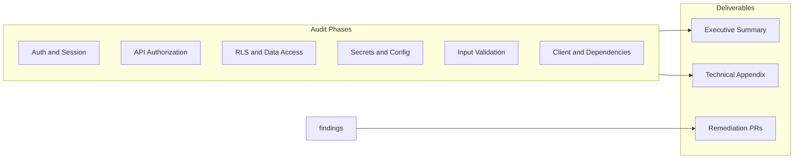

# Full Application Security Audit

## Shaping Summary

| Decision | Choice |
|----------|--------|
| Audit type | Full static review (auth/RBAC, APIs, RLS, secrets, validation, dependencies) |
| Report format | Executive summary + technical appendix for client handoff |
| Standards | OWASP / general best practices (not agent-os standards) |
| Product alignment | Pure technical audit |
| Remediation | Report **and** fix all findings |

**App surface (from codebase inventory):**

- ~35 API routes across admin, cron, chat/n8n, demo, and authenticated user flows
- Supabase Auth + 48 SQL migrations with RLS (`is_dashboard_admin()`, org-scoped project helpers)
- Shared-secret endpoints: cron (`CRON_SECRET`), n8n callback (`CHAT_N8N_CALLBACK_SECRET`), demo email links (HMAC)
- Client-side RBAC in layouts only; real enforcement in API helpers + RLS



---

## Task 1: Save Spec Documentation

Create `agent-os/specs/2026-06-10-1200-full-app-security-audit/` with:

- **plan.md** — this plan
- **shape.md** — scope, decisions, audit methodology
- **standards.md** — OWASP-oriented checklist used
- **references.md** — security-relevant file inventory
- **visuals/** — architecture/risk-map diagrams for the report

---

## Task 2: Authentication and Session Audit

Review session lifecycle and identity trust boundaries.

**Primary files:**

- `middleware.ts` — cookie refresh only; no route blocking
- `lib/auth-context.tsx` — JWT/metadata/mock fallbacks when `public.users` read fails
- `lib/supabase/server.ts`, `lib/supabase/client.ts`, `lib/supabase/session-from-url.ts`
- `app/auth/callback/page.tsx`, `components/login-page.tsx`

**Check for:** session fixation, weak fallback paths, mock/dev auth in production builds, cookie flags, Bearer token handling consistency, magic-link redirect allowlisting.

---

## Task 3: API Route Authorization Audit

Systematically review every route handler under `app/api/` against its auth helper.

**Auth helpers to trace:**

- `lib/api/require-dashboard-admin.ts`
- `lib/api/require-chat-session.ts`
- `lib/api/authorize-cron-request.ts`

**High-priority routes:**

| Tier | Routes | Risk |
|------|--------|------|
| Admin + service role | `app/api/admin/**` | Privilege escalation, IDOR on `[id]` params |
| Cron | `app/api/cron/**` | Inconsistent auth (2 routes duplicate inline check vs shared helper) |
| n8n | `app/api/n8n/route.ts`, `app/api/chat/n8n-complete/route.ts` | Pass-through body; callback secret compromise |
| Demo/public | `app/api/demo/**` | Rate limits, HMAC tokens, GET side effects |
| Chat/user | `app/api/chat/**`, `focus-group/**`, `audience/**`, `credits/**` | Service-role writes trusting route-level org/project checks |

**Check for:** missing auth, horizontal privilege escalation (org/project ID tampering), inconsistent error responses (enumeration), service-role usage without validation.

---

## Task 4: Supabase RLS and Data Access Audit

Review database-enforced access control in `supabase/migrations/`.

**Key migrations:**

- `202603232355_admin_rls_users_organizations.sql` — `is_dashboard_admin()` foundation
- `202603241900_projects_project_users_rls.sql`, `202603251200_fix_projects_rls_recursion.sql`
- Storage RLS: `202603261200_*`, `202603261400_*`, `202603261600_*`
- `202603311200_chat_results.sql` — write-via-service-role pattern
- Demo: `202605191200_demo_access_requests.sql`

**Also review client-side Supabase writes** (RLS-dependent):

- `lib/supabase/projects.ts`, `users.ts`, `organizations.ts`, `documents.ts`, `personas.ts`

**Check for:** policy gaps, SECURITY DEFINER RPC misuse, storage path traversal, cross-org reads, admin bypass holes, missing self-read on `public.users`.

---

## Task 5: Secrets, Configuration, and Third-Party Integrations

**Env/secrets inventory** (documented in `README.md`):

- Server-only: `SUPABASE_SERVICE_ROLE_KEY`, `N8N_WEBHOOK_*`, `CHAT_N8N_CALLBACK_SECRET`, `CRON_SECRET`, `DEMO_APPROVAL_SECRET`, `EMAIL_PROVIDER_API_KEY`
- Public: `NEXT_PUBLIC_SUPABASE_*`, `NEXT_PUBLIC_N8N_*` fallback in `lib/n8n-webhook-url.ts`

**Integrations:**

- n8n proxy: `app/api/n8n/route.ts`
- Resend email: `lib/email/send-transactional.ts`, `lib/demo-access/email.ts`
- Vercel Cron: `vercel.json`

**Check for:** secrets in client bundle, missing env guards, weak secret comparison, webhook URL exposure, email injection, sandbox misconfiguration in production.

---

## Task 6: Input Validation, Client Security, and Dependencies

**Validation gaps to verify:**

- Unvalidated n8n proxy body in `app/api/n8n/route.ts`
- Manual vs Zod validation across admin/demo routes
- Upload sanitization in `lib/supabase/documents.ts`

**Client concerns:**

- UI-only RBAC in `app/(dashboard)/layout.tsx`, `app/client/layout.tsx`
- Demo role switcher in `components/layout/sidebar.tsx`
- CSRF posture for cookie-authenticated mutations

**Dependencies:**

- Run `npm audit` on `package.json`
- Flag outdated packages with known CVEs

**Existing security tests to extend:**

- `lib/api/authorize-cron-request.test.ts`
- `lib/demo-access/tokens.test.ts`

---

## Task 7: Produce Client Security Report

Create deliverable in spec folder:

```
agent-os/specs/2026-06-10-1200-full-app-security-audit/
├── report/
│   ├── executive-summary.md   # Client-facing: scope, methodology, risk overview, top priorities
│   └── technical-appendix.md  # All findings: severity, location, evidence, recommendation, status
└── visuals/
    └── README.md              # Architecture and trust-boundary diagrams
```

**Finding format (each entry):**

- ID, severity (Critical / High / Medium / Low / Informational)
- Category (Auth, Authorization, Data, Config, Validation, Client, Dependency)
- Location (`file:line` or migration name)
- Description and impact
- Recommendation
- Remediation status (Open / Fixed / Accepted risk)

**Executive summary sections:**

1. Audit scope and methodology (static code review; no penetration testing unless added later)
2. System overview (one-page architecture)
3. Risk summary table (counts by severity)
4. Top 5–10 prioritized findings
5. Remediation roadmap and residual risk statement

---

## Task 8: Remediate All Findings

Fix every finding from Task 7, grouped by severity:

1. **Critical / High** — auth bypass, IDOR, secret exposure, RLS gaps, service-role trust issues
2. **Medium** — validation gaps, cron auth inconsistency, client-only guards, CSRF considerations
3. **Low / Informational** — hardening, test coverage, documentation, dev-only feature gating

**Likely remediation themes (based on pre-audit inventory):**

- Harden `lib/auth-context.tsx` fallbacks; fail closed when profile read fails
- Standardize cron auth on `authorizeCronRequest`
- Add Zod schema to n8n proxy; validate admin route UUID params
- Gate or remove demo role switcher in production builds
- Add tests for `requireDashboardAdmin`, `requireChatSession`, n8n callback auth
- Document required Supabase Auth redirect URLs and RLS prerequisites (operational, not code)

Update **technical appendix** finding statuses as fixes land.

---

## Task 9: Verification and Sign-Off

- Re-run targeted checks on remediated areas
- Run existing test suite + new security tests
- Run `npm audit` post-remediation
- Final pass on executive summary to reflect closed findings
- Deliver final report folder to client

---

## Out of Scope (unless explicitly added later)

- Dynamic penetration testing / DAST
- Hosted environment configuration review (Vercel/Supabase dashboard settings)
- SOC 2 / formal compliance certification

---

## Progress

| Task | Status |
|------|--------|
| 1. Save spec documentation | Done |
| 2. Auth and session audit | Done — [`audit/task-02-auth-session.md`](audit/task-02-auth-session.md) |
| 3. API route authorization audit | Done — [`audit/task-03-api-routes.md`](audit/task-03-api-routes.md) |
| 4. RLS and data access audit | Done — [`audit/task-04-rls-data.md`](audit/task-04-rls-data.md) |
| 5. Secrets and integrations audit | Done — [`audit/task-05-secrets-integrations.md`](audit/task-05-secrets-integrations.md) |
| 6. Validation, client, dependencies | Done — [`audit/task-06-validation-deps.md`](audit/task-06-validation-deps.md) |
| 7. Produce client report | Done — [`report/executive-summary.md`](report/executive-summary.md), [`report/technical-appendix.md`](report/technical-appendix.md) |
| 8. Remediate all findings | Done — [`audit/task-08-remediation.md`](audit/task-08-remediation.md) |
| 9. Verification and sign-off | Done — [`audit/task-09-verification.md`](audit/task-09-verification.md) |
