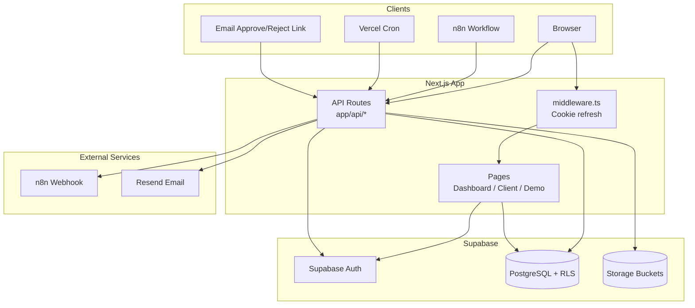
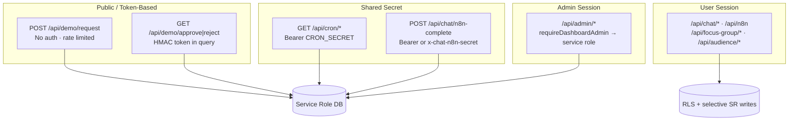
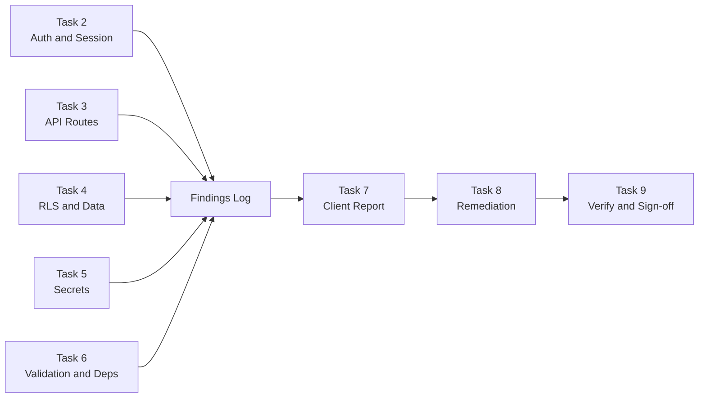
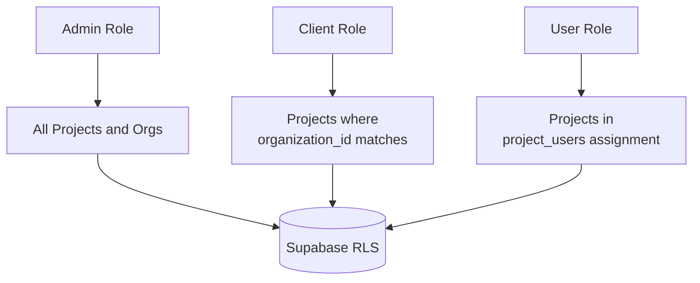

# Visuals — Full Application Security Audit

Diagrams for the client security report. Mermaid sources below; export to PNG if needed for PDF handoff.

---

## System Architecture Overview

High-level request flow for smartA.R.S.E. (Next.js App Router + Supabase + n8n).

---

## Trust Boundary Map

Shows authentication mechanism per API tier. Used to prioritize audit Tasks 2–3.

---

## Audit Phase Flow

Maps audit tasks to deliverables (from `plan.md`).

---

## Role and Data Isolation Model

How org-scoped access is intended to work (verify RLS + API guards enforce this).

---

## Notes for Report Inclusion

- **Executive summary:** Use "System Architecture Overview" and "Role and Data Isolation Model".
- **Technical appendix:** Use "Trust Boundary Map" when documenting per-tier findings.
- **Remediation section:** Use "Audit Phase Flow" to show closed-loop process.

PNG exports are optional; Mermaid renders in GitHub and most markdown viewers.
