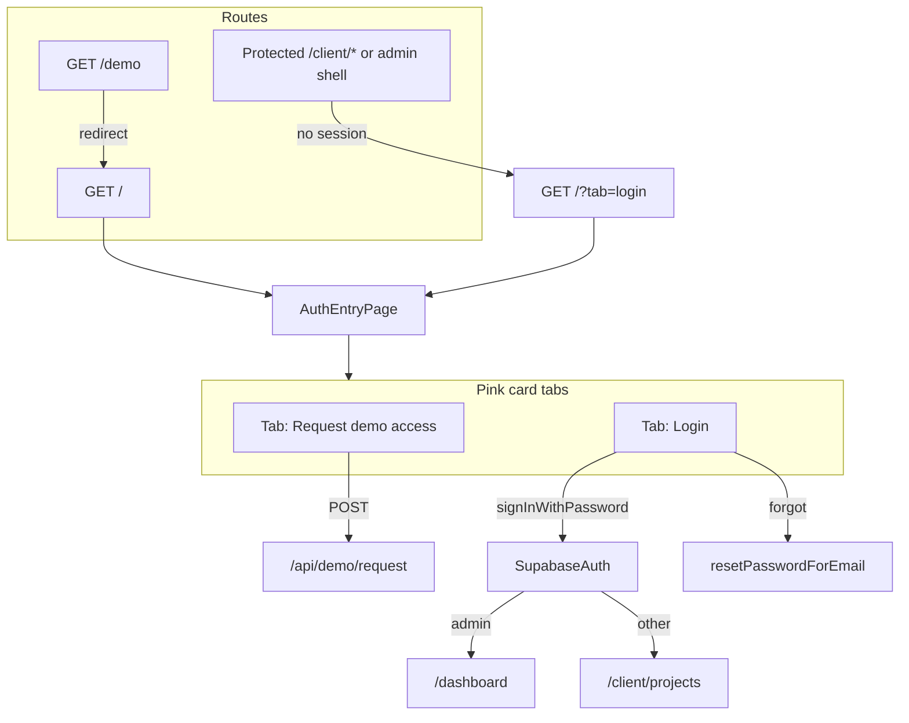

# Unified Demo + Login Entry Page

## Shaping summary

**What we're building:** The client-approved `/demo` split layout becomes the single public entry at **`/`**, with a pink-bordered card containing two tabs:

1. **Request demo access** — existing 4-field form + GDPR consent (unchanged behavior)
2. **Login** — full current login flow (sign-in, forgot password, role-based redirect)

**Decisions confirmed:**

- **`/`** is canonical; **`/demo` redirects to `/`**
- Login tab includes **full sign-in + forgot-password** flow (same Supabase `login()` + `resetPasswordForEmail`)
- **No** `LegalFooterNav` footer on the unified page
- Tab styling matches **control-panel primary tabs** (magenta `border-b-4` underline via Radix `Tabs`)

**Visuals provided:** Demo page wireframe, current login form, control-panel Personas/Studio tabs (saved to spec `visuals/` on execution).

---

## Architecture



---

## Key files

| Role                  | Path                                                                                                                     |
| --------------------- | ------------------------------------------------------------------------------------------------------------------------ |
| Unified page (extend) | [`components/demo-request-page.tsx`](components/demo-request-page.tsx)                                                   |
| Login logic (extract) | New `components/auth-login-form.tsx` from [`components/login-page.tsx`](components/login-page.tsx)                       |
| Root route            | [`app/page.tsx`](app/page.tsx)                                                                                           |
| Demo alias redirect   | [`app/demo/page.tsx`](app/demo/page.tsx)                                                                                 |
| Middleware redirect   | [`middleware.ts`](middleware.ts)                                                                                         |
| Tabs primitives       | [`components/ui/tabs.tsx`](components/ui/tabs.tsx)                                                                       |
| Tab styling reference | [`components/client/project-detail/project-sidebar-tabs.tsx`](components/client/project-detail/project-sidebar-tabs.tsx) |

---

## Task 1: Save spec documentation

Create `agent-os/specs/2026-06-15-1200-demo-login-unified-entry/` with:

- **plan.md** — this plan
- **shape.md** — scope, routing/login/footer decisions, visuals list
- **standards.md** — full content of: `app-routing-protected-shell`, `auth-rbac`, `ui-styling`, `project-conventions`
- **references.md** — pointers to demo page, login page, sidebar tabs, demo-signup-v2 spec
- **visuals/** — copy the 3 screenshots from workspace assets

---

## Task 2: Extract reusable login form

Create [`components/auth-login-form.tsx`](components/auth-login-form.tsx) by lifting the form UI + handlers from [`components/login-page.tsx`](components/login-page.tsx):

- **Props:** `className?`, `onSuccess?` (optional; default behavior stays `router.replace(postLoginPath(role))`)
- **Modes:** `"signin"` | `"forgot"` (same as today)
- **Auth:** `useAuth().login()`, `getSupabaseBrowserClient().auth.resetPasswordForEmail()`
- **Styling:** Full-width pill inputs inside the card (reuse `pillInputClass` / `submitButtonClass` — optionally move to `lib/auth-form-styles.ts` or keep duplicated minimally in one shared export from demo page)

[`components/login-page.tsx`](components/login-page.tsx) can become a thin deprecated wrapper or be removed once nothing imports it.

---

## Task 3: Add tabs to the demo card

Update [`components/demo-request-page.tsx`](components/demo-request-page.tsx):

**Tab bar** (inside the existing `rounded-3xl border-4 border-arse-pink` card, above content):

```tsx
// Pattern from project-sidebar-tabs.tsx — scaled for public card
const tabTriggerClass =
  "min-w-0 shrink border-b-4 border-transparent px-2 py-2 text-center font-arse-title text-xs font-bold uppercase tracking-wide text-arse-black/50 data-[state=active]:border-arse-pink data-[state=active]:text-arse-black"

<TabsList variant="line" className="!flex w-full items-end justify-center gap-6 border-b-0 bg-transparent p-0">
  <TabsTrigger value="request">Request demo access</TabsTrigger>
  <TabsTrigger value="login">Login</TabsTrigger>
</TabsList>
```

**Tab content:**

- **`request`** — existing demo form; on success, keep success panel but change "Back to sign in" to `/?tab=login` (or in-page tab switch via callback)
- **`login`** — render `<AuthLoginForm />` without duplicate page-level logo/header (card context only)

**URL sync:** Read `useSearchParams()` — `?tab=login` opens Login tab; default tab is `request`. Update URL on tab change with `router.replace` (no scroll) for shareable deep links.

**Success state:** When demo request succeeds, the card currently replaces all content — keep that behavior; the "Back to sign in" CTA should navigate to `/?tab=login`.

---

## Task 4: Wire routing

### [`app/page.tsx`](app/page.tsx)

- Keep existing auth gate (spinner while loading; redirect authenticated users to role home)
- Replace `<LoginPage />` with `<DemoRequestPage />` (or renamed export)

### [`app/demo/page.tsx`](app/demo/page.tsx)

- Server redirect: `redirect("/")` (preserve query string if present, e.g. `/demo?tab=login` → `/?tab=login`)

### [`middleware.ts`](middleware.ts)

- When redirecting unauthenticated users to login, set `loginUrl.searchParams.set("tab", "login")` so they land on the Login tab

### Metadata

- Update root page metadata title to something inclusive (e.g. "smartA.R.S.E." or "Sign in — smartA.R.S.E.")
- Keep demo route metadata only if redirect page needs it (minimal)

---

## Task 5: Update cross-links

Links to `/` still work. Update "Back to sign in" affordances to open the login tab explicitly:

| File                                                                   | Change                                              |
| ---------------------------------------------------------------------- | --------------------------------------------------- |
| [`components/demo-request-page.tsx`](components/demo-request-page.tsx) | Success CTA → `/?tab=login`                         |
| [`components/demo-setup-page.tsx`](components/demo-setup-page.tsx)     | `href="/?tab=login"`                                |
| [`app/auth/callback/page.tsx`](app/auth/callback/page.tsx)             | fallback link → `/?tab=login`                       |
| [`app/auth/reset-password/page.tsx`](app/auth/reset-password/page.tsx) | "Back to sign in" → `/?tab=login`                   |
| [`lib/demo-access/html-pages.ts`](lib/demo-access/html-pages.ts)       | email HTML primary CTA URL → `{baseUrl}/?tab=login` |

No change needed for [`components/client/client-shell-header.tsx`](components/client/client-shell-header.tsx) logo `href="/"` (authenticated users won't see entry page).

---

## Task 6: Smoke test

Manual checklist:

- `/` loads split layout; Request tab default
- `/demo` redirects to `/`
- Login tab: sign-in works; admin → `/dashboard`, client/user → `/client/projects`
- Forgot password sends reset email; back to sign-in works within tab
- Demo request submit → success message → "Back to sign in" opens login tab
- Unauthenticated visit to `/client/projects` → `/?tab=login`
- Mobile: marketing panel hidden, tabs + forms usable
- Cookie banner still appears on unified page (`DemoFlowCookieBanner`)

---

## Out of scope

- Legal footer on unified page
- Changing `/auth/demo-setup` styling
- Renaming `DemoRequestPage` component (optional cleanup, not required)
- New automated tests unless requested
