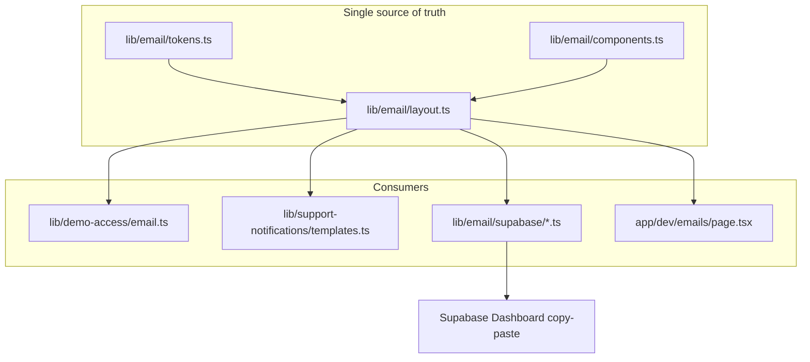

# Unified smartA.R.S.E. Email Templates — Execution Plan

Implementation plan. Shaping in [`shape.md`](shape.md). Standards in [`standards.md`](standards.md). Code pointers in [`references.md`](references.md).

## Tasks

1. **Spec documentation** — this folder
2. **`lib/email/` module** — tokens, layout, components, `supabaseMode` export
3. **Logo asset** — `public/client-header-logo.gif`
4. **Dev preview page** — `/dev/emails`
5. **Supabase Auth templates** — five dashboard copy-paste builders + README
6. **Migrate app emails** — demo-access + support-notifications
7. **Update README** — preview + Supabase setup for all templates

---

## Problem

Emails today are inconsistent:

- **App emails** (Resend) share a layout in [`lib/demo-access/templates/shared.ts`](../../../lib/demo-access/templates/shared.ts) — mint card, pill buttons — but lack a logo and unified footer.
- **Supabase Auth emails** (password reset, etc.) use the default plain template ("Disrupt Insight", no branding).
- **Support alerts** reuse the app layout but use plain text links instead of branded buttons.
- **No preview UI** — every design change requires sending a real email.

## Goal

One cohesive, minimal, deliverability-conscious design used everywhere, with:

- Hosted **logo** (`/client-header-logo.gif` on the app domain)
- Shared header/footer (brand, support contact, transactional disclaimer where relevant)
- **Dev preview page** to see all layouts without sending mail
- **Drop-in Supabase HTML** with correct Go template variables for all common auth templates

## Design direction

Evolve the existing card layout rather than redesign from scratch:



### Layout structure (spam-friendly, minimal)

| Element | Approach |
|---------|----------|
| Structure | Table-based, inline CSS only (email-client safe) |
| Logo | `` with `alt="smartA.R.S.E."`, fixed width ~180px, hosted at `{{ .SiteURL }}/client-header-logo.gif` (Supabase) or `${APP_URL}/client-header-logo.gif` (app) |
| Card | White card, 2px black border, cyan offset shadow — keep existing tokens from `shared.ts` |
| Typography | Inter / system stack (no web fonts) |
| CTA | Pill buttons via `renderEmailButton` |
| Footer | Muted text: product name, `smart-arse@disrupt-insight.com`, optional per-email reason line |
| Deliverability | Multipart text+html; avoid URL shorteners; consistent From name `smartA.R.S.E.`; meaningful alt text |

### Supabase link patterns

All auth links route through [`app/auth/confirm/route.ts`](../../../app/auth/confirm/route.ts) using `token_hash` verification:

| Template | `type` param | `next` redirect |
|----------|-------------|-----------------|
| Reset password | `recovery` | `/auth/reset-password` |
| Confirm signup | `signup` | `/client/projects` |
| Magic link | `magiclink` | `/client/projects` |
| Invite user | `invite` | `/auth/reset-password` |
| Change email | `email_change` | `/client/settings` |

Link format:

```text
{{ .SiteURL }}/auth/confirm?token_hash={{ .TokenHash }}&type=<type>&next=<path>
```

`layout.ts` supports **`supabaseMode`** so hrefs/logo URLs keep Go template literals unescaped for dashboard paste.

---

## Task 2: Create `lib/email/` module

| File | Purpose |
|------|---------|
| `lib/email/tokens.ts` | Colors, font stack, logo dimensions |
| `lib/email/escape.ts` | `escapeHtml` |
| `lib/email/components.ts` | `renderEmailButton`, data-field rows, footer block |
| `lib/email/layout.ts` | `renderEmailLayout({ title, intro, bodyHtml, footer, logoUrl?, supabaseMode? })` |
| `lib/email/index.ts` | Public exports |

**Backward compat:** re-export from `lib/demo-access/templates/shared.ts`; keep `renderLandingPage` there.

## Task 3: Add logo asset

- Add `public/client-header-logo.gif` (referenced in auth pages but missing from repo)
- Verify at `{NEXT_PUBLIC_APP_URL}/client-header-logo.gif`

## Task 4: Dev email preview page

`app/dev/emails/page.tsx` — development only (`NODE_ENV !== "production"` → 404).

- Sidebar: all variants (6 app + 5 Supabase)
- Rendered HTML preview
- Supabase: "Copy HTML" for dashboard paste
- Sample data in `lib/email/preview/samples.ts`

## Task 5: Supabase Auth template definitions

`lib/email/supabase/` — one builder per template:

- `reset-password.ts`
- `confirm-signup.ts`
- `magic-link.ts`
- `invite-user.ts`
- `change-email.ts`

Plus `lib/email/supabase/README.md` with dashboard setup steps.

## Task 6: Migrate app-generated emails

| File | Changes |
|------|---------|
| `lib/demo-access/email.ts` | New layout; logo from `getAppBaseUrl()` |
| `lib/support-notifications/templates.ts` | `renderEmailButton` for settings links |
| `lib/demo-access/templates/shared.ts` | Thin re-exports |

## Task 7: Update project docs

Extend `README.md` — preview link, all five Supabase templates, logo hosting note.

---

## Out of scope

- React Email / MJML toolchain
- Sending test emails from preview page
- Marketing/newsletter templates
- Changing Resend From/Reply-To configuration

## Risks

- `client-header-logo.gif` not in git — needs to be added
- Supabase HTML manually pasted into dashboard after code changes
- Logo requires verified production domain for reliable image loading
